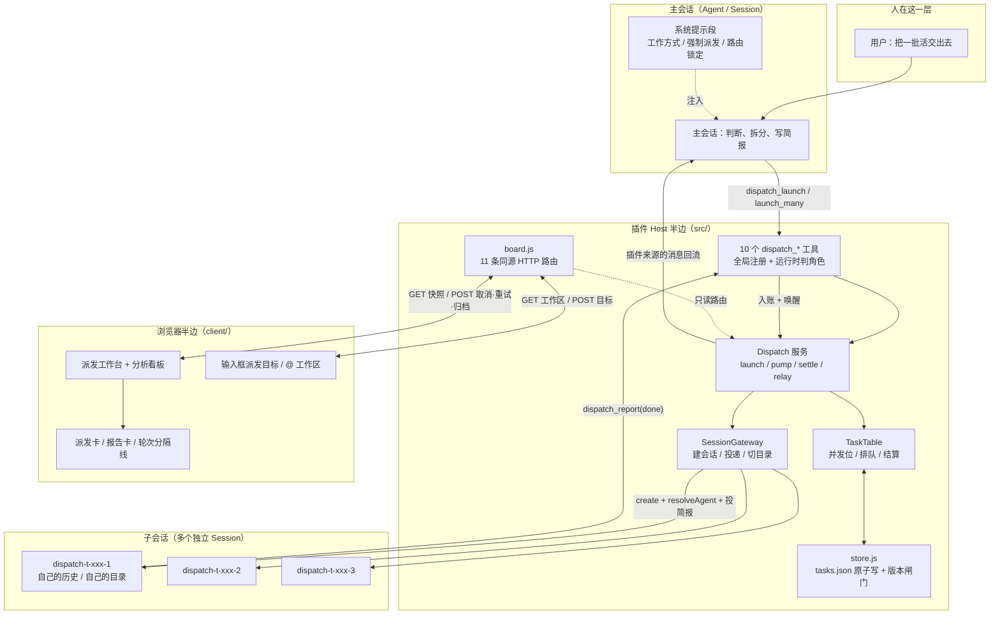
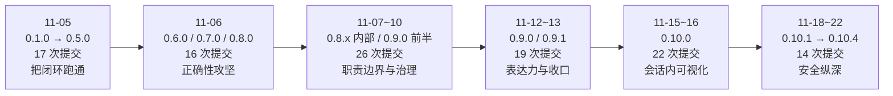

# dsh-mini-superagent 00：项目全景与阅读地图

> **代码仓库**：[wychmod/dsh-mini-superagent](https://github.com/wychmod/dsh-mini-superagent) ｜ **当前版本**：`0.10.4`（MIT）
> **本章目标**：先看清「这是什么、解决什么问题、凭什么值得读」，建立全系列的心智模型，再决定按哪条路径深入。
> **还没装？** 先看 [00A 开始之前](/md/10-项目实战/04-DSH任务派发插件/00A-开始之前-环境安装与最小验证.md)——本篇假定你已经能跑起来。名词卡住查 [00B 术语表](/md/10-项目实战/04-DSH任务派发插件/00B-术语表.md)。
> **原文对照**：包内 `README.md`（788 行）、`docs/architecture.md`（1126 行）、`CHANGELOG.md`（1802 行，18 个版本）与根目录 `plans/` 的 18 份规划书。

---

## 目录

- [一、一句话认识它](#一、一句话认识它)
- [二、它解决什么问题，以及它明确不是什么](#二、它解决什么问题，以及它明确不是什么)
- [三、全景架构：一张图看完主链路](#三、全景架构：一张图看完主链路)
- [四、18 天、114 次提交：版本是怎么长出来的](#四、18-天、114-次提交：版本是怎么长出来的)
- [五、数字快照：用数据认识这个项目](#五、数字快照：用数据认识这个项目)
- [六、十九篇的主题分工](#六、十九篇的主题分工)
- [七、四条推荐阅读路径](#七、四条推荐阅读路径)
- [八、核心讲解：真正的价值不在「派发」本身](#八、核心讲解：真正的价值不在「派发」本身)
- [九、使用建议与推荐结论](#九、使用建议与推荐结论)

---

## 一、一句话认识它

**给 DeepSeek Harness 装一套「派活」工具和一块「派活看板」：主会话派活，子会话干活，报告自己回来，过程在侧边栏看得见。**

这句话里三个动词都不是修辞，各有对应的事实：

| 动作 | 机制事实 | 谁实现 |
|---|---|---|
| **派活** | `dispatch_launch` 建一个**真正的 DSH Session**（不是一次性执行器），投一条自包含简报，然后**立即返回** | `src/dispatch.js` + `src/sessions.js` |
| **干活** | 子会话在自己的工作目录里独立跑一轮或多轮；它看不到主会话历史，只看简报 | 宿主 DSH 本体 |
| **报告回来** | 子会话 `dispatch_report` 之后，报告作为一条**插件来源**的消息进主会话；主会话空闲时被唤醒 | `src/dispatch.js` 的 `relay()` |
| **看得见** | 侧边栏常驻「派发工作台」，2 秒轮询一次同源 HTTP 快照 | `src/board.js` + `client/index.js` |

| 基本信息 | 说明 |
|---|---|
| 项目性质 | 开源 Host 插件（DSH bundle），非框架、非 SaaS、非 SDK |
| 运行形态 | 宿主进程内插件 + 浏览器侧 plain ModuleLoader 模块 |
| 运行时依赖 | **0**（`dependencies` 为空，`main` 直接指向 `src/index.js`） |
| 构建步骤 | **无**。没有打包、没有编译、clone 下来就能装 |
| 语言 | JavaScript（纯 ESM，Node `^22.19.0 \|\| >=24`） |
| 硬依赖宿主服务 | `tools` / `agents` / `sessionController` / **`connection`**（`inject` 里四个，缺一不可） |
| 可选宿主服务 | `webServer`（看板）、`workspaceRegistry`（工作区）、`workingDirectory`（切目录）、`permissionPresets`（权限预设）、`llm`（消息规范化）、`subagents` / `jobs`（后台活探测）、`sessionPersistence`（落盘策略）、`clientModules`（自检探针） |
| 代码规模 | Host 侧 14 个模块 12,093 行；浏览器侧单文件 12,586 行 |
| 测试 | 43 个测试文件、**678 条** `node:test` 用例 |
| 许可 | MIT |

> 一个容易被忽略的定位：**它不是「多 Agent 编排框架」**。它没有 DAG 引擎、没有角色路由表、没有消息总线。它只做一件事——把「一个会话能派活给另一个会话」这条链路做可靠，并把过程摊开给人看。所有复杂度都在「可靠」和「看得见」上，不在「编排」上。

## 二、它解决什么问题，以及它明确不是什么

### 2.1 四个具体痛点

作者在 README 里把动机压成四句话，每句都对应一类真实摩擦：

1. **一次派 5 个互不相关的任务，谁先好谁先报。** —— 同步 subagent 必须等，等就是串行。
2. **派完就能结束本轮；报告回来再继续，不占着 step 等。** —— 这条是全文最硬的约束，后面有一整节讲它为什么必须写成硬约束。
3. **worker 是有历史的 Session：能追问、纠偏、让它接着做下一步。** —— 一次性执行器做不到这件事。
4. **卡住了能看见、能取消，不会变成黑洞。** —— 没有看板的后台任务，等于把不确定性丢给用户。

### 2.2 它明确不是什么

这张表比「功能列表」更有价值——它划定了边界，也解释了后面所有的设计取舍：

| 它不是 | 原因 |
|---|---|
| 同步 subagent | 同步调用要等结果；这里派发只登记 + 投递就返回 |
| 任务队列服务 | 没有持久队列、没有重试策略；重启后未结算任务标 `interrupted`，由你决定是否重派 |
| 权限系统 | 不裁剪 worker 工具集；需要收紧时给子会话指定 `agent_preset` |
| 多机调度 | 状态是一个本地 JSON 文件，单写，不跨进程协调 |
| 多 Agent 编排框架 | 没有 DAG、没有角色表、没有消息总线；依赖只有「先后」这一种关系 |

## 三、全景架构：一张图看完主链路

先看主链路。这张图是全系列的「地图」，后面每一篇都在放大其中一个方块：

图里有两处「看起来多余」的设计，其实是全项目最关键的两条边界：

- **Host 与浏览器不共享内存**，只通过 11 条同源 HTTP 路由对齐（`src/board.js` ↔ `client/index.js`）。所以看板挂了不影响派发，派发挂了看板只是没数据。
- **主会话与子会话之间只有两条通路**：投简报下去、回流报告上来。没有共享上下文、没有共享工作目录（默认共享目录，但会话归属是分开的）。

## 四、18 天、114 次提交：版本是怎么长出来的

这个项目全部发生在 **2026-11-05 到 2026-11-22** 之间，114 次提交、18 个版本。按天看密度极不均匀：

| 日期 | 提交数 | 那天发生了什么 |
|---|---|---|
| 11-05 | 17 | 0.1.0 单文件 → 改名 → 0.2.0 拆分 → 0.3.0 看板 → 0.4.0 工作区 → 0.5.0 输入框 |
| 11-06 | 16 | 0.5.1 修 inspect → 0.5.2/0.5.3 自动选择 → 0.6.0 模式开关 → 0.7.0 六个 P0 → 0.8.0 一批 P1 |
| 11-07 | 9 | 内部 0.8.x：路由模式与提示词契约，看板从流水账改指挥台 |
| 11-08 | 6 | 记忆治理 P0 五项、提示段收敛 |
| 11-09 | 10 | 统计聚合、文案层、四视图、分析看板 |
| 11-10 | 1 | 重试不能复活已归档任务 |
| 11-12 | 12 | 计划透出、批次依赖、会话复用、候选工具，0.9.0 |
| 11-13 | 7 | A 类七条收口、CI、npm 发布准备、README 重写 |
| 11-15~16 | 22 | 派发卡、报告卡、0.10.0、GitHub Pages 落地页 |
| 11-18~19 | 9 | 0.10.1 修复、0.10.2 接宿主准入 |
| 11-21~22 | 5 | 0.10.3 修 inspect、0.10.4 改 fail-closed |

**为什么顺序要单独讲**：本系列的文章编号严格按这条时间轴排。原因不是考古趣味，而是这个项目的取舍没法脱离顺序理解——你只有先知道「0.1.0 的 pump 只在派发时触发」，才能理解为什么 0.2.0 把 pump 挂到每个结算点；只有先看到 33 分钟阻塞的真实事故，才能理解为什么那两条提示词写得那么硬。

> **版本号的坑，先说清——它有三层口径，对不上是常态。**
>
> | 口径 | 数量 | 与更外一层的差异 |
> |---|---|---|
> | `CHANGELOG.md` 的版本段 | 18 | 最宽的一层 |
> | `package.json` 历史值 | 16 | 全量是 `0.1.0`→`0.2.0`→`0.3.0`→`0.4.0`→`0.5.0`→`0.5.1`→`0.5.2`→`0.6.0`→`0.8.0`→`0.9.0`→`0.9.1`→`0.10.0`→`0.10.1`→`0.10.2`→`0.10.3`→`0.10.4`。**没有** `0.5.3`、`0.7.0`、`0.8.1`、`0.8.2` |
> | npm 实际发布 | **6** | 只有 `0.0.0-stage` / `0.9.1` / `0.10.0` / `0.10.1` / `0.10.2` / `0.10.4`；比 `package.json` 再少 `0.9.0`、`0.10.3` |
>
> 三条具体结论：
>
> 1. **`0.8.1` / `0.8.2` 是纯内部里程碑**——`package.json` 里从来没有过这两个值。那一整批改动（路由模式、两条提示词契约、看板改版、恢复与容错四件事、后台活占位）在 CHANGELOG 里合在 `0.8.0 → 0.9.0` 段，代码注释与文档里的「0.8.1 及更早」是内部口径。**同一个坑还多埋了两个：`0.5.3`、`0.7.0` 也有 CHANGELOG 段，但从未进过 `package.json`。**
> 2. **`0.9.0` 从未发布到 npm。** 那一批能力**第一次能被装到**是 `0.9.1`——它才是首个 npm 版本。所以「npm 上第一次拿到是 0.9.0」这句是不成立的。
> 3. **`0.10.3` 同样只在仓库里，没上 npm。** 首次 npm 发布后，`0.10.3` 这一版（`dispatch_inspect` 的 `undefined` 修复）被跳过了，用户可直接从 `0.10.2` 升到 `0.10.4`，修复内容包含在 `0.10.4` 里。
>
> 后文为贴合原始记录仍会沿用「0.8.1」「0.9.0」「0.10.3」这些说法（它们确实存在于 CHANGELOG 与代码注释），但**装的时候只认 `0.10.4`**。

## 五、数字快照：用数据认识这个项目

| 维度 | 数值 | 含义 |
|---|---|---|
| 版本跨度 | 18 个版本 / 18 天 | 0.x 阶段；**已有**的工具名与配置键在 0.2.0 冻结（名字不改），但**集合仍在长**：8 → 9（0.4.0 加 `dispatch_workspaces`）→ 10（0.9.0 加 `dispatch_candidates`） |
| 提交 | 114 次（含 3 个 PR 合并） | 平均每天 6.3 次 |
| Host 源码 | 14 文件 / 12,093 行 | 最大单文件 `dispatch.js` 4,999 行 |
| 浏览器源码 | 1 文件 / 12,586 行 | 不打包、不编译，靠人工与冒烟守住 |
| 文档 | 8 篇 / 4,307 行（包内） | 另有 18 份规划书在仓库 `plans/` |
| 测试 | 43 文件 / 678 用例 | `node --test`，零测试框架依赖 |
| 工具 | 10 个 `dispatch_*` | 名字固定，不做别名 |
| 配置项 | 47 个默认值 | 全部可选，写在 `cordis.patch.yml` 的 `config` |
| 错误码 | 12 个机器码 | 中文 message 给人读，code 给脚本分流 |
| HTTP 路由 | 11 条 | 5 读 + 6 写，一个 handler 覆盖 |
| 任务状态 | 8 个 | 6 个属于「已结算」 |
| 报告段 | 四段式 | 【任务】【结果】【说明】【需要你】 |

> 一个诚实的提醒：**678 条用例不等于「界面验过」**。项目的 README 专门列了一节「未实测」，明确写着「界面未在真浏览器里跑过」「分隔线只验到注册成功」。把「没验」写进文档这件事本身，就是这个项目的一部分价值。

## 六、十九篇的主题分工

> **编号约定**：`00A` / `00B` 是**补充篇**，不属于那条 18 天的时间轴——它们讲的是「怎么装」和「这些词什么意思」，放在 00 之后、01 之前读。`15` / `16` 是**工具篇**，放在最后按需查。

| 序号 | 文章 | 讲什么 | 你会得到 |
|---|---|---|---|
| **00** | 项目全景与阅读地图（本文） | 定位、边界、架构、时间轴、阅读路径 | 全局心智模型 |
| **00A** | 开始之前：环境、安装与最小验证 | 前置五概念、环境要求、三种安装、自检三步、六个坑 | **能装上、能跑通** |
| **00B** | 术语表 | 40 个跨篇术语，一词一句，标注首见篇号 | 读任何一篇卡住时能查 |
| 01 | 从单文件到最小闭环 | 0.1.0 的 853 行、0.2.0 的八模块拆分、pump 缺陷 | 看懂「派发 + 回流」怎么成立 |
| 02 | 让后台可见：看板与同源 HTTP | 0.3.0 的 Host/Client 两侧、快照契约、第一道栅栏 | 理解「不打包的浏览器半边」 |
| 03 | 工作区模型：会话归属与工作目录 | 0.4.0 的默认工作区、日期工作区、四级解析、自动归档 | 学会把「住哪」和「干哪」分开 |
| 04 | 输入框变成指挥台 | 0.5.x 的派发目标、`@` 工作区、0.6.0 的模式开关 | 看懂「意图」怎么落到参数上 |
| 05 | 正确性攻坚：两轮 P0 与 P1 | 0.7.0 六个 P0、0.8.0 一批 P1 | 一份「隐形缺陷清单」 |
| 06 | 路由模式与两条提示词契约 | `tools.restrict`、派发即移交、结束本轮 | 理解「结构性约束 vs 提示词」 |
| 07 | 记忆治理：权威源与投影 | 准入分级、单条预算、合并窗口、账本封顶、退休 | 学会给「事实」和「投影」分家 |
| 08 | 看板重装与统计口径 | 指挥台三段式、五个 chip、两套聚合口径 | 学会不编造指标 |
| 09 | 计划、依赖与会话复用 | PRD-01/02、`handoff_from`、候选工具 | 三种「连续性」的区别 |
| 10 | 工程收口与对外发布 | A1–A7、CI 三闸门、npm 包边界、落地页 | 把「说过的」钉成「验过的」 |
| 11 | 会话里的卡片与分隔线 | 派发卡三阶段、报告卡四段、槽位降级三态 | 插件 UI 的接缝与降级 |
| 12 | 安全纵深与最后三修 | 0.10.2 接宿主闸门、0.10.3 无损 JSON、0.10.4 fail-closed | 三层准入为什么不能只留一层 |
| 13 | 亮点、适用场景与推荐结论 | 十条横切亮点、可迁移模式、适用/不适用地图 | 判断「要不要用、该学哪几招」 |
| 14 | 复核记录 | 三个真实缺陷、六处文档漂移、二十项确认无误 | 知道哪些结论验过、哪些没验过 |
| 15 | 常见故障排查 | 三个排障入口、看板 401/403/503、状态不对、卡片异常、12 错误码 | 出问题能自己定位 |
| 16 | 十工具速查与 47 个配置项 | 10 个工具的参数与返回、47 键分组清单、六个易错参数 | 放在手边查 |

## 七、四条推荐阅读路径

> 时长按「中文阅读约 400 字/分钟」估：本系列 19 篇合计约 16.6 万字。**这几条路径里的数字是纯阅读时间，不含动手实践。** 原先标的「40 分钟 / 2 小时 / 3 小时 / 30 分钟」是凭感觉写的，与字数对不上，已按实际字数重算。

**路径 A · 我要用它（约 2.5 小时）**
00A → 00 → 13 → 04 → 03 → 09 → 12（七篇约 5.9 万字）。**从 00A 开始**——它讲怎么装、怎么验证；跳过它你会卡在「装完没图标」。之后先判断适不适合，再学怎么配目标、放到哪个工作区、怎么接续，最后看安全边界。故障查 15、参数查 16。

**路径 B · 我要学「可靠后台任务」（约 2.5 小时）**
00 → 01 → 05 → 06 → 07 → 09（六篇约 5.7 万字）。这条路径不讲 UI，只讲「一条异步任务怎么才能不丢、不重、不卡死」。遇到不认识的词查 00B。

**路径 C · 我要写 DSH 插件（约 2.5 小时）**
00A → 00 → 01 → 02 → 11 → 10 → 12（七篇约 6.3 万字）。**00A 第二节点出的五个概念（宿主 / Session / Agent / 工具全局层 / bundle）是这条路线的入场券**，不读那五条，02 篇的「plain ModuleLoader」和 06 篇的 `tools.restrict` 都会是黑话。

**路径 D · 我要判断这份材料可不可信（约 1.5 小时）**
00 → 14 → 13（三篇约 3.0 万字）。[第 14 篇](/md/10-项目实战/04-DSH任务派发插件/14-复核记录.md)是复核记录：三个真实缺陷、六处文档漂移、二十项逐条验过的数字。看完再决定信多少。

## 八、核心讲解：真正的价值不在「派发」本身

派发本身不难——建个会话、发条消息、等个回调，两百行能写完。这个项目真正的价值在三个地方，而且都是「反直觉」的：

**第一，它把「异步」的边界写成了契约，而不是留给模型自己判断。**
`dispatch_launch` 立即返回；报告自己会回来；`dispatch_wait` 才是真阻塞；派发之后的默认动作是**结束本轮**。这四条不是提示词的措辞风格，而是被真实事故逼出来的：作者实测过一次主会话连续调用约 10 次 `dispatch_wait`、累计原地阻塞约 33 分钟、零产出。根因不是模型不知道它会阻塞，而是**没人告诉它「结束本轮」就是正确动作**——模型的推理是「用户问了问题，我必须当场给出答案才能收尾」。

**第二，它区分了「结构性约束」和「语义约束」，并且只用对了地方。**
「谁能调哪个工具」是语义的，用 `execute` 里判角色就够；「必派发的会话不许改代码」是结构性的，必须用 `tools.restrict({deny:['write','edit']})` 让模型**看不见**这两个工具。两者的分界线写在架构文档里：语义的可以靠判断，结构的必须靠工具面。这个区分在多数项目里是混着的。

**第三，它把「账本」当权威、把「会话里的消息」当投影。**
`tasks.json` 是派发事实的唯一权威——任务归属、报告正文、投递成败、`attempt`、归档时刻、退休原因，全部只在这份表里。会话里那条报告消息只是「从账本读出来渲染的东西」，可以更短、可以丢、可以重放，但**不得反过来成为事实**。这条口径让「压缩」「合并」「退休」这些动作有了合法性：压的永远是投影，账本一个字不压。

一句话概括：**它示范的不是「怎么让 AI 并行干活」，而是「怎么在 AI 不可靠的地方用工程兜住」。**

## 九、使用建议与推荐结论

**推荐给三类人：**

1. **正在用 DSH / 类似 Agent 宿主、且经常要「一次开好几摊活」的人。** 收益最直接：不用串行等，且卡住了看得见。
2. **写 Agent 插件或后台任务系统的工程师。** 这个项目把「异步任务的可靠性」拆到了可以照抄的颗粒度——状态跃迁表、原子落盘、投递判重、后台活占位、账本封顶，每一项都有「不这样做会怎么坏」的记录。
3. **需要向团队解释「为什么不能只靠提示词」的人。** [第 06 篇](/md/10-项目实战/04-DSH任务派发插件/06-路由模式与提示词契约.md)那两起事故是极好的教材：同一个模型，在提示词补上一句「结束本轮 ≠ 没回答」之后行为才稳定。

**暂时不必看的三类人：**

- 只需要单轮问答、不涉及多任务并行的：这套东西是纯开销。
- 需要跨机器调度、需要持久队列语义的：它的状态就是本地一个 JSON 文件，明确不做多机。
- 想要「开箱即用的多 Agent 编排框架」的：它没有 DAG、没有角色路由，只有「派发 + 回流 + 看板」。

**读这一系列的正确姿势**：不要把它当「功能说明书」读。每一篇的骨架都是「先有什么问题 → 试了什么 → 为什么这样而不是那样 → 留下了什么代价」。代价那一栏是重点——一个只讲优点的架构文档，通常下一次改动就会推翻自己。

---

> **证据口径**：本系列所有数字取自仓库 `package.json`、`src/constants.js` 的 `VERSION`、`CHANGELOG.md` 的版本段、`git log` 的提交记录与 `npm test` 的用例数（678）。凡文档与代码冲突处，以代码为准并在正文标注；凡作者自己标为「未实测」的，本文一并标为未实测，不替他补结论。
