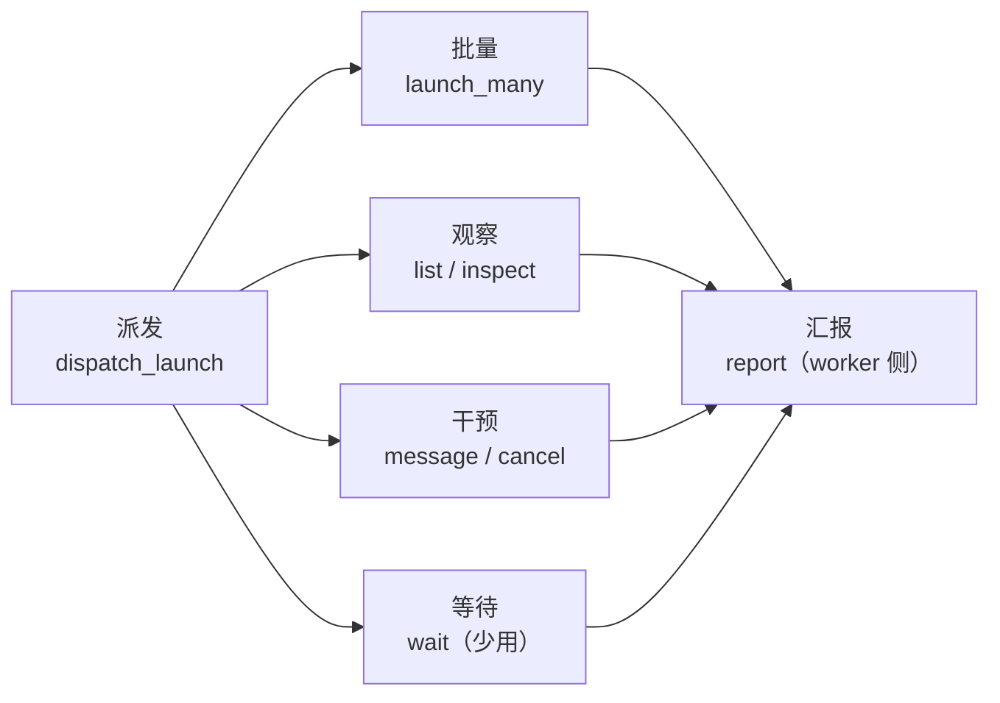
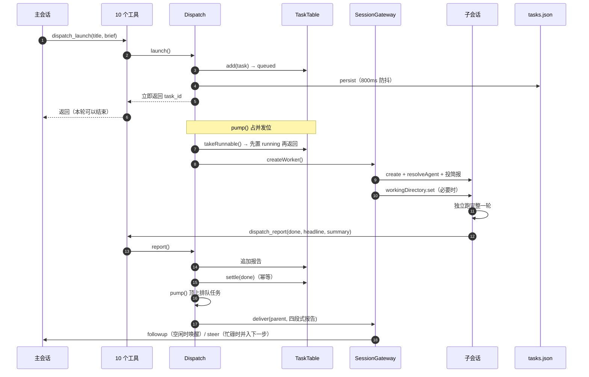
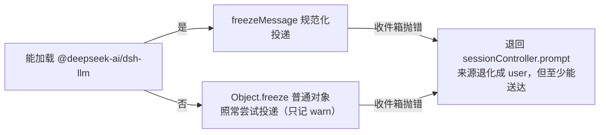
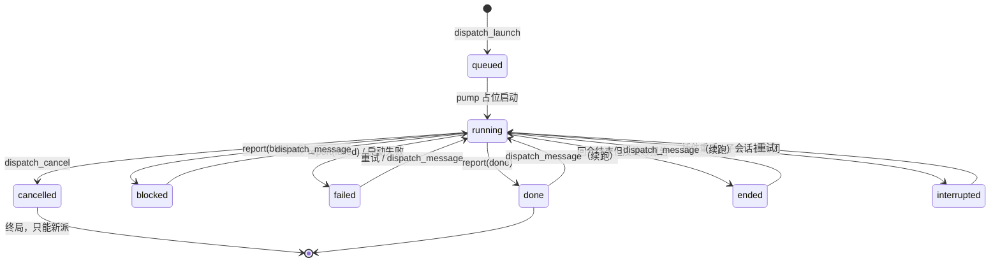
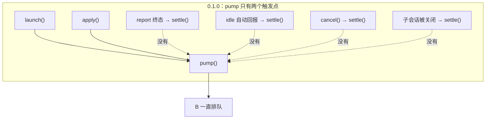
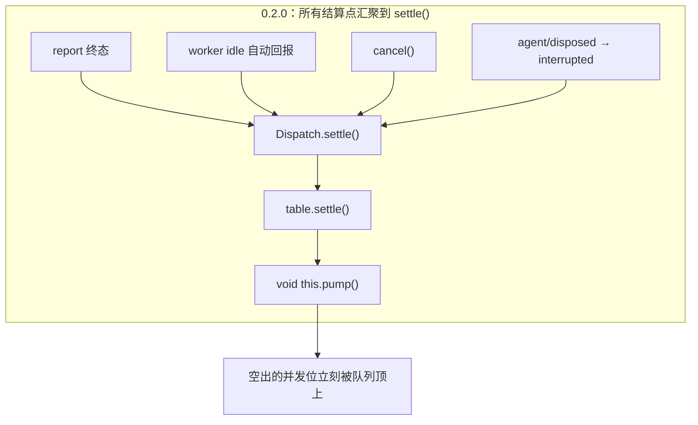
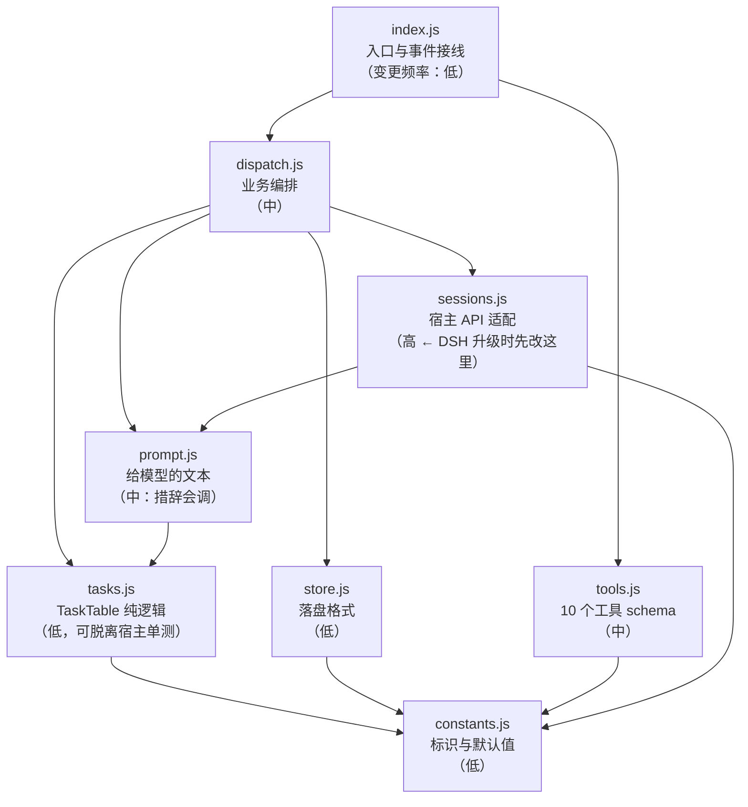
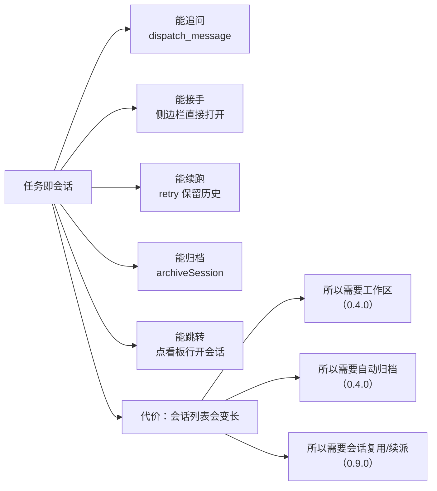

# dsh-mini-superagent 01：从单文件到最小闭环（0.1.0 → 0.2.0）

> **代码仓库**：[wychmod/dsh-mini-superagent](https://github.com/wychmod/dsh-mini-superagent)
> **本章目标**：看清「派发 → 干活 → 报告回流」这条最小闭环是怎么立起来的，以及第一个真实缺陷（队列不推进）如何逼出了模块拆分。
> **对应提交**：`7bb2571`（初始化）→ `ac045ac`（0.1.0，853 行单文件）→ `a6bb907`（改名重组）→ `5b770e3` 之前的 0.2.0 拆分。
> **原文对照**：`CHANGELOG.md` 的 0.1.0 / 0.2.0 两段，`docs/architecture.md` 的「关键设计决策 1–9」。

---

## 目录

- [一、0.1.0 要解决的最小问题](#一、010-要解决的最小问题)
- [二、八条链路：派发到回流的完整时序](#二、八条链路：派发到回流的完整时序)
- [三、三个关键选择，以及不这样会怎么坏](#三、三个关键选择，以及不这样会怎么坏)
- [四、状态机：八个状态与两个集合](#四、状态机：八个状态与两个集合)
- [五、第一个真实缺陷：队列不推进](#五、第一个真实缺陷：队列不推进)
- [六、0.2.0：按「谁最容易变」切开](#六、020：按「谁最容易变」切开)
- [七、核心讲解：为什么「任务即会话」是这个项目的地基](#七、核心讲解：为什么「任务即会话」是这个项目的地基)
- [八、使用建议](#八、使用建议)

---

## 一、0.1.0 要解决的最小问题

0.1.0 叫 `dsh-dispatch`，**一个文件 853 行**。它只回答一个问题：

> 主会话能不能把一件事交给另一个会话去做，然后**不等**？

为了回答这一个问题，它必须同时提供八件东西——少一件闭环就不成立：



| 工具 | 谁用 | 缺了它会发生什么 |
|---|---|---|
| `dispatch_launch` | 主会话 | 没有入口 |
| `dispatch_launch_many` | 主会话 | 只能一条条派，无法表达「这一批」 |
| `dispatch_list` | 主会话 | 派完就瞎了，不知道谁在跑 |
| `dispatch_inspect` | 主会话 | 只能看到 200 字摘要，无法判断「做到哪了」 |
| `dispatch_message` | 主会话 | 无法追问，等于一次性任务 |
| `dispatch_cancel` | 主会话 | 跑偏了只能等它自己结束 |
| `dispatch_wait` | 主会话 | 少数「必须等」的场景无法表达 |
| `dispatch_report` | worker | 报告回不来，闭环断了 |

**注意第八个工具是给 worker 的**，其余七个给主会话。这个「工具注册在全局、角色靠运行时判定」的形态从 0.1.0 就定了，一直没改——原因写在后面第三节。

## 二、八条链路：派发到回流的完整时序

下面这张时序图是全系列的地基。后面十三篇讲的都是它某一段的加固：



图里有两个「先于直觉」的顺序，两个都是被 bug 逼出来的：

**① `takeRunnable()` 必须「先占位、再返回」。** 如果先返回任务、再由调用方去置 `running`，那么两个 `pump()` 在 `await` 期间交错时，会都读到「还有空位」而同时启动——实测能超发到 7/6。修法是把状态变更放进返回之前，让「占位」成为原子动作。这条写在 `src/tasks.js` 的注释里。

**② `settle()` 之后必须立刻 `pump()`。** 这条是 0.2.0 才补上的，第三节详述。

## 三、三个关键选择，以及不这样会怎么坏

架构文档把这三条列为「关键设计决策」，因为它们各自都有一个看起来更自然的替代方案，而替代方案会坏。

### 3.1 worker 是 Session，不是一次性执行器

自然的做法是用宿主提供的 `ctx.subagents.startActivation` 起一个一次性执行器：跑完就散，不留历史，会话列表干净。

**它为什么被否掉了**：

| 维度 | 一次性执行器 | 真正的 Session（选中的方案） |
|---|---|---|
| 追问 | 做不到——进程没了，上下文也没了 | 直接 `dispatch_message`，历史还在 |
| 人接手 | 做不到 | 侧边栏里能直接打开，接手继续 |
| 建完能否立刻投递 | 要等执行器就绪 | `create()` **立即创建并发布 Agent**，`resolveAgent` 只做恢复 |
| 代价 | 会话列表干净 | 子会话会出现在列表里、历史持续增长、取消不删会话 |

**为什么「建完能立刻投递」是决定性的**：派发的核心承诺是「立即返回」。如果建会话之后还要等一个执行器 ready 事件，那这个「立即」就打折了。`create()` 立即发布 Agent 这个宿主行为（`docs/api-contracts.md` §4 有取证）让「同步拿到可投递的句柄」成立。

### 3.2 投递走 Agent 收件箱，不走 `sessionController.prompt`

`prompt()` 是最顺手的接口，但它构造的消息来源是 `{kind:'user', rpcId:…}`——**看起来像用户亲手打的字**。这有两个后果：

- 主会话无法区分「用户说的」和「子会话报的」；
- 界面上那条报告会显示成用户消息，后面的卡片、分隔线、样式全都没法做。

所以 0.1.0 就自己造消息：

```js
{ id, role: 'user', content: [{ type: 'text', text }],
  source: { kind: 'dsh-mini-superagent', form: 'relay' } }
```

再用 `freezeMessage` 规范化，交给 `agent.steer()` / `agent.followup()`。

**降级阶梯**也是三级，每一级都留了活路：



代价写在文档里：降级到 `prompt` 之后，来源就污染了。0.8.0 专门为此补了 `delivered:'prompt'` 返回值，让调用方能区分——「静默降级」在这个项目里被当成缺陷处理。

### 3.3 消息 id 必须唯一且稳定

DSH 的 Inbox 对**同一 id 的待投递消息**直接抛 `message "<id>" is already pending`。所以 id 由四段拼成：

```text
<taskId>:<start|relay|msg>:<BOOT>:<seq>
```

- `BOOT` 是每次插件加载生成的 6 位随机串——跨插件重启不会复用；
- `seq` 是进程内自增；
- 投递前统一加来源前缀 `dsh-mini-superagent:<id>`，避免和别家的 `rpcId` 撞车。

这条设计后来被反过来用了一次（0.9.0 那一批改动）：既然 id 稳定，那「重试前先查这条消息是否已经在会话里」就能做到**至多一次投递**。更早的实现把 id 生成写在重试循环**里面**，于是「第一次其实投进去了、只是后面抛错」会变成两条一模一样的报告。修法是三件套：`requestId` 在循环外算一次、重试前用 `holds()` 查收件箱与会话历史、判重只在 `attempt > 0` 时做。

## 四、状态机：八个状态与两个集合



| 集合 | 成员 | 语义 |
|---|---|---|
| `SETTLED` | done / blocked / failed / cancelled / ended / interrupted | 不再占并发位、`dispatch_wait` 不再等 |
| `TERMINAL_REPORT` | done / blocked / failed / cancelled | 本回合已给过结论，`idle` 时不再补自动回报 |
| 都不在 | queued / running / **progress** | `progress` 不是状态，只是报告的 kind |

**这个状态机在 0.1.0 是不完整的**：`task.status` 有 6 处裸赋值（`index.js` 的 `agent/status`、`takeRunnable`、`settle`、`start`、`message`、`retry`），没有一处校验前置状态。后果在第 05 篇详述——`done` 能被看板的「取消」改成 `cancelled`、已结算任务能被 `agent/status` 的 running 事件复活。

0.7.0 才补上 `TRANSITIONS` 跃迁表与唯一写入口 `transition()`。这里先记住一个结论：**状态机能被任意赋值，就等于没有状态机。**

## 五、第一个真实缺陷：队列不推进

0.1.0 的 `pump()` 只在两个地方被调用：`launch()` 和插件加载（`apply()`）。

于是有了这个场景：`maxWorkers = 1`，先派一个慢任务 A（`running`），再派一个快任务 B。B 进 `queued`，然后……就一直在那。

**因为 A 结算的时候没有任何人叫 `pump()`。** A 空出来的并发位，要等「下一次有人派发」或者「插件重载」才会被用上。



修法是把 `pump()` 挂到**所有结算点**，并且让它们统一走一个入口：



这里有一个必须写清的细节：**`pump()` 自己的失败分支用 `table.settle` 而不是 `Dispatch.settle`**。因为 pump 的循环本来就会继续走下一轮，再触发一次 pump 只会自递归。

实测记录（写在 README 的验证表里）：`maxWorkers=1`，A 慢任务结算于 `13:05:53`，B 快任务在 `13:05:57` 自动从 `queued` 转 `running`，间隔约 4 秒，期间**没有任何新派发**。

> 4 秒不是「立即」。因为 `pump()` 是 `void this.pump()`（不 await），加上建会话本身要时间。文档没有把它吹成「毫秒级」，而是老实写了「约 4 秒」——这种口径在这个项目里是通则。

## 六、0.2.0：按「谁最容易变」切开

853 行单文件被切成 8 个模块（后来长到 14 个）。**拆分的轴不是「功能」，而是「变更频率」**：



**依赖方向是单向无环的**，这条约束后面被反复引用：`tasks.js`、`store.js`、`workspaces.js` 不 import 任何 `@deepseek-ai/*`，所以能脱离 DSH 单测；`index.js` 只 import 四个模块，把「谁会碰宿主 API」限制在 `sessions.js` 与 `workspaces.js` 两个文件里。

拆分带来的直接收益，是 0.2.0 顺手加了第一个测试文件 `test/tasks.test.js`（13 条）。在此之前**一条测试都没有**——单文件 853 行，任何改动都只能靠人肉回归。

### 0.2.0 的兼容性代价（写在这里，因为它示范了「改名要付什么账」）

| 变了什么 | 影响 |
|---|---|
| 包名 `dsh-dispatch` → `dsh-mini-superagent` | 按名字过滤日志的脚本要改 |
| 状态目录 `<DSH_HOME>/dsh-dispatch` → `dsh-mini-superagent` | **不自动迁移**，历史列表为空 |
| 消息来源 kind、提示段名、日志前缀 | 全部跟着改 |
| 账本 `version: 1` → `2` | 读取时**不强校验**（当时还没有版本闸门） |

**不能并存**：两个包共有 8 个同名工具，同一全局层重复注册会直接抛错。这条限制到 0.10.4 依然成立。

## 七、核心讲解：为什么「任务即会话」是这个项目的地基

回头看，0.1.0 那个决定——用 `sessionController.create` 建真会话，而不是起一次性执行器——决定了后面所有能力的形状：



**右侧那三个「所以」不是巧合**。0.4.0 的工作区与自动归档、0.9.0 的会话复用与续派，本质上都在偿还 0.1.0 那笔债：既然任务即会话，那会话变多就是必然代价，必须有人来治理。

这也是读这个项目的正确姿势：**每一个后续版本，几乎都能追到一个早期决定的代价。** 一个只讲「我选了 A」的架构文档是不完整的，必须同时写「选 A 要付 B」。

## 八、使用建议

1. **先只装、只派一个任务。** 别一上来就批量。`dispatch_list()` 应该返回 `{"version":"0.10.4","total":0,"running":0,"max_workers":6,"tasks":[]}`——`version` 对不上说明装的是别的版本，`max_workers` 对不上说明配置没生效。
2. **简报要自包含。** 子会话看不到主会话历史，这是设计而非缺陷。一条能用的简报有四段：目标、约束、验收、已知事实。反例是「修一下那个 bug」——worker 会瞎猜，报告里全是假设。
3. **别把 `queued` 当失败。** 并发位满时任务会排队，`queued` 代表「已派出去、在等空位」。把 `queued` 读成「没派成」是本项目最常见的误读。
4. **`dispatch_wait` 默认不要用。** 这一条从 0.1.0 就写在文档里，但直到那批「提示词契约」改动才写成硬约束——因为只写「少用」是不够的，第 06 篇会解释为什么。

---

> **本篇留下的三个悬念**（后面各有专篇）：① 看板是怎么在「不打包、不编译」的约束下做出来的？② 为什么「住在哪个工作区」和「在哪个目录干活」要分开？③ 一个队列缺陷能靠「改调用点」修，那状态机的 6 处裸赋值该怎么修？
