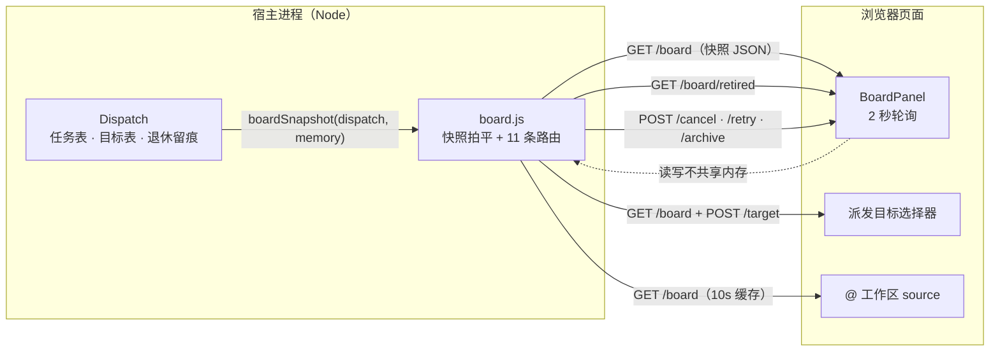
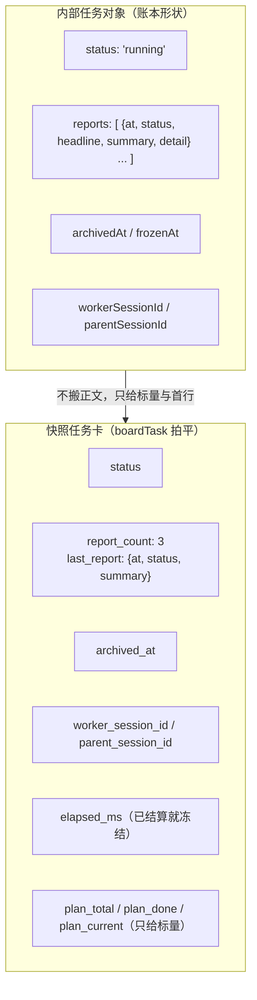
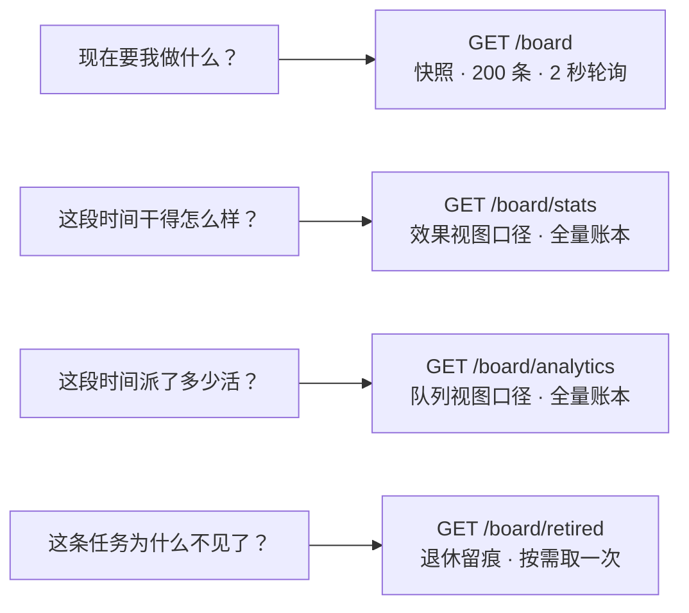
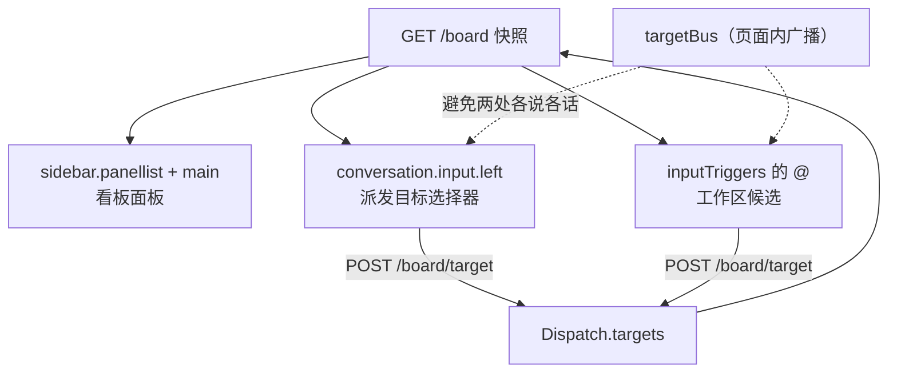
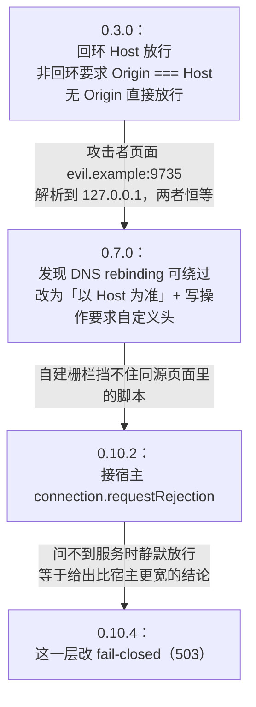
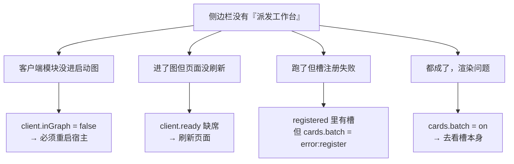

# dsh-mini-superagent 02：让后台可见——看板与同源 HTTP（0.3.0）

> **代码仓库**：[wychmod/dsh-mini-superagent](https://github.com/wychmod/dsh-mini-superagent)
> **本章目标**：看懂「派发工作台」的 Host/Client 两侧怎么分工、为什么不用 RPC 而用同源 HTTP、以及「不打包的浏览器模块」要付什么代价。
> **对应提交**：`7b54bd8`（常驻侧边栏任务看板）→ `5b770e3`（/board/selfcheck）→ `86c94e4`（准入改 Host 判据）。
> **原文对照**：`docs/board.md`（1092 行）、`docs/architecture.md` 决策 14–16、`CHANGELOG.md` 0.3.0 段。

---

## 目录

- [一、为什么需要一块看板](#一、为什么需要一块看板)
- [二、总体形态：两个半边，一条 HTTP 契约](#二、总体形态：两个半边，一条-http-契约)
- [三、Host 半边：快照是拍平，不是转发](#三、host-半边：快照是拍平，不是转发)
- [四、Client 半边：不打包、不编译](#四、client-半边：不打包、不编译)
- [五、为什么不用 Remote/RPC](#五、为什么不用-remoterpc)
- [六、第一道栅栏：Host 判据的三次演进](#六、第一道栅栏：host-判据的三次演进)
- [七、诊断入口：区分「没重载」和「清单有问题」](#七、诊断入口：区分「没重载」和「清单有问题」)
- [八、核心讲解：快照契约是「手写的两端一致」](#八、核心讲解：快照契约是「手写的两端一致」)
- [九、使用建议](#九、使用建议)

---

## 一、为什么需要一块看板

派发解决了「不等」，但制造了一个新问题：**看不见**。

`dispatch_list` 能回答「我派了什么」，但它有三个天生不足：

| 不足 | 后果 |
|---|---|
| 只列**本会话**的任务 | 多个主会话各自派活时，全局并发多少没人知道 |
| 是**工具调用**，要模型主动调 | 你不可能每秒问一次 |
| 没有全局并发位概念 | 你不知道「还能不能再派」 |

所以 0.3.0 加了常驻面板。它的定位不是「更好看的列表」，而是**一平方米的仪表盘**：并发占了几格、谁在排队、谁失败了、失败在哪。

## 二、总体形态：两个半边，一条 HTTP 契约



**关键约束：两侧不共享内存。** 宿主是 Node，页面是浏览器，中间只有 HTTP。这条约束带来两个好处、一个代价：

| | 内容 |
|---|---|
| 好处 1 | 看板挂了不影响派发（工具从不走这条路） |
| 好处 2 | 排障时每一条链路都能单独 curl / 单独看 |
| 代价 | 契约是「手写的两端一致」——路由前缀与快照字段在 `src/board.js` 与 `client/index.js` 各有一份 |

那份代价被一个测试钉住了：`test/contract-consistency.test.js` 在每次 `npm test` 时比对两边的路由前缀字面量。这是「不引入构建步骤」前提下能做到的最强约束——没有类型系统，就用断言替代。

## 三、Host 半边：快照是拍平，不是转发

`board.js` 的核心函数是 `boardSnapshot()`。它不把内部任务对象直接吐出去，而是**拍平**成一份给界面用的形状：



**为什么必须拍平，而不是「少返回几个字段」**：

1. **正文不能进快照。** 报告 detail 上限 4000 字、summary 6000 字；200 条任务 × 全文会让每次轮询的 payload 放大一个量级。所以快照只给 `report_count` 与最后一条报告的摘要首行。
2. **派生值要现算。** `elapsed_ms` 在运行中走表增长、已结算就冻结在结算时刻。这个语义 0.8.0 才修对——之前用「开始 → 现在」，一个 26 小时前的 `done` 任务会显示「26 时 0 分」。
3. **计数与列表要分开算。** `counts` 始终是全量口径（即使列表只截 200 条），否则「总计 500 / 列表 200」看起来像数据丢了。所以快照额外给一个 `truncated: {shown, total}`。

排序也是定死的：

```text
running → queued → 其余按 updated_at 倒序
```

这条骨架从 0.3.0 到 0.10.4 没变。批次聚合（同 `group` 的行聚在一起）只发生在**客户端**，不动服务端底序——因为服务端底序是「2 秒一次的快照」，改它会让每次轮询都重排。

### 三条只读通道，各回答一个问题



**为什么要三条而不是一条**：快照每 2 秒轮询、只带 200 条任务，拿它算比例的分母从一开始就是错的。统计必须遍历完整账本，偶尔查一次就够。这条判断写在 `docs/board.md` 里，是「接口设计跟着取数频率走」的一个干净例子。

## 四、Client 半边：不打包、不编译

浏览器侧是一个 **plain ModuleLoader 包**：

```js
window.__ModuleLoader__.load({
  id: 'dsh-mini-superagent',
  factory(require) { /* React 从 require('react') 取 */ }
})
```

**为什么不做打包**：

| 理由 | 展开 |
|---|---|
| 仓库硬约束是「无构建」 | 为一个面板引入打包器，就破坏了「clone 下来就能装」 |
| ModuleLoader 的 `factory` 能直接 `require` 宿主已提供的 React | 不用自己带运行时 |
| 样式随面板 `<style>` 卸载 | 只用 `var(--dsw-alias-*, fallback)`，不维护明暗两套 |

**代价也说清了**（写在架构文档里）：没有 JSX、没有类型检查，`client/index.js` 在 0.3.0 落地时是 1,017 行，到 0.10.4 长到 12,586 行，改结构时靠测试与人工审查。

这个代价后来被两件事部分对冲：一是 `scripts/client-smoke.mjs`（一个手写的 React 桩：`createElement` / `useState` / `useEffect` 都是自己实现的假实现，把客户端模块跑一遍并断言渲染结果，当前 817 项检查）；二是 0.10.0 引入的卡片把 UI 复杂度关进了「槽位 + 降级矩阵」的框架里（第 11 篇详述）。

### 三条注册共用一个快照

0.5.0 的输入框能力没有新增 Host 工具，而是复用看板 HTTP 面：



一份快照、一个写入口、一个页面内广播——这是「不新增接口也能加能力」的标准做法。

## 五、为什么不用 Remote/RPC

宿主提供了 Remote/RPC 机制，看起来更适合「跨进程调用」。这个项目选了普通 HTTP + JSON，理由三条：

1. **只为「读快照 + 两个按钮」定义一套跨进程契约（类型、版本、序列化）不划算。** HTTP + JSON 已经够用。
2. **同源页面本来就带浏览器上下文**，普通 `fetch` 自动带 `Origin`，鉴权判断能直接做在 handler 里。
3. **路由是 prefix 注册**，路径、方法、状态码都在一个文件里，排障时看日志就能对上。

代价前面说过：两端手写一致。这条代价在 0.9.0 之后变成「三处手写一致」——`memoryStats()` 的 `{window, ledger, admission, pending, retired}` 形状、`retiredSnapshot()` 的 `{ok, count, dropped, entries[]}` 形状，都被文档标注为**冻结契约，字段名不得改**。

## 六、第一道栅栏：Host 判据的三次演进

看板要暴露 HTTP，就必须自己判断「谁可以读」。这条判据改了三次，每次都是因为被绕过：



**0.7.0 那次为什么必须改**：DNS rebinding 的攻击方式是——攻击者页面从 `http://evil.example:9735` 加载，该域名解析到 `127.0.0.1`，然后它向同一个源发请求。此时浏览器的 `Host` 与 `Origin` **都是** `evil.example:9735`，「两者相等」恒真。而 0.3.0 对不带 `Origin` 的 POST 直接放行，等于局域网里任意脚本都能打。

修法的关键是**把判据从「两个头相等」换成「Host 是回环」**：浏览器无法伪造 `Host`，它来自 URL。攻击者想让浏览器发出 `Host: 127.0.0.1:9735`，就必须真的去连 `127.0.0.1`，那时 `Origin` 是 `evil.example`，会被回环分支的 Origin 检查拒掉。

**自定义头的作用**要说准：它挡不住 rebinding（同源请求不触发预检），它挡的是**同源页面之外的脚本**与简单 CSRF。

第 12 篇会把 0.10.2 / 0.10.4 两层讲透。这里先记住结构：**三层准入并存，删任何一层都会掉一档防护**。

| 层 | 谁判断 | 挡什么 |
|---|---|---|
| 1 | 宿主 `connection.requestRejection` | 部署不承认的 Host、没有登录凭据 |
| 2 | 本插件 `readAllowed` | 回环之外的地址、回环 Host 但 Origin 非回环 |
| 3 | 本插件 `writeAllowed` | 同源页面之外的脚本、简单 CSRF |

## 七、诊断入口：区分「没重载」和「清单有问题」

看板最常见的故障不是「接口 500」，而是**「装完了，侧边栏就是没有图标」**。这个故障有三种完全不同的原因，而它们的表象一模一样：



所以 0.5.x 加了两个诊断入口：

| 入口 | 作用 | 关键字段 |
|---|---|---|
| `GET /board/selfcheck` | 宿主侧能力、工作区、默认主会话、`client.*` 自报、`memory` 口径 | `client.inGraph` / `client.ready` / `client.probes` |
| `POST /board/client-ready` | 浏览器半边在 `apply` 末尾自报 | `{ok, registered:[...], cards:{...}}` |

**`inGraph` 与 `ready` 是两件事**：前者是「模块进了图」，后者是「它在页面里真的跑起来了」。两个都过、还是没有面板，才轮到槽注册与渲染。

`client.probes` 这个字段要说一下：它对 `dsh-context` / `dsh-ppt` 等**已知正常**的包做同样的探测。如果它们也都为空，说明是**探测方法本身不可靠**（多半是宿主 API 变了），而不是本插件有问题。这是「探针要能自证」的写法——一个永远返回失败的探针，比没有探针更糟。

## 八、核心讲解：快照契约是「手写的两端一致」

没有类型系统，两端只能靠手写保持一致。这段代码就是它防漂移的具体做法。

一段典型的宿主侧代码：

```js
const cards = clientCardsOf(body?.cards)
dispatch.clientReady = {
  at: new Date().toISOString(),
  ok: body?.ok !== false,
  ...(Array.isArray(body?.registered) ? { registered: … } : {}),
  ...(body?.error ? { error: … } : {}),
  ...(cards ? { cards } : {}),   // 没有合法结论 → 这个键不存在
}
```

三个细节：

**① 条件写入，不是写 `null`。** 没有合法结论时，字段**不存在**，而不是 `cards: {}`。这样排障时「键缺席」和「值是 error」是两种明确含义：前者正常降级，后者注册真失败。如果写成 `cards: {}`，读的人永远分不清。

**② 白名单过滤，静默丢弃不报错。** `clientCardsOf()` 只认 `batch` / `report` 两个键、只认 `on` 或 `error:slot|register|parse` 三种值、每个值截断 64 字符。因为 `cards` 是**浏览器发来的、客户端可控的数据**，而它会原样出现在诊断响应里——不滤的话，页面能往宿主诊断快照里塞任意键（`hack: 'x'`），排障时看起来像一条真的能力结论。

**③ 被过滤掉的东西不报错。** 这是浏览器自报的存活信号，一条畸形 body 不该让端点 500——那会让页面进入「自报失败 → 重试 → 再失败」的循环，反而盖住它本来要报的问题。

这三条合起来，就是「**诊断接口自己也要有可信度**」。这个项目在这件事上踩过坑：`cards` 曾经在宿主侧被整段丢掉，客户端上报与 `client-smoke` 全绿，`/selfcheck` 里却永远是空——所以 `test/board.test.js` 里专门有一组「POST → GET」跨链路用例，钉的不是「客户端发出去了」，而是「宿主收下并还原了」。

## 九、使用建议

1. **装完/升级后必须刷新一次 GUI 页面。** 客户端模块在页面刷新后才加载，插件本身激活不影响这一点。这一条在 README 里出现三次，是最高频的「假故障」。
2. **看板是全实例的，`dispatch_list` 是本会话的。** 看到「看板任务比 `dispatch_list` 多」不是 bug。
3. **headless 形态没有看板。** 没有 `webServer` 服务时不注册路由，日志会写「没有 webServer，跳过任务看板路由」——工具与派发完全不受影响。
4. **远程访问只能用同源页面。** 非回环 `Host` 默认 403，要开放得把地址写进 `BOARD_ALLOWED_HOSTS`。代价是远程 `curl` 读不到看板，这是有意的取舍。
5. **排障先看 `/selfcheck`，别猜。** `inGraph` / `ready` / `Probes` 三个字段能把「没重载」与「清单有问题」分开，省掉大部分来回。

---

> **下一篇**：看板解决了「看得见」，但子会话越派越多，侧边栏会被塞满。0.4.0 的工作区模型要回答的是——「会话住在哪」和「活干在哪」能不能不是一回事？
