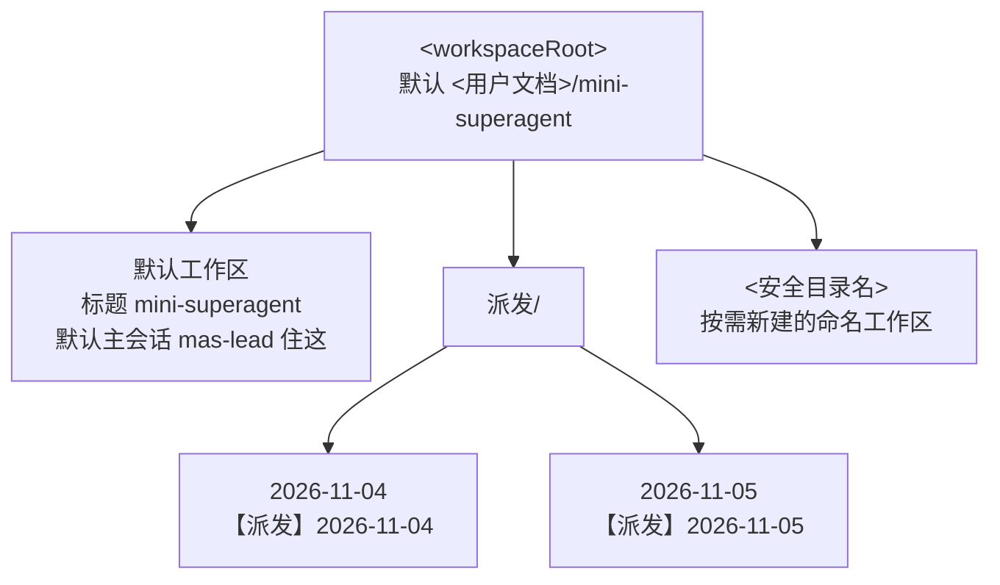
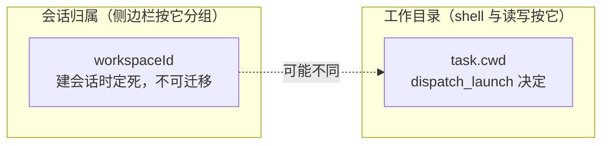
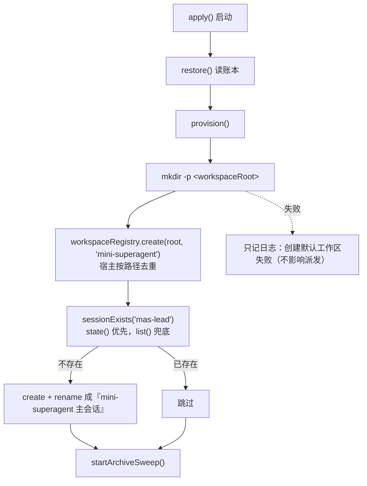
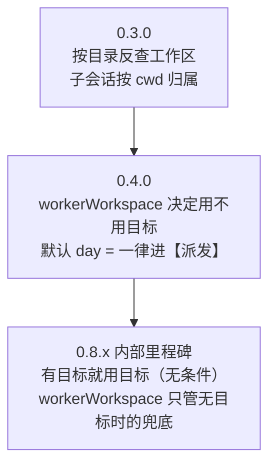
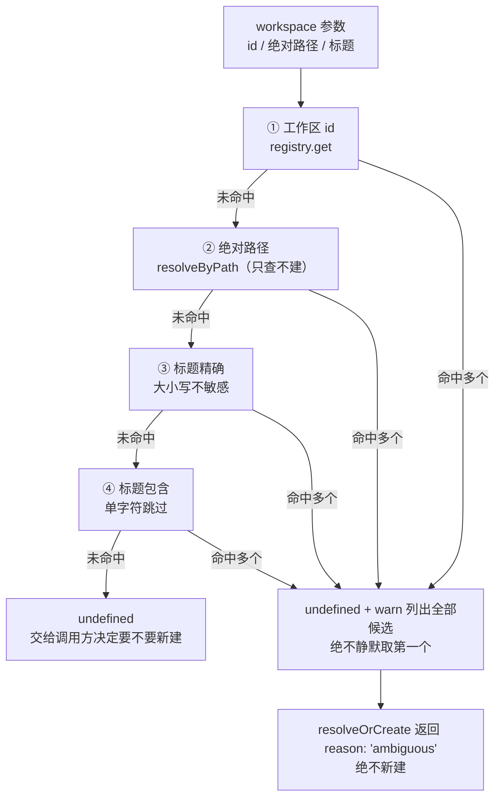
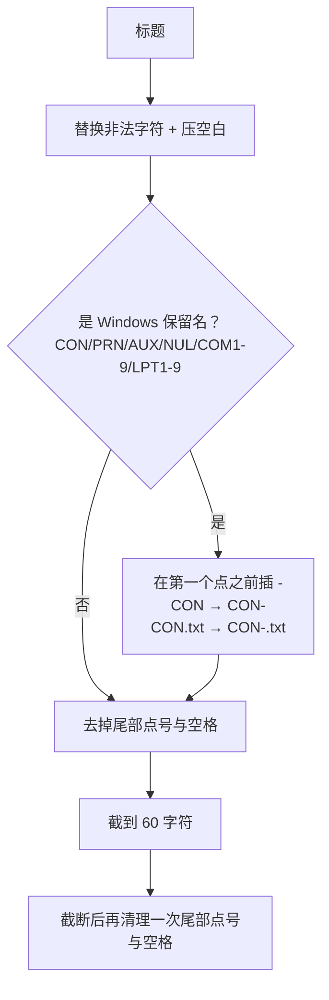
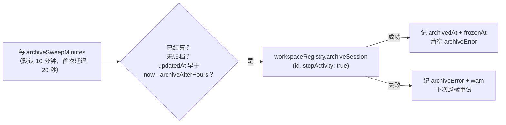
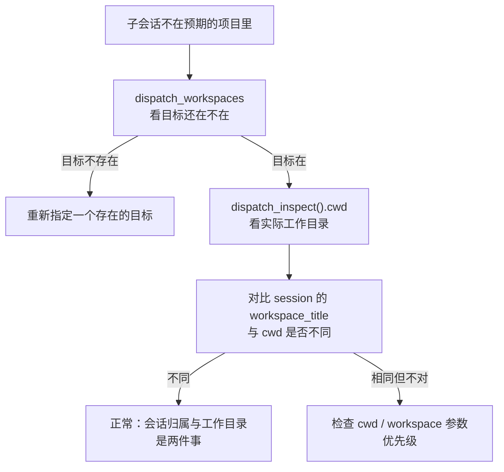

# dsh-mini-superagent 03：工作区模型——会话归属与工作目录是两件事

> **代码仓库**：[wychmod/dsh-mini-superagent](https://github.com/wychmod/dsh-mini-superagent)
> **本章目标**：搞清「子会话住在哪个工作区」与「它实际在哪个目录读写」为什么必须分开，以及四级解析、歧义处理、自动归档的完整规则。
> **对应提交**：`de3b126`（默认工作区 / 按工作区派发 / 每天【派发】/ 自动归档）→ `fa9b336`（Windows 保留名与歧义）→ `2824ef3`（放置规则改成「有目标用目标」）→ `bbf9bce`（精确匹配也不再静默取第一个）。
> **原文对照**：`docs/workspaces.md`（354 行）、`docs/architecture.md` 决策 17–19 与 §30。

---

## 目录

- [一、问题：子会话把侧边栏塞满了](#一、问题：子会话把侧边栏塞满了)
- [二、核心模型：两个「在哪里」](#二、核心模型：两个「在哪里」)
- [三、默认工作区与默认主会话](#三、默认工作区与默认主会话)
- [四、放置规则的三次修正](#四、放置规则的三次修正)
- [五、工作区解析：四级顺序与同一套歧义规矩](#五、工作区解析：四级顺序与同一套歧义规矩)
- [六、目录名安全：Windows 的四个坑](#六、目录名安全：windows-的四个坑)
- [七、自动归档：只收起，不删除](#七、自动归档：只收起，不删除)
- [八、核心讲解：为什么「静默取第一个」是缺陷](#八、核心讲解：为什么「静默取第一个」是缺陷)
- [九、使用建议与排障口径](#九、使用建议与排障口径)

---

## 一、问题：子会话把侧边栏塞满了

0.2.0 之后，每派一个任务就多一个 Session。派 20 个任务，侧边栏多 20 条记录。

这带来两个具体麻烦：

1. **侧边栏被历史淹没。** 你真正想找的项目会话被压到下面去了。
2. **子会话的工作目录五花八门。** 有落在主会话目录的，有落在进程 cwd 的，有落在某个绝对路径的——事后想找「那个改 auth 的会话」得靠记忆。

0.4.0 的答案不是「少建会话」，而是**给会话归类**：



## 二、核心模型：两个「在哪里」

这是全篇最重要的一张图。**会话归属**和**工作目录**是两个独立的事实：



| 概念 | 谁决定 | 能不能改 |
|---|---|---|
| **会话的工作区** | 建会话时定；DSH 里会话的工作区建完**不可迁移** | 不能 |
| **任务的工作目录** | `dispatch_launch` 的 `workspace` / `cwd` / 会话记住的派发目标 | 能，每个任务都可以不同 |

两条路径分开走：

```text
dispatch_launch({ workspace: "某项目" })
  1. 解析工作区 → target（id / 路径 / 标题）
  2. 任务 cwd = target.path
  3. 建子会话，归属按顺序决定：
       a. 有 target 且注册表里查得到 → 挂到 target（无条件）
       b. 没有 target / 已失效     → workerWorkspace 兜底
            day（默认）→ 当天【派发】工作区
            cwd        → 直接挂到任务 cwd
  4. 若 会话所在地 ≠ 任务 cwd → workingDirectory.set(agent, 任务 cwd)
```

**第 4 步是「两件事」的落点**。子会话挂在【派发】工作区下（侧边栏干净），但 `Get-Location` 返回目标目录（活干在对的地方）。

一个实测记录（README 的验证表里）：子会话的 `Get-Location` 返回 `…\Documents\mini-superagent`，而它的会话挂在【派发】工作区下。两者确实分开了。

## 三、默认工作区与默认主会话

启动时（`provisionDefaultWorkspace: true`，默认）插件做两件**幂等**的事：



**「失败只记日志」是一个明确的设计决策**，理由写在架构文档 §19：工作区是「让侧边栏更好用」的增强，**不是派发的前置条件**。目录不可写、注册表缺失、默认会话创建失败，都不该让 10 个工具跟着不可用。

代价也写清了：失败只在日志里，需要 `dispatch_workspaces` 或看板自己确认。

> 这里有一段小历史：0.5.0 用 `sessionController.inspect()` 判断默认主会话是否存在，但这个服务上根本没有 `inspect`——调用直接抛 `TypeError`，被 catch 成「不存在」。后果是**每次启动都以为 `mas-lead` 没了，重新 create 一遍**，而 `selfcheck.lead.exists` 永远报 `false`。0.5.1 改用 `state({sessionId}, signal)`（只读被动状态，不 resume Agent），并返回 `{exists, error}` 而不是裸 boolean——因为「查不了」和「不存在」是两件事，盲建会覆盖或冲突。

## 四、放置规则的三次修正

这条规则改了三次，每次都是「用户的明确选择被默认值压掉」：



**0.4.0 的错在哪**：`workerWorkspace` 的语义是「用不用目标工作区」，而它默认 `day`。于是：

```text
用户显式写: dispatch_launch({ workspace: "某项目" })
实际结果:   子会话进【派发】2026-11-05，每次派发都凭空多出一个日期工作区
```

**用户的意图是「选了目标就该在目标里」，而默认值把这个选择压掉了。** 这是典型的「配置项语义膨胀」——一个参数同时承担了「用不用目标」和「无目标时怎么办」两件事。

这次改动把它拆开：

| 配置取值 | 旧语义（≤0.8.0） | 现语义 |
|---|---|---|
| `target` | 决定**用不用**目标工作区 | 已废弃，归一到 `day` |
| `day`（默认） | 一律放【派发】，目标被忽略 | **只决定无目标时的兜底**：当天【派发】 |
| `cwd` | —— | 无目标时的兜底：直接按任务目录归属 |

旧值 `target` 已废弃——它想表达的行为成了无条件默认。配成 `target` 会被**归一成 `day`，不报错**（旧 profile 升级不该让插件起不来）。

同时修掉一个相关缺陷：**日期工作区改成惰性创建**。`dayWorkspace()` 会 `mkdir` + 注册，所以只在真的需要兜底时才调；有目标的派发从头到尾不碰它，`provision()` 也从不建它。

## 五、工作区解析：四级顺序与同一套歧义规矩



### 为什么「精确匹配也会歧义」

旧文档把第 ③ 步写成「标题精确匹配」，暗示它唯一、无歧义。**那是错的**，而且它的歧义比包含匹配更隐蔽——查询看起来「就是这个名字」，调用方很容易以为唯一。

一个实测踩到的场景（2026-11-08 12:10）：

```text
D:\idea\dsh-mini-superagent                     ← 仓库根
D:\idea\dsh-mini-superagent\dsh-mini-superagent ← 包根
```

宿主按目录 basename 起标题，于是两条工作区的标题都是 `dsh-mini-superagent`。用户点「dsh-mini-superagent」时被静默送进**另一个目录**，日志里一行线索都没有。

修法有三条配套取舍：

| 取舍 | 内容 | 为什么 |
|---|---|---|
| 候选文案必须带 `path` | `标题（路径，id=…）` | 同名工作区之间 id 是一串 uuid，对人毫无区分度；path 一眼能看出「这是包根不是仓库根」 |
| warn 而不是 throw | 返回 `undefined` + warn | 调用方要的是「解析不到」这个统一信号；抛错会改掉 `setTarget()` 的错误信息并牵动 `dispatch.js` |
| 单字符不做包含匹配 | 按码点数，代理对算 1 个 | `'a'` 命中一堆无关工作区，取第一个纯属偶然，比解析不到更糟 |

### `reason` 字段：为什么要区分「歧义」与「找不到」

`resolveOrCreate()` 的返回值是 `{workspace, created, reason?}`，`reason` 只在**没拿到工作区**时出现：

| `reason` | 含义 | 会发生什么 |
|---|---|---|
| `'ambiguous'` | 注册表里有多个候选 | **绝不新建**——那些目录真的存在，再建一个同名目录只会把「有两个候选」变成「多出一个重复工作区」 |
| `'not-found'` | 确实不存在 | 按 `create` 决定新建与否 |
| 缺席 | 解析成功 / 新建成功 / **空引用** | —— |

**空引用不给 `reason`**：调用方没给目标，不是「找不到」。给它贴 `'not-found'` 只会让 `dispatch.js` 为一句空话编出一段错误文案。

0.8.0 及更早两者都是 `undefined`，`dispatch.js` 只能把所有失败都写成「找不到工作区「…」，且允许新建被关闭」——**而这句话在歧义时是假的**（并没有人关掉新建）。这才是「用户明明没关新建，却被告诉新建被关了」的成因。

还有一处漏洞：`resolve()` 因精确歧义返回 `undefined` 后，`resolveOrCreate()` 曾经只判了包含匹配，于是把「精确歧义」当成「不存在」然后 `mkdir` 一个同名目录——比原问题更糟。现在它在真正新建**之前**会重跑一遍与 `resolve()` **完全一致**的顺序（`diagnoseTitleRef()`）。

## 六、目录名安全：Windows 的四个坑

`safeDirName` 把 `\ / : * ? " < > |` 与控制字符换成 `-`，去掉开头连续的点，空白压成一个空格，截到 60 字符。0.7.0 又补了两类 Windows 特例：



**为什么要插在点前而不是末尾**：`CON.txt-` 去掉扩展名之后仍然是 `CON`，一样非法。

**为什么要清理两次尾部点号**：Windows 会静默去掉尾部点和空格，导致 `abc` 与 `abc.` 撞同一个目录；而截断点可能正好落在点号后面，所以截断前后各做一次。

这两条都不是理论——它们会让 `mkdir` 直接失败或建出非法目录。

## 七、自动归档：只收起，不删除



**归档不是删除会话，也不是任务状态。** 这是三条独立的取舍：

| 取舍 | 内容 | 理由 |
|---|---|---|
| 用 `archiveSession` 不用删会话 | 会话从列表收起，历史还在 | 误归档可以恢复，删了就没有了 |
| 归档不改成任务状态 | `status` 不变，只多一个 `archivedAt` 标记 | 任务表、报告、看板都引用 `workerSessionId`，删会话会让 `dispatch_inspect` / 重试 / 审计断链 |
| `stopActivity: true` | 顺手停掉还在跑的活动 | 避免归档一个仍在执行的会话 |

**`archiveAfterHours` 的默认值从 24 提到 168（7 天）**，理由很实在：24 小时会让看板「全部」隔一天就空了。

**`frozenAt` 为什么要单独一个字段**：归档是「只读冻结」的开始，冻结时刻与归档时刻语义上是两个事实（「最后一次可写」与「已归档」）。当前实现里两者取同一个 `at`，保留两个字段是为了将来「冻结」独立于「归档」时不必改存储。

## 八、核心讲解：为什么「静默取第一个」是缺陷

「命中多个就取第一个」在代码里看起来是「优雅降级」：至少能用。但它有三个隐性代价：

1. **错误不可观测。** 用户拿到的结果看起来正常，没人会去查日志。
2. **错误会自我强化。** 因为「按目录登记工作区」也会自动造标题，撞名会**每撞一次再冒一个**，不是一次性脏数据。
3. **它把「我有多个候选」这个信息永久丢弃了。** 而这个信息恰恰是唯一能解释「为什么派到了别的目录」的东西。

所以这个项目把判据改成三条，**并且每一级都遵守同一条规矩**：

```text
命中 0 个  → undefined（交给调用方决定要不要新建）
命中 1 个  → 返回它
命中多个   → undefined + warn 出全部候选，绝不静默取第一个
```

配套的第二个修法同样重要：**`distinctTitle()` 让新建的工作区避开撞名**（`proj` → `b/proj` → `D:/idea/b/proj`，极端情况才用 `（2）` 后缀），但**绝不改已有工作区的标题**——「改别人的标题等于把用户认过的名字偷偷换掉」。

这两条合起来是一个完整的治理闭环：**新建时不制造歧义，解析时不隐藏歧义。**

## 九、使用建议与排障口径

### 配置建议

| 场景 | 建议 |
|---|---|
| 想让子会话住在项目里 | 显式传 `workspace`（id 最稳，其次绝对路径） |
| 只想让活干在某目录、不在乎侧边栏 | 传 `cwd`（显式 `cwd` 优先于会话记住的目标） |
| 完全不想建日期工作区 | `workerWorkspace: 'cwd'` |
| 侧边栏太乱 | 调小 `archiveAfterHours`（比如 24），别关归档 |

### 五条常见误读

1. **「派发目标 ≠ 会话归属」**：输入框选的目标只影响下一次 `dispatch_launch`；DSH 里会话的工作区建完不可迁移。
2. **「有目标就一定在目标里」**：`workerWorkspace` 管不到有目标的派发。看到子会话在【派发】里，说明目标没解析到（先查 `dispatch_workspaces`）。
3. **「`workspace` 胜 `cwd`，但 `cwd` 不被丢弃」**：两者同时给时会话住在 workspace 里，活干在 cwd 里（由 `enterDirectory()` 切过去）。
4. **「显式 `cwd` 不做日期兜底」**：调用方明确给了目录，就不该再被塞进当天的【派发】。
5. **「归档不删目录」**：`<workspaceRoot>/派发/<日期>` 下的文件不会自动清理。

### 排障顺序



---

> **下一篇**：工作区让每个任务落在对的地方，但「这次派不派、派到哪」这个意图还停留在工具参数里。0.5.0 要把它提到输入框上——让「选择模式」本身成为一种指令。
>
> 继续读：[第 04 篇](/md/10-项目实战/04-DSH任务派发插件/04-输入框变成指挥台.md)
