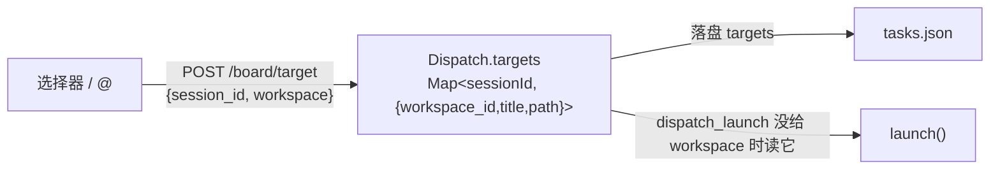
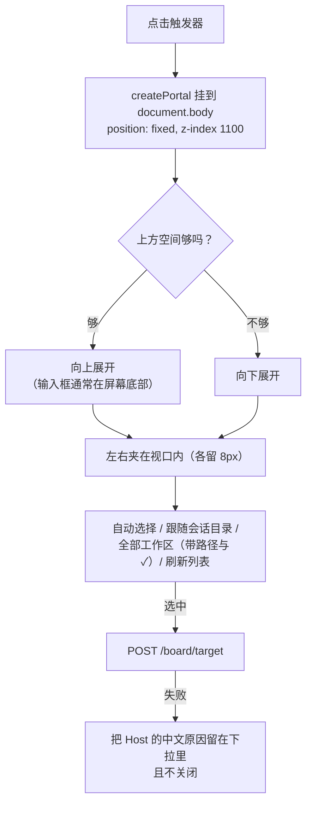
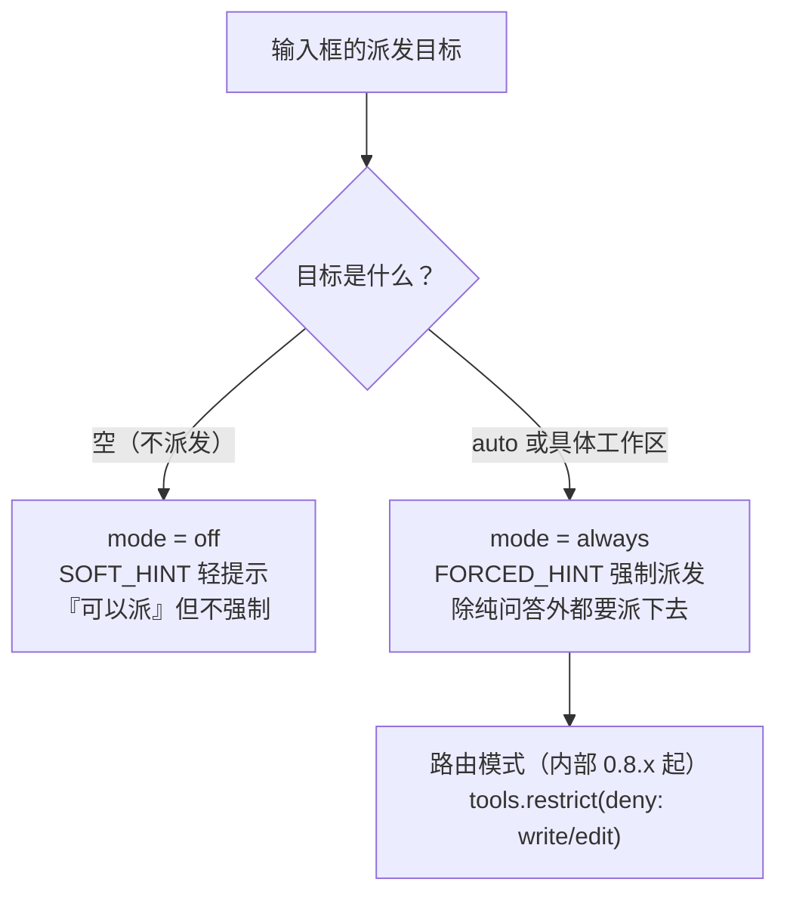
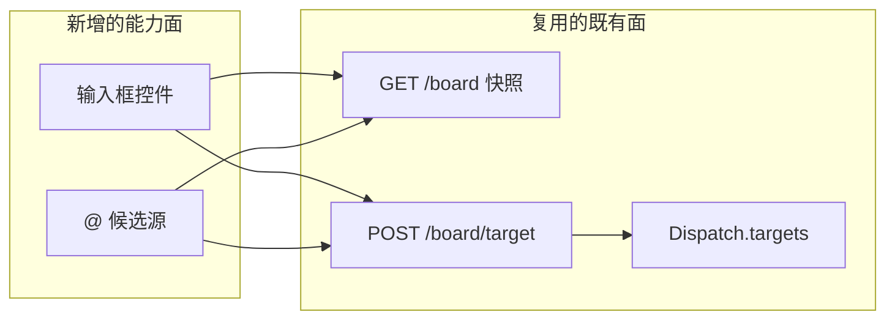

# dsh-mini-superagent 04：输入框变成指挥台（0.5.x → 0.6.0）

> **代码仓库**：[wychmod/dsh-mini-superagent](https://github.com/wychmod/dsh-mini-superagent)
> **本章目标**：看懂「派发目标」控件与 `@` 工作区是怎么把「意图」落到「参数」上的，以及 0.6.0 的模式开关为什么把「派不派」变成一个会话级属性。
> **对应提交**：`45c29c9`（每个会话的派发目标）→ `95c5907`（输入框选择器 + `@`）→ `ecfa96c`（不派发为默认）、`236151b` / `d49b27c`（自动选择成为默认）→ `5de660d` / `5b770e3`（归档视图与 selfcheck）。
> **原文对照**：`docs/composer.md`（225 行）、`CHANGELOG.md` 的 0.5.0 / 0.5.2 / 0.5.3 / 0.6.0 段。

---

## 目录

- [一、问题：意图藏在参数里](#一、问题：意图藏在参数里)
- [二、派发目标：一个「下一次」的偏好](#二、派发目标：一个「下一次」的偏好)
- [三、选择器：28 像素的控件背后](#三、选择器：28-像素的控件背后)
- [四、`@` 工作区：与官方 `@reference` 并存](#四、-工作区：与官方-reference-并存)
- [五、自动选择：打分而不是猜测](#五、自动选择：打分而不是猜测)
- [六、0.6.0：把「派不派」变成模式](#六、060：把「派不派」变成模式)
- [七、核心讲解：一个控件如何不新增一个工具](#七、核心讲解：一个控件如何不新增一个工具)
- [八、使用建议](#八、使用建议)

---

## 一、问题：意图藏在参数里

0.4.0 之后，派发的目标工作区靠 `dispatch_launch({ workspace })` 传。问题是**这是模型决定的**，不是人决定的。

实际使用中有个反复出现的摩擦：

```text
用户（心里想着）：这个会话接下来都往「某项目」派
模型（实际行为）：有时传 workspace，有时不传，有时传错名字
```

结果就是同一批任务散落在不同的工作区。用户要纠正，只能每次都在话里嘱咐一句「记得派到某项目」——而这会污染对话，也照样不可靠。

0.5.0 的解法是：**把「派到哪」从一次调用的参数，提成一个会话级的偏好**，并且让它出现在**人能直接点的地方**——输入框。

## 二、派发目标：一个「下一次」的偏好

先分清两个概念，这是全篇最容易混的地方：

| 概念 | 谁决定 | 能不能改 |
|---|---|---|
| **会话的工作区** | 建会话时定死 | **不能**。DSH 里会话的工作区建完不可迁移 |
| **派发目标工作区** | 输入框选择器 / `@` / `dispatch_launch` 的 `workspace` | 能，随时改 |

所以选择器上写的是「派发 → 某项目」，语义是**「下一次从我这个会话派出去的任务，默认去那里」**，而不是「把我这个会话搬到那里」。

它的存储很轻：



三个边界说清：

- `dispatch_launch` **显式给了** `workspace` → 用显式值，选择器不生效；
- 没给 → 用该会话的派发目标；
- 目标**失效**（工作区被删 / 路径没了）→ 只记 warn，退回调用者目录，**不会**凭选择器新建目录。

## 三、选择器：28 像素的控件背后

这个控件挂在 `conversation.input.left`（工具行左侧），`order: 60`。规格写在文档里，精确到像素：

| 项 | 值 |
|---|---|
| 尺寸 | 高 28px、`flex: none`、`max-width: min(260px, 45cqw)` |
| 文案 | 有目标 `派发 → <标题>`；无目标 `派发 → 跟随会话` |
| 图标 | 左侧圆点：有目标实心取品牌色，无目标空心 |
| 可见条件 | 有活跃会话才渲染；空白 / hero 会话看不到 |
| 无障碍 | `aria-haspopup="menu"`、`aria-expanded`、`aria-label="派发目标工作区"` |

下拉的工程细节解决的是「输入框在屏幕底部」这个具体问题：



**几个细节都是有原因的**：

- **用 `createPortal` 而不是就地定位**：输入框外层常有 `overflow: hidden`，就地展开会被裁掉。
- **优先向上**：输入框在底部，向下展开会出视口。
- **失败不关闭下拉**：用户刚点的东西失败了，把下拉关掉等于让他重新点一遍。
- **窗口 `resize` / 滚动会重新定位**：`fixed` 定位不会跟着滚动走，不重算就会飘。
- **`Esc` 关闭并把焦点还给触发器**：这是菜单该有的行为，不是可选项。

## 四、`@` 工作区：与官方 `@reference` 并存

同一个目标还能在输入框里用 `@` 选。这是复用宿主已有的 `inputTriggers` 机制：

| 项 | 值 |
|---|---|
| 注册 | `inputTriggers.registerSource({trigger:'@', name:'workspace', order:40})` |
| 候选分组 | 「工作区」，与官方 `@reference` 并存 |
| 选中动作 | **同时**做两件事：`POST /board/target` 设目标 + 往草稿插 chip |
| 模型看到的文本 | `<workspace id="ws-2" title="副工作区"/>` |
| 剪贴板文本 | `@副工作区` |

两个「不能」必须写清，因为它们是宿主契约的限制而非选择：

**① `appearance` 故意省略。** 宿主只认 `session` / `file` / `folder` 三种 chip 外观，传别的会让**整条草稿恢复时被清空**。所以插件只插「裸 chip」。

**② `@中文名` 纯文本不可行。** 因为没有「只插纯文本」的返回形态，选中一定产生 chip。

这两条合起来的后果是：用户看到的是一个 `@副工作区` 的 tag，模型看到的是结构化标签。中间那层「纯文本」不存在——不是设计者没想到，是宿主没给这个口子。

降级路径也明确：`inputTriggers` 服务缺席时 `@` 不出现，但看板与选择器照常工作。

## 五、自动选择：打分而不是猜测

0.5.2 加了一个默认模式：`auto`。

它的语义是「**每次派发时按任务内容自己挑工作区**」，实现是一套纯规则打分，**不做语义猜测**：

| 命中方式 | 分值 |
|---|---|
| 标题完全相等 | 100 |
| 标题包含 | 40 |
| 目录名相等 | 30 |
| 目录名包含 | 15 |
| 路径包含 | 5 |

规则细节：

- 多关键词**累加**，同分按标题字典序；
- **无关键词时全部同分（1 分）**，退化为按标题排序取第一——所以 `@` 后直接回车也能选到一个；
- **命中门槛 40**（标题包含级别以上），避免路径里沾一个字就被误判；
- 挑不到 → 退回默认工作区（`mini-superagent`）。

**为什么要门槛**：如果只要 5 分就算命中，那「路径里含 `mini`」也会把任务送进 `mini-superagent`——用户会觉得「它随机乱选」。门槛让「宁可不选」成为可能。

一个端到端实测（写在 CHANGELOG 0.5.2）：把会话目标设为 `auto`，派发标题「sableos 项目目录结构梳理」的任务，`task.workspace_title = sableos`，子会话 `Get-Location` 返回 `D:\idea\sableos`。自动识别生效。

> 一个实现细节：`rankWorkspaces` 被搬到了 **Host 侧**（`src/workspaces.js`），Client 侧用同一套分值。理由是「同一个决定不能两处各写一份」——这和后面第 07 篇的「单点定义」是同一条原则。

## 六、0.6.0：把「派不派」变成模式

0.5.x 解决了「派到哪」，0.6.0 解决了「派不派」。

在此之前，模型在「派活」和「自己干」之间摇摆：有时该派的没派，有时不该派的派了。加一句提示词能改善，但不稳定——因为**「要不要派」本身是个会话级决策，不是每条消息的决策**。

0.6.0 把它提成一个明确的开关：



三条规则：

1. **「不派发」是默认项。** 任何会话都可能是主会话，所以只要没设目标，工具一个都不少、行为一点不变。
2. **选了任何具体目标 → 强制派发。** 除纯问答外，一切执行型工作都必须 `dispatch_launch` 派下去。
3. **切换不用重载插件。** 提示段注册的是**函数式文本**，DSH 每次装配系统提示都重新求值。

第 3 条的实现有个坑，要单独说（第 06 篇会展开）：宿主的请求装配对**变化的提示是追加，不是替换**。文本一变就 append 一个新的 `system/message`，**旧的那个仍然留在面上**、仍随 `deriveMessages()` 进请求。

于是 0.6.0 出现过一个真实故障：

```text
用户：我选了「不派发」，为什么它还是派发了？
原因：模型同时读到旧的强制段和新的轻提示
```

后来才修（内部记作 0.8.2）：插件在装配文本**相对上一步真的变了**时，通过 `agent/pre-step` 返回 `startsRequestSeries: true`，把收敛交回宿主自己的机制。文本没变时不动，避免白白打掉提供方的前缀缓存。

## 七、核心讲解：一个控件如何不新增一个工具

要给「派发目标」加能力，最自然的做法是加一个工具 `dispatch_set_target`。这个项目**没有加**，而是：



**为什么不加工具，理由有三层**：

1. **工具面是给模型的，控件是给人的。** 「设置派发目标」是人的动作，不是模型的动作。把它做成工具，模型会开始自己改目标——那不是需求。
2. **工具面已经 10 个了。** 再加会稀释每条规则被读到的概率（这个理由在第 06 篇会被写进提示词的长度门禁）。
3. **复用已有接口的成本最低。** `POST /board/target` 本来就是给选择器用的；`@` 复用它是零成本。

代价也写清了：快照有 10 秒缓存（`@` 候选复用），选择器打开下拉时强制刷新；`@` 选中时设置目标失败**没有可挂错误的位置**，只 `console.warn`——这是一个已知的、被记录下来的粗糙处。

## 八、使用建议

| 你的场景 | 怎么设 |
|---|---|
| 这个会话只是聊天，不派活 | 保持默认「不派发」 |
| 接下来一批活都去同一个项目 | 选择器选那个工作区（或 `@` 它） |
| 让插件按任务标题自己挑 | 选「自动选择」，标题里带上项目名 |
| 一次性的、只这一次不同 | 不设目标，`dispatch_launch` 里显式传 `workspace` |
| 只改工作目录、不在乎工作区 | 传 `cwd`，别动选择器 |

三条容易踩的坑：

1. **选择器不搬会话。** 它只影响下一次派发。想把已有会话换到别的工作区，做不到。
2. **`@` 一定插 chip。** 没有「只写纯文本」的形态，所以草稿里会多一个 tag——这是宿主契约，不是插件的选择。
3. **切模式后模型可能还读得到旧提示。** 这是 0.6.0 引入模式开关后暴露的问题，后来通过开新请求序列收敛解决。遇到「选了不派发它还是派」，升级到当前版本即可。

---

> **下一篇**：0.5.x 到 0.6.0 加了很多能力，但能力多了，**正确性**开始出问题。0.7.0 一口气修了六个 P0——它们都属于「平时看不出、出事很难查」的类型。
