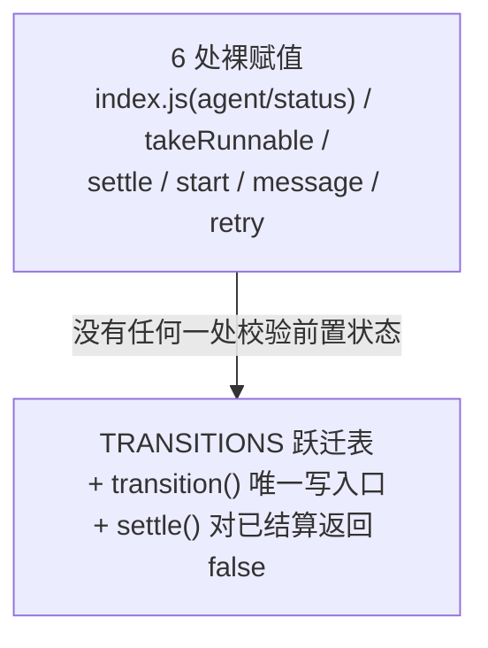
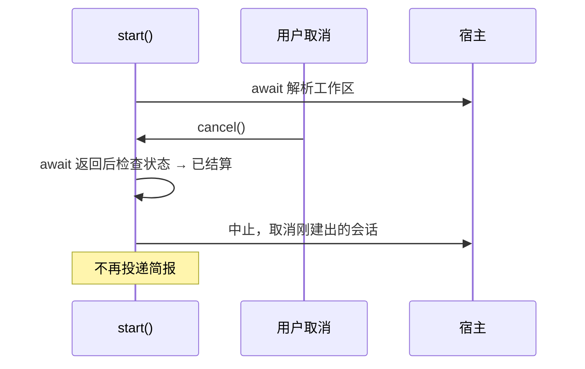
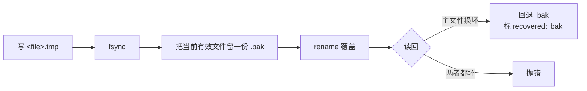
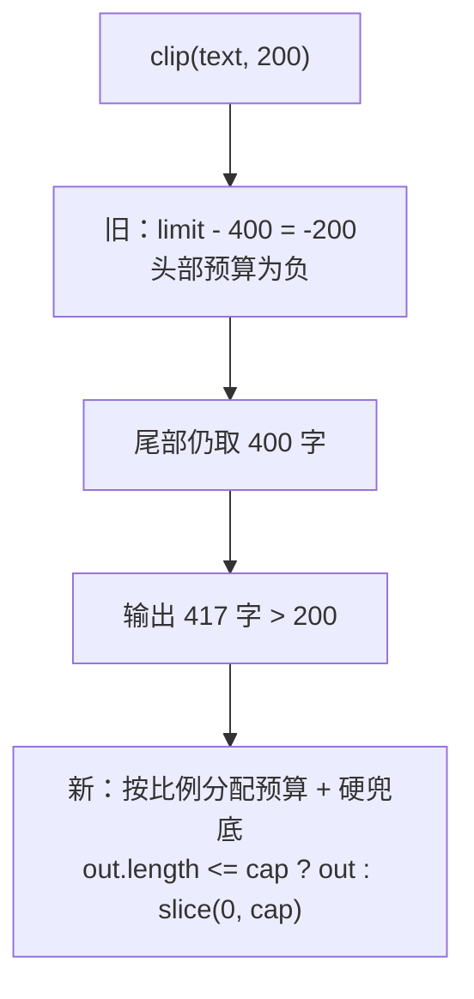
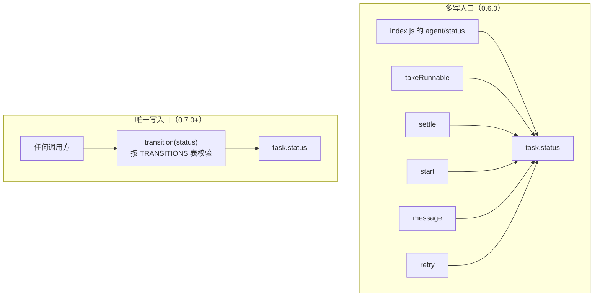
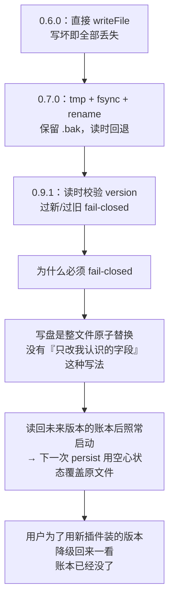
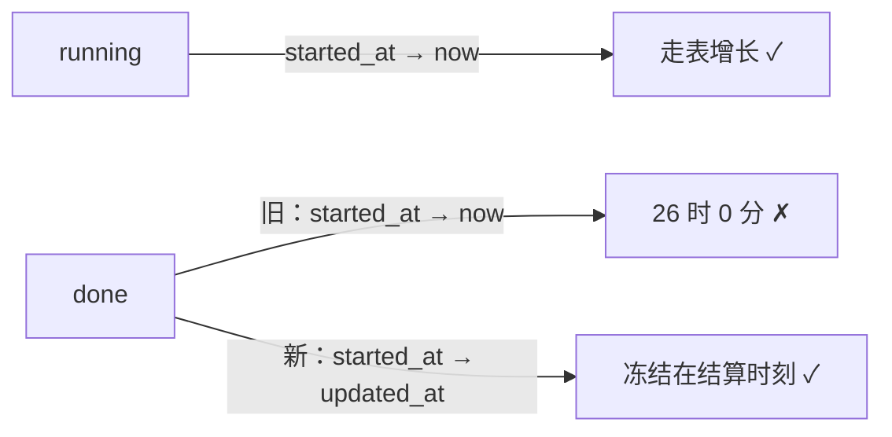

# dsh-mini-superagent 05：正确性攻坚——两轮 P0 与 P1（0.7.0 → 0.8.0）

> **代码仓库**：[wychmod/dsh-mini-superagent](https://github.com/wychmod/dsh-mini-superagent)
> **本章目标**：看清 0.7.0 的六个 P0 与 0.8.0 的一批 P1 各自是什么形态、为什么「平时看不出」、修法的共性是什么。
> **对应提交**：`023d5a8`（原子写）→ `86c94e4`（准入改 Host）→ `8a9ccad`（跃迁表）→ `0501a54`（启动竞态）→ `6271ea8`（状态复活）→ `8b96fb8`（越权与卡死）→ `fa9b336`（Windows 与歧义）。
> **原文对照**：`CHANGELOG.md` 的 0.7.0 与 0.8.0 两段（这两段是本项目最像「缺陷教科书」的部分）。

---

## 目录

- [一、为什么叫「正确性攻坚」](#一、为什么叫「正确性攻坚」)
- [二、0.7.0 的六个 P0](#二、070-的六个-p0)
- [三、0.8.0 的 P1：三类咬人的问题](#三、080-的-p1：三类咬人的问题)
- [四、共性一：状态必须有唯一写入口](#四、共性一：状态必须有唯一写入口)
- [五、共性二：落盘必须原子且可回退](#五、共性二：落盘必须原子且可回退)
- [六、共性三：降级必须被记录，不能静默](#六、共性三：降级必须被记录，不能静默)
- [七、核心讲解：一个 26 小时的「已完成」任务](#七、核心讲解：一个-26-小时的「已完成」任务)
- [八、使用建议：怎么在自己的项目里找这类缺陷](#八、使用建议：怎么在自己的项目里找这类缺陷)

---

## 一、为什么叫「正确性攻坚」

到 0.6.0，功能面已经很丰富了：派发、批量、看板、工作区、输入框、模式开关。

但有一个共同特征：**所有测试都是「正向路径」**。派一个任务、它做完、报告回来——绿的。而 0.7.0 修掉的六个缺陷，全部是「正向路径绿、异常路径烂」。

它们有统一的形态：


这就是「平时看不出、出事很难查」。0.7.0 的 CHANGELOG 开头一句写得很准：

> 它们都属于「平时看不出、出事很难查」的类型：状态机没有单一入口、落盘不原子、看板准入判据可被绕过。

## 二、0.7.0 的六个 P0

### P0-1 · 看板准入可被 DNS rebinding 绕过

这是唯一一个**安全性**的 P0，第 02 篇已经讲过机制。这里补它的后果严重性：

> 实测能读全部任务标题 / 工作目录 / 报告摘要，能归档、改派发目标、取消任务。

也就是说，局域网里任意一个恶意页面，可以在你不知情的情况下取消你的任务、把你的派发目标改到别处。

**修法核心**：判据从「`Origin === Host`」换成「`Host` 是回环」。因为浏览器无法伪造 `Host`——它来自 URL。

### P0-2 · `settle()` 无幂等，状态可被任意覆盖

0.6.0 的 `settle` 是**裸赋值**：

```js
task.status = status   // 就这么一句
```

于是：

| 场景 | 后果 |
|---|---|
| 看板点「取消」 | `done` 被改成 `cancelled`——已完成的任务消失了 |
| `agent/status` 的 running 事件 | 已结算任务被**复活**，并发位被幽灵占用且永不结算 |
| `queued` 任务被 `message` 置 running | 状态变了但没出队，排队顺序永久错乱 |

修法是两层：



**关键判据**：`settle()` 对**已结算**任务直接返回 `false`（幂等）。离开终态只能走显式命名的 `reopen()`。

这条设计后来救了很多次——第 07 篇的「权威源靠单写入口保证」、第 12 篇那个「写进账本的脏键」，本质都是同一件事的两面：**只要状态有多个入口，就没有人能解释它为什么变成现在这样。**

### P0-3 · `dispatch_message` 先改状态后投递

顺序错了：

```text
旧：置 running → 投递 → 投递失败 → 状态不回滚
```

后果有两个，都很糟：

- 已完成任务被打回 `running` 并**永久占用并发位**；
- 对 `queued` 任务更糟：状态置 running 但没从队列摘除，**排队顺序永久错乱**。

**修法**：先投递，成功后跃迁状态，失败则保持原状态并抛错。

这条修法的普适性很强：**任何「改状态 + 外部副作用」的组合，副作用必须先做。** 因为状态是本地可回滚的，外部副作用不是。

### P0-4 · `cancel()` 与 `start()` 竞态留下僵尸 worker

`start()` 有多个 `await`：解析工作区、建会话、切目录、投递。期间如果用户取消任务：

```text
cancel() 执行 → agents.get() 还是空的 → agent.cancel() 被跳过
但 start() 继续跑完 → 会话照常被创建并投递简报
```

**看板显示已取消，实际有子会话在烧模型额度。** 这是最典型的一类「异步竞态」：不是逻辑错，是时序错。

**修法**：每个 `await` 之后检查一次状态，已结算就中止启动并取消已建出的会话。



### P0-5 · 落盘非原子，写坏即全部历史丢失

原来是直接 `writeFile` 覆盖。进程在写入中途崩溃 → 半截 JSON → `restore` 只 warn → 以空表启动。

**最糟的不是丢数据，是「丢数据」和「第一次装」长得一模一样。** 用户无法区分。

修法三步：



另外 `Dispatch.persist()` 加了串行写链——两个 `persist` 交错会让 `.bak` 也变成半截。

### P0-6 · 「自动选择」目标重启后丢失

`restore()` 只恢复带 `workspace_id` 的目标，`auto` 目标被过滤掉。

后果比「丢一个偏好」严重得多：0.6.0 里 `auto` 还意味着「必派发」模式，所以丢失后会话会**静默退回「不派发」**（自己干活）——行为反转，界面无提示。

**这是一个「默认值 + 过滤 + 语义耦合」的三重坑**：如果 `auto` 只是「一个工作区选项」，丢了就丢了；但它同时是模式开关，丢了就是行为反转。

## 三、0.8.0 的 P1：三类咬人的问题

0.7.0 之后评审还剩 20 条 P1，0.8.0 修掉一批。它们的共同特征是「单个看都不致命，但用久了会咬人」。

### 第一类 · 越权与污染

| 缺陷 | 形态 | 后果 |
|---|---|---|
| `dispatch_wait` 缺归属校验 | 同文件的 inspect/message/cancel 都校验了，唯独 wait 没校验 | 会话 A 传会话 B 的 `task_id`，**能读到对方的标题、状态与报告摘要** |
| 工作目录可伪造提示规则块 | `工作目录: ${task.cwd}` 未清洗，cwd 含换行 | 能伪造出「工作规则」块并插在真规则**之前** |
| 降级投递污染消息来源 | 收件箱不可用时退回 `prompt()`，它构造 `{kind:'user'}` | 主会话把报告当成**用户亲口说的** |

第二条的修法是：**结构化字段一律压成单行去控制字符；简报用围栏包住；规则放到数据块之后，并显式声明「与简报冲突时以规则为准」。**

顺序很关键。如果规则在前、数据在后，数据里的伪造内容就能「覆盖」规则；反过来，数据后面还有一段规则声明，模型就能分辨。

第三条的修法更细：降级时记 warn，并返回 `delivered:'prompt'` 让调用方能区分。**「静默降级」被当成缺陷处理**——这是这个项目反复出现的态度。

### 第二类 · 状态与额度

| 缺陷 | 形态 | 后果 |
|---|---|---|
| `maxTasksPerSession` 永久锁死 | 原实现数 `ofSession().length`，而任务表只增不减 | 累计派发满 64 个后该会话**再也不能派发**，即使全部 done、全部归档 |
| `waitFor` 重复 id 要等满超时 | `finishOne` 被 Set 去重，但 `remaining` 按数组长度计 | `waitFor([a,a])` 里 a 结算后仍要等满超时 |
| `waitFor` 超时不清理等待者 | 超时分支从不摘除 `waiters` | 长期不结算的任务会一直挂着 resolver |
| `retry` 的 attempt 先自增后投递 | 投递失败时 attempt 已消耗、状态卡 running | 重试次数白耗 |

第一条是「用着用着突然不能派了」的典型成因。修法：`quotaUsed()` 只数**仍在册**的任务——已归档的不计，已结算超过 24 小时的不计。

### 第三类 · 文本与数据的边界

| 缺陷 | 形态 | 后果 |
|---|---|---|
| `clip()` 在 `limit < 400` 时输出比上限还长 | `limit - 400` + `slice(-400)`，短 limit 下头部预算变负、尾部仍取 400 | 实测 `clip(1000 字, 200)` 返回 **417 字**，把消息撑出上下文预算 |
| 简报落盘被截到 2000 字，retry 重投残版 | 重启读回的是残版 | 「重投原始简报」实际投的是被截断的任务描述，worker 无从得知 |
| `createWorker` 丢弃 `create()` 的返回值 | `create({sessionId})` 在会话已存在且非空白时**可能换号** | 用请求里的 id 去 `resolveAgent` 必然 not-found，任务 failed 而真会话成孤儿 |

`clip()` 那个缺陷是一条**数学错误**，不是逻辑错误：



## 四、共性一：状态必须有唯一写入口

六个 P0 里三个与状态有关。它们的根因是同一个：**`task.status` 可以被任意代码赋值。**



**为什么「校验前置状态」是必要的**：因为状态蕴含了资源占用。`running` 意味着占着一个并发位；如果把 `done` 改成 `running` 而不走正规入口，并发位就永远回不来了。这类「幽灵占用」在日志里完全看不出来——计数器就是对的。

## 五、共性二：落盘必须原子且可回退

这条不只出现在 0.7.0，它一路演进到 0.9.1 的「版本闸门」：



这道闸门的取舍写得很清楚：

| 选择 | 代价 |
|---|---|
| 拒绝加载（fail-closed） | 工具消失 + 一行启动日志 |
| 照常启动（fail-open） | **不可逆的数据损失** |

两边不对称，所以必须选前者。

## 六、共性三：降级必须被记录，不能静默

这一条在 0.8.0 出现三次，形式各不相同：

| 降级 | 记录方式 |
|---|---|
| 投递从收件箱退回 `prompt` | 返回 `delivered:'prompt'`，调用方能区分 |
| 报告投递失败 | 按 2s→4s→8s 重试 3 次，结果记 `task.delivery`，`card()` 暴露 `report_delivery` |
| 工作区按目录登记时标题撞车 | `distinctTitle()` 逐段加长，且**不改已有标题** |

第三个的取舍要单说：

> 谁先登记谁拿短名，先后顺序变了标题会变，但已有条目一个字都不动——**改别人的标题等于把用户认过的名字偷偷换掉。**

## 七、核心讲解：一个 26 小时的「已完成」任务

这是全篇最具体的一个例子，出自 0.8.0 的看板修复。

**现象**：一个 26 小时前就 `done` 的任务，看板显示「26 时 0 分」。

**根因**：`elapsed_ms` 用 `startedAt → 现在` 计算。对运行中的任务这是对的（走表增长），但对已结算的任务，这个数字会**永远增长**。

**修法**：已结算的冻结在 `updatedAt`。



**这个例子要单讲，原因是**：

它示范了一类特别隐蔽的错误——**「派生指标没有生命周期概念」**。一个字段在两种状态下应该有两种语义，而代码只写了一种。这类错误不会抛异常、不会报错，只会让数字慢慢变得荒谬。

而它的发现方式是：**不是靠测试，是靠人看界面。** 这解释了为什么这个项目的 README 里有一整节「未实测」，专门列「界面没在真浏览器里跑过」——作者清楚哪些东西测试守不住。

配套还修了另一条同源的：**200 条截断无提示**。任务数超上限时「总计 500 / 列表 200」看起来像数据丢了。快照新增 `truncated: {shown, total}`。

这两条合起来是一个完整的态度：**界面上的每个数字，都要能解释它是怎么来的。**

## 八、使用建议：怎么在自己的项目里找这类缺陷

从这六个 P0 + 一批 P1 里，可以抽出一份可操作的检查清单：

| 检查项 | 问法 | 本项目的答案 |
|---|---|---|
| 状态写入口 | 有多少处直接赋值 `status =`? | 曾有 6 处 → 收敛成 1 处 |
| 幂等 | 对已完成的实体再执行一次「结算」会怎样？ | 返回 false，不改状态 |
| 副作用顺序 | 改状态与外部调用谁先？ | 副作用先，状态后 |
| `await` 之间 | 每个 `await` 之后状态还可能变吗？ | 每个 await 后检查 |
| 落盘原子性 | 写到一半崩溃会留下什么？ | `.tmp` + `fsync` + `rename` + `.bak` |
| 降级可见性 | 走了备用路径，调用方知道吗？ | 返回 `delivered:'prompt'` 之类 |
| 额度释放 | 「用完」的判据是累计还是当前？ | 只数仍在册的 |
| 截断函数 | 短上限下还满足 `len <= limit` 吗？ | 硬兜底 `slice(0, cap)` |
| 派生指标 | 终态时它还在增长吗？ | 冻结在 `updatedAt` |
| 静默取第一个 | 命中多个候选时怎么办？ | `undefined` + warn 出全部 |

**最重要的一条建议**：这十个问题里，有七个的答案在最初版本是错的。也就是说——**这些缺陷不是「水平不够」，是「正向路径太容易被当成全部」**。写完之后拿这张表过一遍，比多写十个测试有用。

---

> **下一篇**：0.8.0 修完，功能与正确性都到位了。但还有一类问题修不掉——模型自己的行为。接下来那批改动要用两条提示词契约 + 一道结构性闸门来处理「派出去之后，主会话该干什么」。
