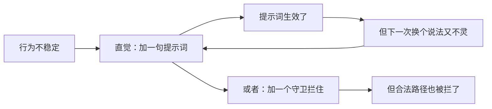
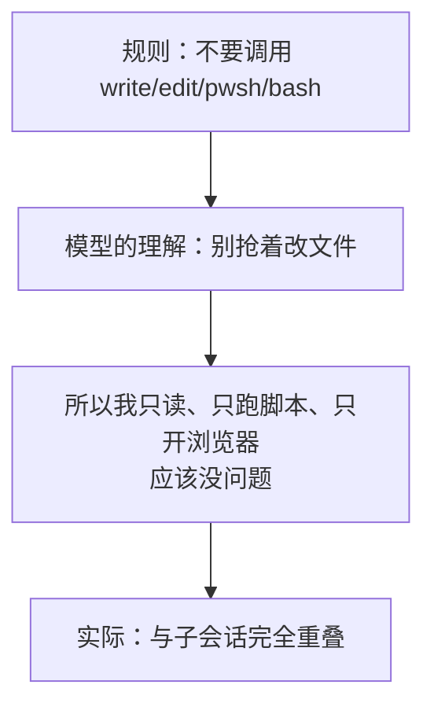
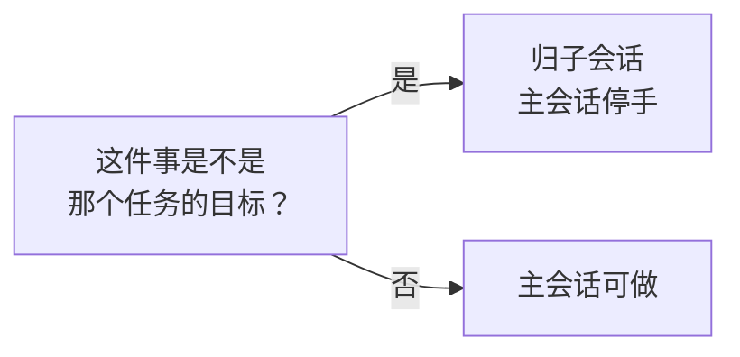
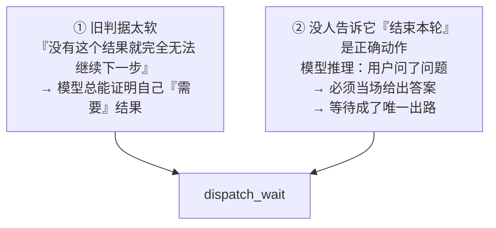
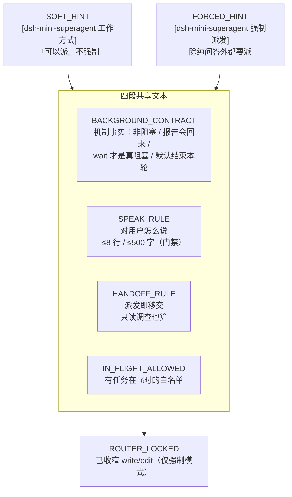
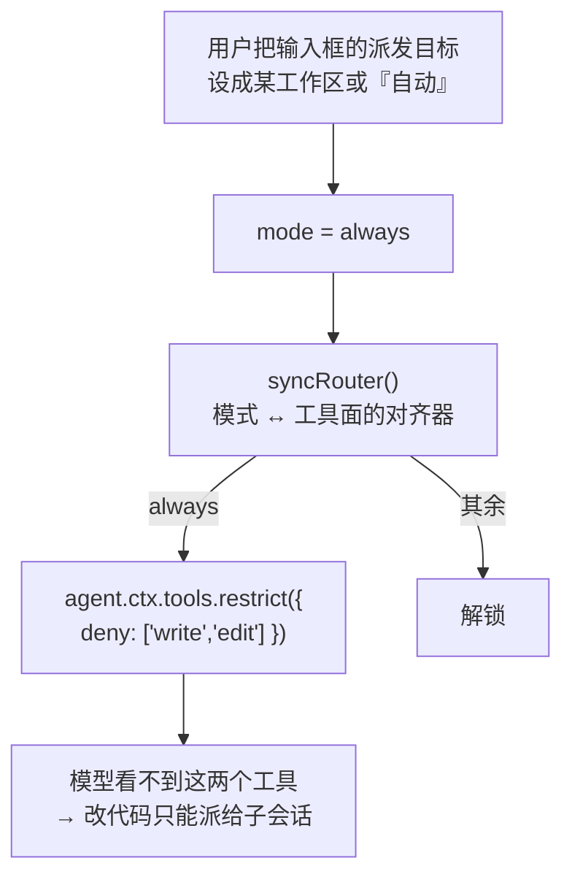
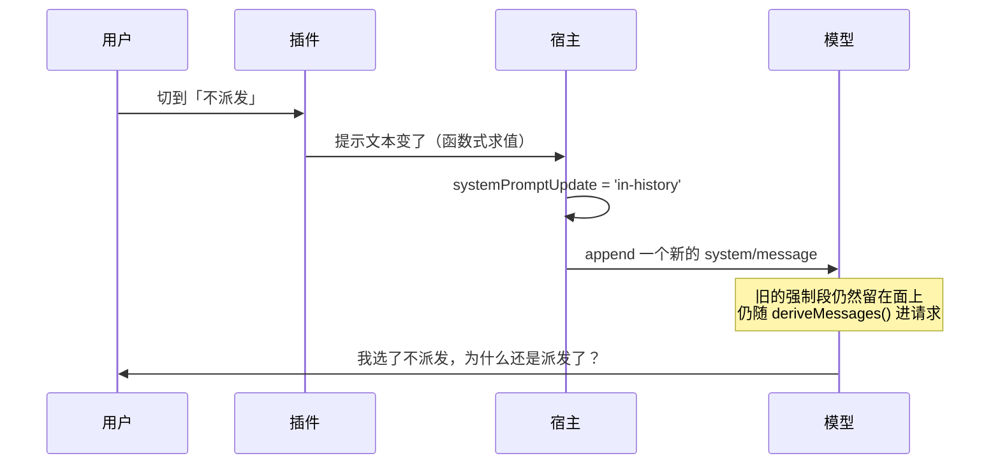
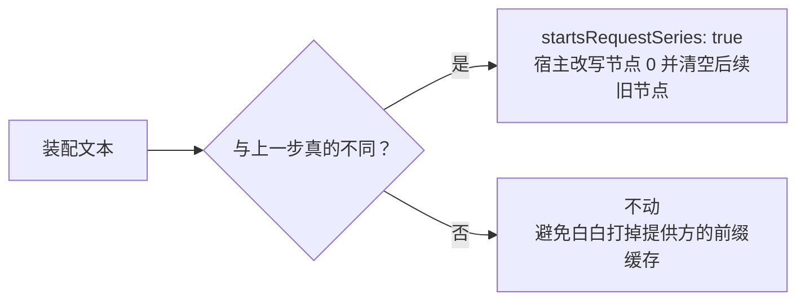
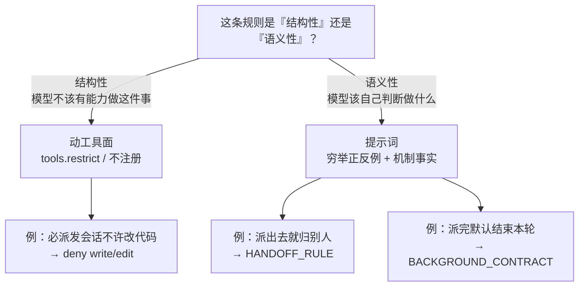

# dsh-mini-superagent 06：路由模式与两条提示词契约（内部 0.8.1 / npm 0.9.0）

> **代码仓库**：[wychmod/dsh-mini-superagent](https://github.com/wychmod/dsh-mini-superagent)
> **本章目标**：理解「派发即移交」与「派发后结束本轮」这两条硬约束各自对应哪次真实事故，以及「结构性约束 vs 提示词约束」的分界线画在哪里。
> **对应提交**：`2824ef3`（路由模式 + 后台活占位 + 每任务目录）→ `c51d4ef`（派发即移交与 `dispatch_wait` 硬边界）→ `3cf7473`（用例覆盖）→ `5337105`（事故依据入档）→ `1dcca1f`（切模式后提示段收敛）。
> **原文对照**：`docs/architecture.md` 决策 21 与 §25，`docs/tools.md` 的「派发即移交」与 `dispatch_wait` 两节。

---

## 目录

- [一、这一版要修的东西不是代码](#一、这一版要修的东西不是代码)
- [二、事故一：派出去之后，主会话又把活干了一遍](#二、事故一：派出去之后，主会话又把活干了一遍)
- [三、事故二：连续等 33 分钟，零产出](#三、事故二：连续等-33-分钟，零产出)
- [四、两条契约怎么写的](#四、两条契约怎么写的)
- [五、路由模式：唯一的「结构性」约束](#五、路由模式：唯一的「结构性」约束)
- [六、切模式为什么要开新请求序列](#六、切模式为什么要开新请求序列)
- [七、核心讲解：什么时候该用提示词，什么时候该动工具面](#七、核心讲解：什么时候该用提示词，什么时候该动工具面)
- [八、使用建议](#八、使用建议)

---

## 一、这一版要修的东西不是代码

0.7.0 与 0.8.0 修的都是**代码缺陷**：状态能被覆盖、落盘不原子、越权读取。这些有明确的对错。

紧跟其后的那一批改动（仓库内部按 `0.8.1` 记账，npm 上合在 `0.9.0` 里发布）修的是另一类问题：**模型的行为**。它没有对错，只有「这个行为在大多数时候是否可接受」。

这类问题的麻烦在于：



这一版做了两个判断：

1. **能用提示词的地方，把措辞写成「机制事实 + 穷举反例」，而不是「请尽量」。**
2. **必须结构性约束的地方，动工具面（`tools.restrict`），而不是继续加提示词。**

分界线在第六节。

## 二、事故一：派出去之后，主会话又把活干了一遍

### 事故形态

主会话把「只读定位某个现象的根因」派给子会话之后，**自己又干了一遍**：

| 主会话做的 | 与子会话的重叠 |
|---|---|
| 读了三个源码模块 | 完全重叠 |
| 跑了 30000 局模拟 | 完全重叠 |
| 跑了候选手合法性穷举 | 完全重叠 |
| 开浏览器复现并截图 | 完全重叠 |
| 查了 git 历史 | 完全重叠 |
| 解析了历史录像 | 完全重叠 |

最后两边给出同一结论。**成本翻倍，还因为两边同时读写同一个目录而互相干扰。**

### 根因：枚举不完

旧文案写的是：

> 不要自己调用 `write` / `edit` / `pwsh` / `bash` 去完成派发出去的工作

这句话只点名了**写操作**。模型于是合理地认为「我只是读一读、跑个脚本看看」不算重做——在它的理解里，那条规则说的是「别抢着改文件」。



**为什么不能靠继续列工具名补完**：`read` / `grep` / `glob` / `node -e` / 浏览器 / 网络……永远列不全。而且每加一个名字都在暗示「没列的可以」。

### 修法：判据从「工具名」换成「意图归属」



新文案把移交范围写成**穷举示例**，并明确写出「**只读调查同样属于移交范围**」，再加一条自检：「正要做的操作与在跑任务重叠就停手」。

派发之后，主会话对该任务**只剩两个动作**：读报告、`dispatch_message`。

## 三、事故二：连续等 33 分钟，零产出

### 事故形态

同一次事故里，主会话连续调了约 10 次 `dispatch_wait`：

```text
180 / 240 / 300 / 180 / 180 / 180 / 120 / 120 / 180 / 240 秒
累计约 33 分钟原地阻塞，期间零产出
```

### 根因不是「不知道它会阻塞」

旧文案**已经写了**「`dispatch_wait` 是真的阻塞」。所以问题不在信息缺失。

真正的根因是两件事：



第 ② 条是**认知层面的错位**，不是规则层面的。模型不是不听话，是它对「怎么算完成一轮」的理解与设计者的预期不同。

### 修法：把「结束本轮」写成合法终点

新文案做了四件事：

| 做法 | 具体写法 |
|---|---|
| 明确合法终点 | 「**结束本轮 ≠ 没回答**：你在这一轮末尾说的那段话就是回答（哪怕只是『已派发，报告回来我汇总』）」 |
| 绑定用户原话 | 允许等待的情形**只在用户于同一条消息里明确要求**「等结果再继续」时成立 |
| 逐条否定自我说服 | 点名否定三种推理：「等一次看看」「等着比结束省事」「用户问了就必须当场答」 |
| 给量级 | 把「约 33 分钟」这个数字写进去——没有量级的警告读起来像模板话术，会被当口头禅跳过 |

第四条最容易忽略：**警告必须带量级，否则会被当成套话。**

## 四、两条契约怎么写的

四条共享文本（`BACKGROUND_CONTRACT` / `SPEAK_RULE` / `HANDOFF_RULE` / `IN_FLIGHT_ALLOWED`）由两种模式（轻提示 / 强制派发）**共享同一份常量**，按同样顺序拼进各自正文。



**为什么共享同一份常量而不是各写一遍**：

> 两处各写一遍就会漂移，而且之前确实漂过：强制版写「派下去，然后结束本轮」，读起来像「派完就没事了」，完全没交代报告会回来；轻提示版又只讲工具能力，没讲这层契约。模型同时看到两套语义时，行为取决于它先信哪一段。

一个更细的取舍：**`SPEAK_RULE` 的位置不是排版问题。** 它夹在机制契约与移交规则中间，凑成「先讲机制 → 再讲表达 → 最后讲职责」。

> 放到最前面会让「先认领任务」被读成又一条**动作规定**，而它实际是表达方式；动作与语气混在一起时，模型只会保住动作、丢掉语气。

还有长度门禁：`SPEAK_RULE` 受 `test/voice-prompt.test.js` 约束，**≤ 8 行、≤ 500 字**，而且量的是**装配后的真实提示文本**，不是源码字符数。

理由写得很直白：

> 提示词继续膨胀会稀释每条规则，所以加内容前先删一段重复解释。

## 五、路由模式：唯一的「结构性」约束

前两条都是提示词。但有一件事提示词拦不住：**模型仍会在「派活」和「自己干」之间摇摆，两边同时改同一个项目。**

`FORCED_HINT` 第 3 条只能劝。所以这一版加了 `restrictRouter`：



### 五条硬规则

| 规则 | 内容 | 为什么 |
|---|---|---|
| 只对强制模式生效 | 判据是 `modeOf()` 返回 `always` | 「不派发」是默认选项，不能因为派过一次就永久收走工具 |
| 切回「不派发」立刻解锁 | `setTarget()` 会调 `syncRouter()` | 用户的当场意图必须立刻生效 |
| 触发点是**模式**，不是「派发过一次」 | 初版按「第一次派发」判定，已改 | 那等于用插件的假设覆盖用户的当场意图 |
| worker 不受影响 | `table.byWorker(agent.id)` 命中就跳过 | 收窄它等于让它干不了活 |
| 可逆 | `restrictRouter: false` 全局关；卸载/会话销毁也回收 | 不留残余 |

### 为什么用 deny 而不是 allow

| 方案 | 问题 |
|---|---|
| `allow` 白名单 | 各部署的工具集不一样；写死一份会顺手把我们不认识的工具（包括本插件自己的 9 个）一起收走 |
| `deny` 点名 | 只碰点名的两个，缺哪个跳哪个；`restrict` 对未知名字会抛错，所以 `restrictTools` 还要先过滤 |

### 边界必须说清

**`bash` 默认保留，所以 `echo > file` 依然能写文件。** 这与上游一致（它的 router preset 也留着 shell，为的是 `git status` 这类只读命令）。要硬边界就把 `routerDenyTools` 配成 `['write','edit','bash','pwsh']`。

这一条被写进 README 的「已知限制」，用词很直接：「**`maxWorkers` 是软的**」「**`bash` 默认保留，`echo > file` 依然能写文件**」。不假装它是一道密不透风的墙。

## 六、切模式为什么要开新请求序列

这是全篇技术含量最高的一段，也是最容易踩的坑。

0.6.0 的实现是「提示文本是函数，下一轮换文案」。这**只说对了一半**。

真相是：宿主对**变化的提示是追加，不是替换**。



实测证据（写在 README 里）：本机会话的 `session-<redacted>` 面上叠着**三份** `system/message`——turn 1 强制段、turn 2 强制段、turn 7 轻提示，三份都还在。

### 修法

插件在**装配文本相对上一步真的变了**时，通过 `agent/pre-step` 返回 `startsRequestSeries: true`，把收敛交回宿主自己的机制。



**为什么要判「真的不同」**：无条件开新序列会让每一轮都清空历史提示节点，等于每轮都丢掉提供方的前缀缓存——成本和延迟都会涨。

## 七、核心讲解：什么时候该用提示词，什么时候该动工具面

这是这一版留下的最重要的一条判断标准：



判据其实很简单：**问「能不能用一条守卫拦住」**。

| 规则 | 能否用守卫 | 结论 |
|---|---|---|
| 必派发的会话不许改代码 | 能——`deny` 两个工具名即可 | 结构性，用 `restrict` |
| `dispatch_wait` 不该滥用 | **不能**——「用户真的要求等结果」时它是对的调用，插件无法判定那句话在不在用户原话里 | 提示词 |
| 派发后主会话不该重做 | **不能**——「重做一遍」在工具层面与「做另一件相关的活」无法区分（都要 `read` / `pwsh`） | 提示词 |
| 报告该不该回流主会话 | 能——按状态判定 | 代码（准入分级） |

**这个判断的价值在于它阻止了两类错误**：

1. **不该用守卫时用守卫**：会误伤合法路径（主会话合法的只读问答）。
2. **该用守卫时用提示词**：永远不可靠，因为模型总会为违规找到理由。

代价也如实记了：这两条提示词契约的防回归靠 `test/handoff.test.js` 的**文本断言**——测的不是行为，是「文案还在」。这是一个诚实的降级：行为无法自动验证，只能守文案。

## 八、使用建议

### 如果你在用这个插件

1. **别把 `dispatch_wait` 当 sleep。** 它阻塞的是当前 step，超时回来任务可能还在跑，再等一次只是再阻塞一次。
2. **想让「这个会话只路由」，就把派发目标设成具体工作区。** 这是唯一会真正收走 `write`/`edit` 的开关。
3. **要硬边界就配 `routerDenyTools: ['write','edit','bash','pwsh']`。** 默认保留 `bash` 是有意的（只读命令要用）。
4. **别指望提示词能管住一切。** 如果你在自己项目里也遇到「模型反复重做派出去的活」，先想清楚这件事能不能用守卫拦——不能的话，就得把规则写成「判据 + 穷举反例 + 量级」。

### 如果你在写自己的 Agent 系统

这三条经验可以直接抄：

| 经验 | 具体做法 |
|---|---|
| 警告要带量级 | 「约 33 分钟、零产出」比「可能很久」有用一个量级 |
| 判据要可操作 | 「同一份产物 / 同一条工作线」是形容词；「改完 A 再改 A 的样式」是样例 |
| 明确合法终点 | 模型不知道「结束本轮」算不算完成，就必须写出来 |

**最有价值的一条**：把「机制事实」和「行为要求」分开写。前者是「报告会自动回来」，后者是「所以你不必等」。混在一起写，模型只会记住后者是建议。

---

> **下一篇**：行为问题处理完了，接下来是**体积**问题。任务越派越多，账本越来越胖、会话历史越来越长。0.9.0 的记忆治理要回答：哪些是事实、哪些只是投影、该在哪一层压缩？
