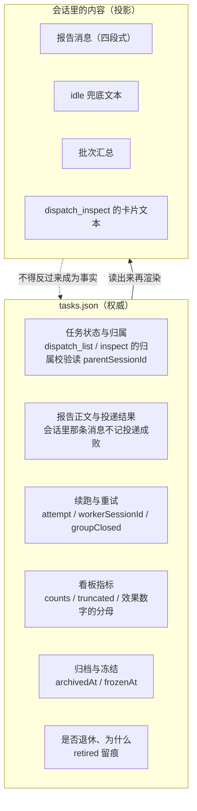
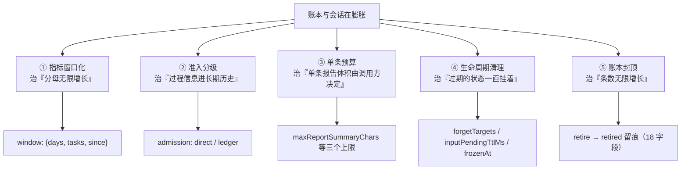
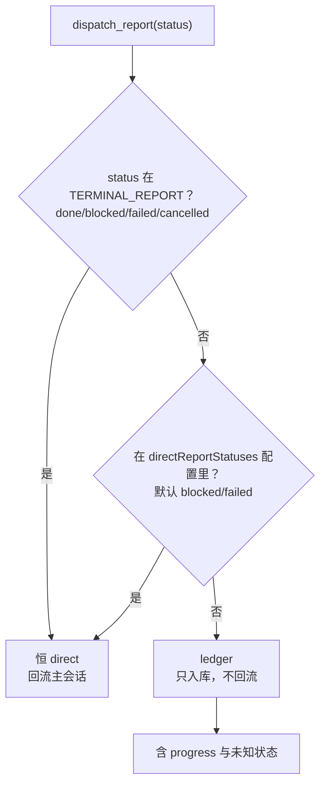
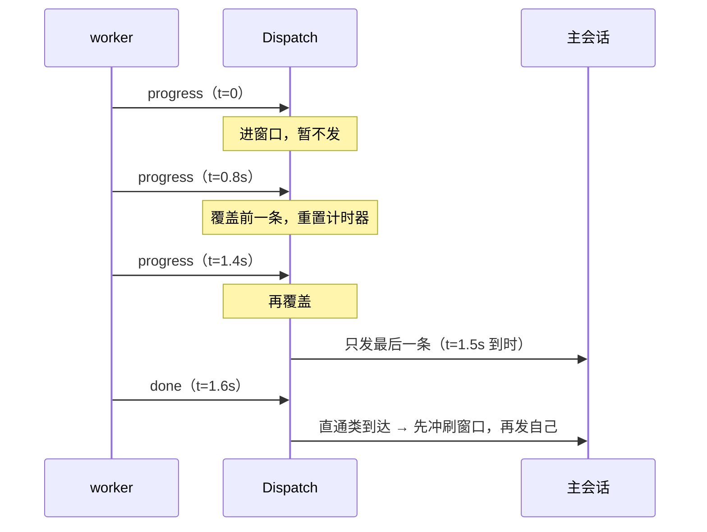
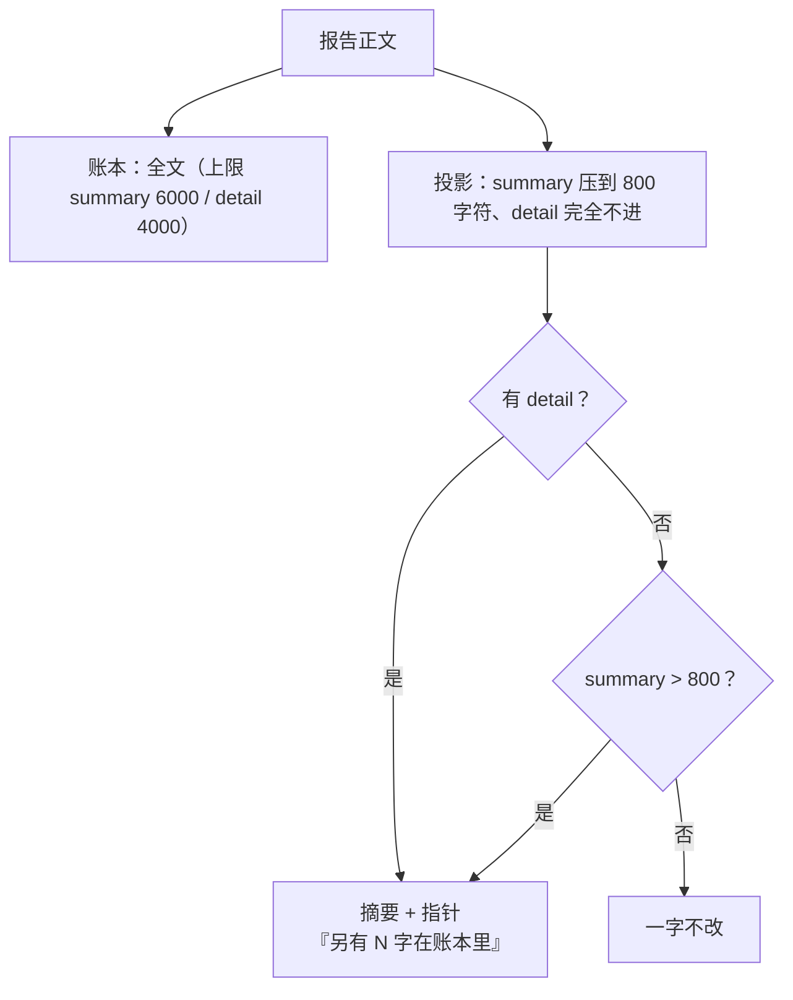
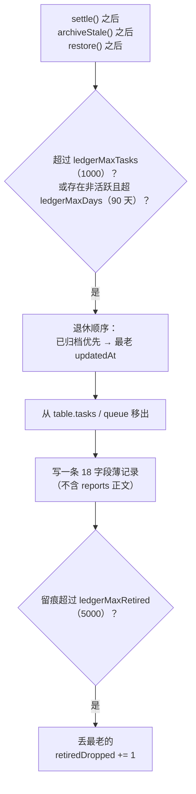
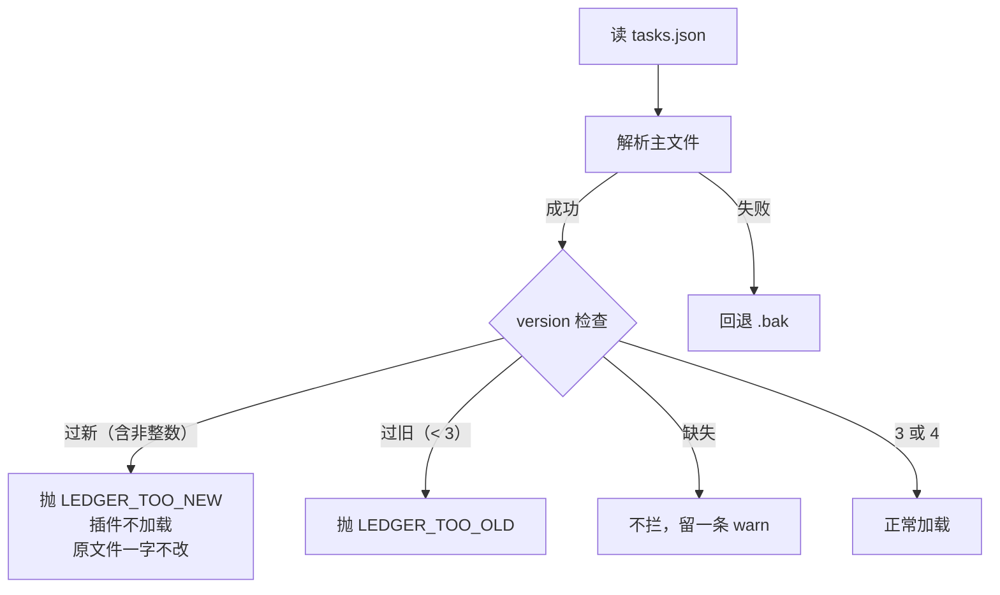
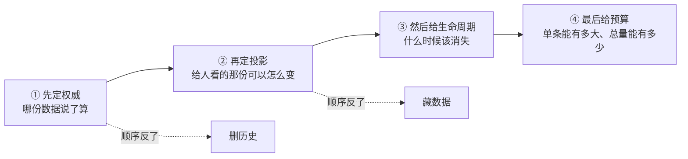
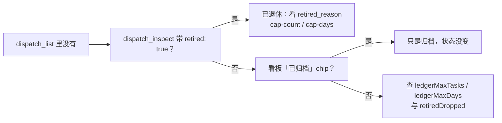

# dsh-mini-superagent 07：记忆治理——权威源与投影（0.9.0 核心）

> **代码仓库**：[wychmod/dsh-mini-superagent](https://github.com/wychmod/dsh-mini-superagent)
> **本章目标**：理解「账本是派发事实的唯一权威、会话是可重建的投影」这条口径，以及它如何推导出准入分级、单条预算、合并窗口、账本封顶、退休留痕五个机制。
> **对应提交**：`f05f610`（记忆治理 P0 五项）→ `57a51d1`（指标窗口化与「已退休」chip）→ `041ccdc`（口径入档）→ 0.9.0 的 P1 两条。
> **原文对照**：`docs/architecture.md` §26–§29（这是全项目最长的一节），`CHANGELOG.md` 0.9.0 的「记忆治理 P0」段。

---

## 目录

- [一、问题：数据在长大的时候，语义在漂移](#一、问题：数据在长大的时候，语义在漂移)
- [二、权威源：一条曾经写错、必须否定的口径](#二、权威源：一条曾经写错、必须否定的口径)
- [三、五个治理机制，各治一种膨胀](#三、五个治理机制，各治一种膨胀)
- [四、准入分级：谁能叫醒主会话](#四、准入分级：谁能叫醒主会话)
- [五、单条预算：入库即截断](#五、单条预算：入库即截断)
- [六、P1 降噪：合并窗口与事实/投影分离](#六、p1-降噪：合并窗口与事实投影分离)
- [七、账本封顶与退休留痕](#七、账本封顶与退休留痕)
- [八、核心讲解：先定权威，再定投影，然后给生命周期和预算](#八、核心讲解：先定权威，再定投影，然后给生命周期和预算)
- [九、使用建议](#九、使用建议)

---

## 一、问题：数据在长大的时候，语义在漂移

到 0.8.x，这个插件的账本已经装了：

| 事实 | 存在哪 |
|---|---|
| 任务状态与归属 | `tasks.json` |
| 报告正文 | `task.reports` |
| 投递成败 | `task.delivery` |
| 重试次数 | `task.attempt` |
| 归档时刻 | `task.archivedAt` |
| 派发目标 | `targets` |

而会话历史里还有一份：每条回流报告都是一条 `user/message`。

**两份数据会分叉。** 会分叉就有取舍：哪份说了算？哪份可以压、可以丢？

0.8.x 之前的答案是错的——`store.js` 的注释写着「任务表是辅助信息，丢了不影响子会话」。

## 二、权威源：一条曾经写错、必须否定的口径

架构文档 §26 把这件事写得很硬：

> **旧口径（错的，已被本文取代）**：`src/store.js` 的注释与更早的 README 都写着「任务表是辅助信息，丢了不影响子会话」。**这个说法必须明确否定。**
> 它错在把「会话内容由 DSH 持久化」这件事，误推成「任务表也可以丢」——两者不是同一份事实。

### 事实清单：只有账本知道的六类东西



**投影的三条自由与一条禁令**：

| 投影可以 | 投影不可以 |
|---|---|
| 更短（`clip` 压缩） | 反过来成为事实 |
| 丢失（主会话不在时 `dropped`） | 独占某个事实 |
| 重放（重启后从账本重建） | 被当作唯一副本 |

一句话记法（架构文档原话）：**先定权威，再定投影，然后给生命周期和预算。顺序反了就会变成「删历史」或「藏数据」。**

### 为什么当初会写错

这段历史是「文档漂移」的标准样本：


## 三、五个治理机制，各治一种膨胀



## 四、准入分级：谁能叫醒主会话

这是五个机制里影响行为最大的一个。



**这条最容易反直觉，所以文档反复强调**：

> **终态硬直通，配置只能扩展、不能降级。** 把 `directReportStatuses` 清空**不会**让 `done` 静默——`admissionOf()` 对终态恒 `direct`。

为什么必须这样：

| 如果允许降级 | 后果 |
|---|---|
| 用户把 `done` 配成静默 | 主会话**永远等不到「做完了」** |
| 结论与「需要人处理」是主会话唯一必须知道的两类事 | 任何配置都不该把它们降级 |

配置的唯一用途是**扩大**——比如把 `progress` 加进去，换回 0.8.x 的旧行为（那时所有 progress 都会回流）。

### progress 默认不回流的意义

这是「过程信息不该进会话长期历史」的具体落地：

| | 回流 | 后果 |
|---|---|---|
| 旧行为 | 每条 `progress` 都回流 | 一个跑 20 分钟的任务能塞 10 条进度进会话，**挤占上下文且读完没信息量** |
| 新行为 | 只入库 | `dispatch_inspect` 看得到，主会话不会被叫醒 |

而「结论」的保证一点没降：`done` / `blocked` / `failed` / `cancelled` 恒直通。

### 批次汇总的例外

批次成员的终态**只入库**，整批结束由 `maybeSummarize()` 汇总一条。但如果成员静默 + 汇总静默 = **整批静默**。所以：

> 批次汇总本身**恒 `direct`**——`admissionCounts` 在 `maybeSummarize()` 里直接记一次 direct。

## 五、单条预算：入库即截断

0.8.x 只在**外发时**截断，账本里存的是调用方给的原样长度。**「单任务体积由调用方决定」是容量膨胀的根之一。**

0.9.0 改成入库即截断：

| 字段 | 上限 | 说明 |
|---|---|---|
| `headline` | 120 字符（`HEADLINE_LEDGER_MAX`） | 一句话给用户看的结论 |
| `summary` | 6000 字符 | 入库上限 |
| `detail` | 4000 字符 | 只进账本，不随报告回流 |
| `lastText` | 5000 字符 | worker 最后一段输出 |

被截的条目记 `entry.truncated = { summary: 原始长度, detail: 原始长度 }`——**只在真被截时出现这个键**（一个恒存在的空对象会让「是否截过」永远为真）。

### `clip()` 不是「截到恰好 N 字」

这一条被单独写进文档，因为它是反直觉的：

```text
clip(text, limit) 超长时头尾各半
并在中间插一句 \n…（已截断 X 字符）…\n
而提示语本身也占这 N 的预算（bodyBudget = limit - 40）
```

所以 `clip('a'.repeat(1000), 200)` 的实际总长 **≤ 200**，不是「200 字正文 + 提示」。

极端小 `limit` 下干脆硬截到 `limit`。这条在 0.6.0 之前是 `limit - 400` + `slice(-400)`，`limit < 400` 时输出反而比 `limit` 还长（实测 417 字）。

> **复核时发现的一处小偏差**：那句「已截断 X 字符」里的 X 是按 `value.length - cap` 算的，而真实丢弃是 `value.length - bodyBudget`（`bodyBudget = cap - 40`）。实测 `clip` 掉 5000 字、`cap=200` 时，文案写「已截断 4800 字符」，实际丢弃 4840 字符——**少报 40，恒定偏移。** 长度上限本身没问题（输出 176 ≤ 200），错的只是这句提示的计数。这类偏差不影响功能，但它恰好说明「给人看的数字」和「给机器判的数字」得分开验。

#### 这个偏差可以自己复现（全系列唯一一处动手实验）

不用读源码，一行命令就够。在**包目录**（含 `package.json` 的那一层）执行：

```bash
node -e "
import('./src/tasks.js').then(m => {
  const out = m.clip('x'.repeat(5000), 200)
  console.log('输出长度:', out.length)
  console.log('文案声称:', out.match(/已截断 (\d+) 字符/)[1])
})"
```

预期输出：

```text
输出长度: 177
文案声称: 4800
```

三个数字各有含义，**第三个和它们都对不上**：

| 观察 | 值 | 说明 |
|---|---|---|
| 输入 | 5000 | 原始长度 |
| 输出 | 177 | ≤ `cap`（200），**长度上限是对的** |
| 文案声称丢弃 | 4800 | `5000 − 200` |
| 实际丢弃 | **4840** | `5000 − 160`，因为 `bodyBudget = 200 − 40 = 160` |

**差 40，正好是提示语本身的预算。** 把 `cap` 换成 500、1000 再跑一次，差仍然是 40——它是**恒定偏移**，不是随机误差。

**这个实验的价值不在「找到一个 bug」**，而在它示范了一种验收方式：当一个字段同时被「机器判」（`out.length <= cap`）和「给人读」（文案里的数字）使用时，**两条路径必须分开验**。只验前者，后者会安静地错很久——账本对、单测绿、只有那句提示在骗人。

### 内外同一口径是有意的

否则会出现「库里 10 万字、`dispatch_inspect` 看到残版、主会话看到另一个残版」的**三方错位**。

## 六、P1 降噪：合并窗口与事实/投影分离

P0 管「写不写进账本」，P1 管「**写进会话的那一份有多长、隔多久**」。

### P1-1 合并窗口



**语义是「后一条覆盖前一条」**，与节流的区别很关键：

| 机制 | 丢什么 | 保证什么 |
|---|---|---|
| 节流（`progressRelayIntervalMs`） | 丢「当前态」——一分钟只剩一条 | 没有保证 |
| 合并（`noticeMergeWindowMs`） | 丢「中间态」 | **最后的进度一定送达** |

三条硬规则：

1. **只有 `progress` 可合并。** 终态、批次汇总、启动失败、回合兜底**永不参与**。
2. **合并键是 `taskId`**，不是会话——跨任务合并会让人读不出「哪条在做什么」。
3. **直通类到达时先冲刷窗口**再发自己。不做这一步，结论会先于过程到达，因果颠倒。

硬上限 2000ms，配更大被截断。回退开关 `noticeMergeWindowMs: 0`。

### P1-2 事实/投影分离

这是「投影可以更短」从原则变成动作：



三个「不做」：

- **不用 `clip()`**：它会在中间插一段带换行的提示，把单行的【说明】撑成三段，四段式的「一行一段」直接破掉。投影要的是「取开头 + 一句指针」。
- **预算内的短报告一字不改**：实测典型报告 34–120 字，压它们只会凭空制造信息损失。
- **账本一个字都不压**：`#admitEntry()` 写的 summary / detail 与本函数无关。

## 七、账本封顶与退休留痕

### 退休（retire）不是归档（archive）

这两个词中文里都像「收起来了」，后果完全不同：

| | 归档 archive | 退休 retire |
|---|---|---|
| 标记字段 | `archivedAt` + `frozenAt` | `retiredAt` + `retiredReason` |
| 还在活表里吗 | **在** | **不在** |
| 参与指标吗 | 不参与 | 不参与 |
| 报告正文能看到吗 | 看得到 | 看不到（只留 200 字摘要） |
| 谁触发 | 巡检 / `POST /archive` | `enforceLedgerCap()` |
| 能否撤销 | 会话可从归档恢复 | **不能** |



**为什么不搬报告正文**：搬正文等于把容量上限换了个地方存，`ledgerMaxRetired` 就成了笑话。

**为什么 `retiredDropped` 不落盘**：它是「本次进程内丢弃了多少条留痕」，不是累计值。这一点必须写明，否则用户会对不上号——看到 `dropped: 1` 之后重启，数字变 0 会以为「数据回来了」，而真相是新进程还没丢过任何东西。

### 存储格式 v4 的版本闸门



三个细节都是有意的：

1. **判定点在主文件解析成功后立刻**，早于任何 `.bak` 回退——否则「主文件 v99 + 备份 v4」会被备份救活，等于白拦。
2. **缺失 `version` 不拦**：现有「缺字段按空读」已能完整覆盖它的形状。
3. **`OLDEST_FILE_VERSION = 3` 而不是 4**：v3 只差 `retired` 一个键，取 4 会把 0.7.x 用户挡在门外，等于用一次格式校验制造一次不可升级。

## 八、核心讲解：先定权威，再定投影，然后给生命周期和预算

这十二个字是这个项目最可迁移的一条方法论。它解释了五个机制为什么长这样：



**为什么顺序不能反**：

| 反了会怎样 | 具体表现 |
|---|---|
| 先定投影、后定权威 | 两份数据分叉时不知道该信谁；压缩时不知道该压哪份 |
| 先定预算、后定生命周期 | 你会为了「省空间」去删还在用的东西 |
| 没有生命周期、只有预算 | 总量封顶了，但旧数据永远不消失，等于慢性泄漏 |

**一条配套的工程约束**：权威性靠**单写入口**保证。

- `TaskTable.transition()` 是状态唯一写入口；
- 账本封顶只从 `Dispatch.enforceLedgerCap()` 一个地方动删除；
- 退休只经 `#retire()`。

这不是洁癖——**只要有两个地方能删数据，就没有人能解释「这条为什么不见了」。**

## 九、使用建议

### 配置建议（按「你想让它活多久」调）

| 目标 | 配置 |
|---|---|
| 看板只关心最近一周 | `memoryWindowDays: 7`（默认），`archiveAfterHours: 168`（默认） |
| 别让我看见太多历史 | `ledgerMaxDays: 30`，`ledgerMaxTasks: 500` |
| 我要留全量审计 | `ledgerMaxTasks: 0`（不限制）+ 自己备份 `tasks.json` |
| 进度信息很烦 | 保持 `progress` 不在 `directReportStatuses` 里（默认） |
| 我就要看每条进度 | 把 `progress` 加进 `directReportStatuses`，并用 `progressRelayIntervalMs` 节流 |

### 四条常见误读

1. **「清空 `directReportStatuses` 就能关掉 `done` 回流」** —— 不行，终态恒直通。
2. **「已退休记录还能查到报告正文」** —— 不能，只留 18 个字段（身份、时刻、原因、关系、200 字摘要），`reports` 正文随记录消失。
3. **「`retiredDropped` 变小说明数据回来了」** —— 不，它是进程内计数，重启归零。
4. **「归档 = 退休」** —— 归档的在活表里、正文可查；退休的不在活表里、只有摘要。

### 一条排障口径

看到「任务不见了」时，按这个顺序查：



---

> **下一篇**：账本治理好了，但看板还是一张「流水账」。0.9.0 把它从列表重装成指挥台——三段式分区、五个 chip、四个效果数字，以及两套刻意不同的统计口径。
>
> 继续读：[第 08 篇](/md/10-项目实战/04-DSH任务派发插件/08-看板重装与统计口径.md)
