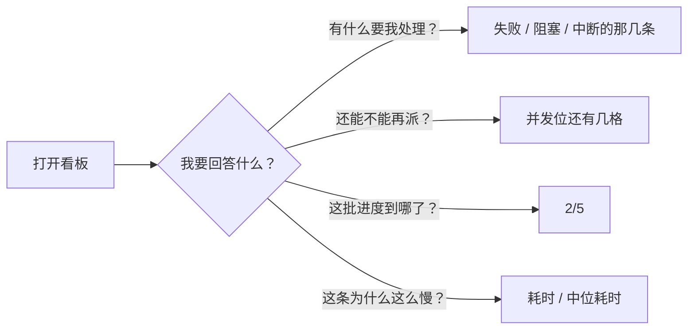
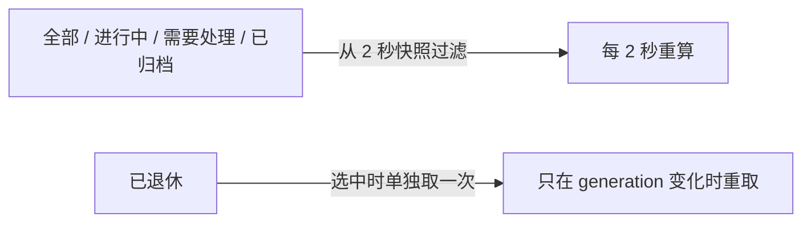
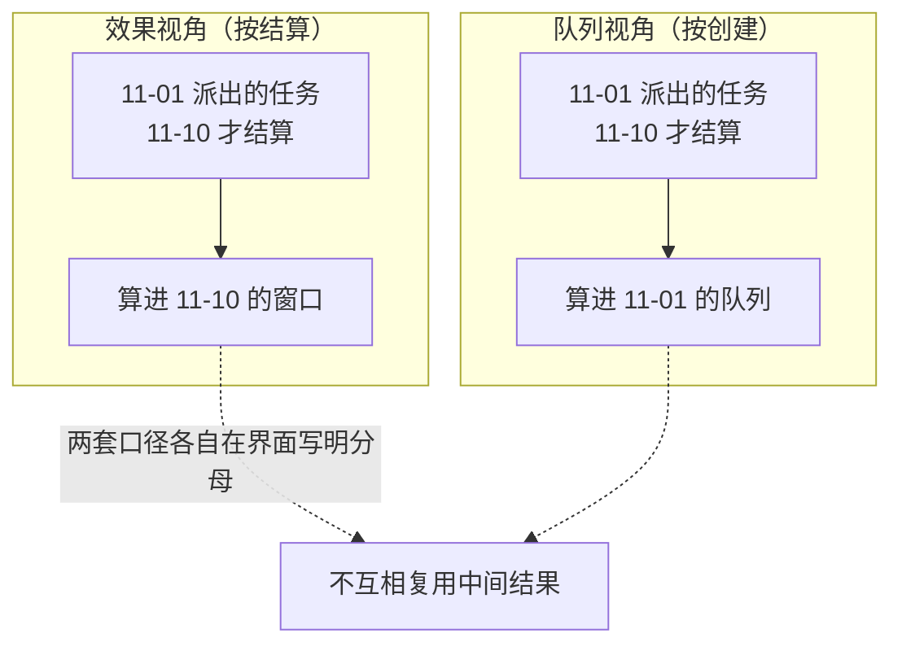
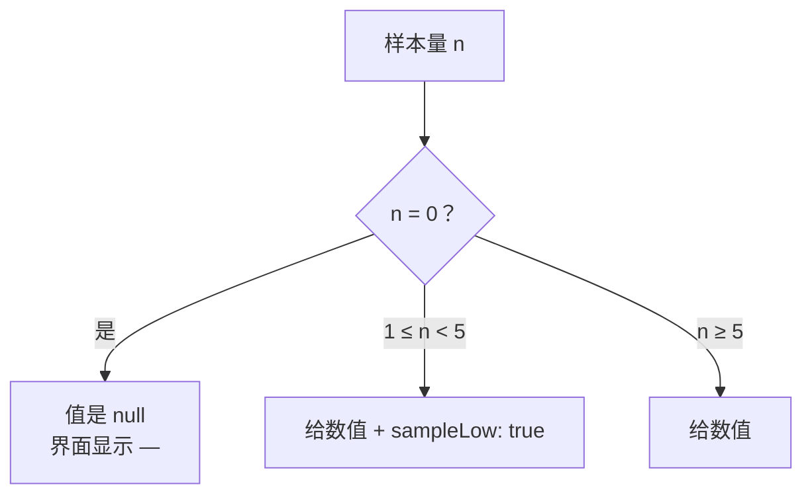
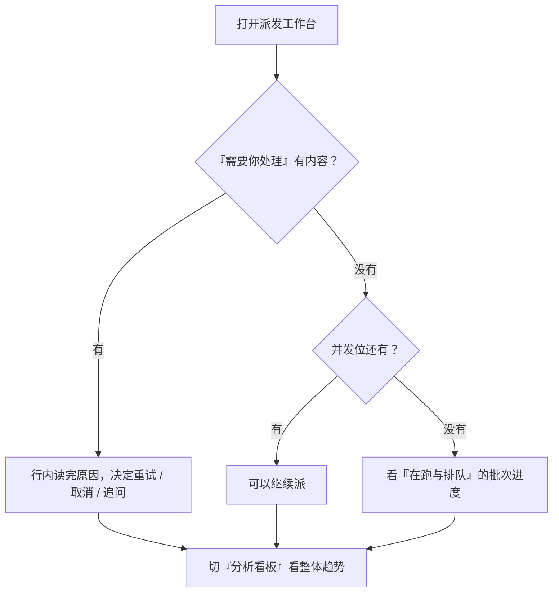

# dsh-mini-superagent 08：看板重装与统计口径（0.9.0 / 0.9.1）

> **代码仓库**：[wychmod/dsh-mini-superagent](https://github.com/wychmod/dsh-mini-superagent)
> **本章目标**：看懂「流水账 → 指挥台」这次重排的信息架构，以及为什么同一个看板里要有两套**刻意不同**的统计口径。
> **对应提交**：`1de078c`（看板从流水账改成指挥台）→ `a0c1ff7`（统计聚合与文案层两个纯函数模块）→ `74e40fb`（统计口径地基）→ `e1bdf33` / `bfb3218`（分析看板）。
> **原文对照**：`docs/board.md`（1092 行）、`plans/06-board-redesign.md`、`plans/09-board-analytics.md`。

---

## 目录

- [一、问题：一张列表回答不了「现在要我做什么」](#一、问题：一张列表回答不了「现在要我做什么」)
- [二、三段式：把列表按「要不要我管」切开](#二、三段式：把列表按「要不要我管」切开)
- [三、五个 chip 与一条并发条](#三、五个-chip-与一条并发条)
- [四、四个效果数字，每个都能追到分子分母](#四、四个效果数字，每个都能追到分子分母)
- [五、两套刻意不同的口径](#五、两套刻意不同的口径)
- [六、不编造指标：代理字段怎么标](#六、不编造指标：代理字段怎么标)
- [七、核心讲解：n=0 时必须给 null，不能给 0](#七、核心讲解：n0-时必须给-null，不能给-0)
- [八、使用建议](#八、使用建议)

---

## 一、问题：一张列表回答不了「现在要我做什么」

0.3.0 的看板是一张按状态排序的列表。它的隐含假设是「用户想知道所有任务的当前状态」。

但真实使用不是这样。真实使用是：

一张流水账列表**一个都回答不了**——它把答案混在几十行里，要你自己找。

## 二、三段式：把列表按「要不要我管」切开

重排的核心是放弃「一个列表 + 排序」，改成**三个语义分区**：

三个分区各自回答一个问题：

| 分区 | 回答 | 关键设计 |
|---|---|---|
| 需要你处理 | 「我该干什么」 | **行内直接给原因**，不用点进子会话才知道它为什么停住 |
| 在跑与排队 | 「还要等多久 / 哪条跑偏了」 | 耗时超过中位转橙——一眼看出哪条异常 |
| 最近完成 | 「刚才那批成了没」 | 默认 5 条，不占屏幕 |

**这一条最要紧**：「需要你处理」分区**行内直接给原因**。

这一条看起来只是排版，实际是**减少一次导航**：用户看到「失败」，第一反应是点进去看为什么；如果原因就在行上，这一次点击就省了。而这个面板是 2 秒刷新一次的常驻面板——少一次点击，一天下来省的是几十次上下文切换。

## 三、五个 chip 与一条并发条

### chip 的语义边界

| chip | 判据 | 数从哪来 |
|---|---|---|
| 全部 | `!archived_at`，**不含已归档** | 按当前工作区筛选后计算 |
| 进行中 | 未归档且 `running` / `queued` | 同上 |
| 需要处理 | 未归档且 `failed` / `interrupted` / `blocked` | 同上 |
| 已归档 | `archived_at` 非空 | 同上 |
| **已退休** | **不从快照取数** | `counts.retired`（即 `memory.retired.count`） |

**第五个 chip 是特殊的**：退休记录根本不在 `tasks` 数组里，所以它的 `match` 恒为 `false`，选中时才触发一次 `GET /board/retired`。

**为什么不跟着轮询**：退休记录一旦生成就不再变化（它描述的是「已经消失」这件事），跟着快照每 2 秒拉一次纯属浪费，也会让视图在手滑时闪。

**空态要分三种，不能混成一句「没有」**：

| 情形 | 文案 |
|---|---|
| `memory` 为 `null` | 「宿主未提供退休记录」——旧版 / headless，**不是**「没有退休记录」 |
| 取数失败 | 「退休记录暂时取不到：<原因>」 |
| 真的空 | 「没有被退休的任务」 |

这三句话的区别，就是「你不知道」与「你知道是零」的区别。混成一句，用户永远分不清是功能缺失还是真的没有。

### 并发条：4px 换来了什么

头部已经有两个数字（并发 2/6、排队 1）。再加一条 4px 的进度条，看起来是重复。

但**数字要读，条形要看**。在「还能不能再派」这个判断上，条形比数字快——你不需要算出 2/6 还剩 4 格，你直接看见进度条还空着大半。

## 四、四个效果数字，每个都能追到分子分母

| 数字 | 口径 | 注意 |
|---|---|---|
| 完成 | `counts.done` | —— |
| 成功率 | `done / (done + ended + failed + blocked + interrupted)` | **取消不进分母** |
| 平均耗时 | **中位数** | 不是平均数 |
| 并行节省 | `max(0, Σ占用 − 墙钟跨度)` | 粗算，`estimated` 恒为 true |

### 为什么中位数而不是平均数

一个跑了 3 小时的任务会把平均数拉到没法看，而它可能只是「你让它跑了个长压测」。中位数描述的是「典型情况」，平均数描述的是「总账」。看板上要回答「这条任务是不是比平时慢」，中位数才对。

### 为什么取消不进分母

这条原则写在 `constants.js` 的注释里，原文如下：

> **取消不在这里**：取消是用户主动收回，不是任务执行的结果。把它算进分母会让「我今天取消了 3 个排错的任务」直接压低成功率——那个数字随后会被当成质量信号解读，而它其实只反映用户改了主意。

取消率单列，分母是全部已结算（含取消）。

## 五、两套刻意不同的口径

0.9.0 后期加了「分析看板」，它与既有「效果视图」用的是**两套不同的口径**，而且**刻意不复用中间结果**：

| | `/board/stats`（效果视图） | `/board/analytics`（分析看板） |
|---|---|---|
| 视角 | **结算时刻**归属窗口 | **创建时刻** `createdAt` 选队列 |
| 归档任务 | 不进效果指标，另在 coverage 计数 | **计入总量与分母** |
| 当前工作 | 不隐藏（running / queued 不看窗口） | 只看窗口内创建的 |
| 回答 | 「这段时间干得怎么样」 | 「这段时间派了多少活」 |

**为什么必须两套而不是统一一套**：

- 「这段结算的任务做得好不好」——必须按结算归因，否则同一批任务会随窗口滑动换位置。
- 「这段时间我派了多少活、完成率多少」——必须按创建归因，否则「今天派了 10 个」这个事实会随它们结算的时间散到未来几天。

两个问题都合理，答案必然不同。**硬统一一套，必然有一方给出误导性数字。**

代价是界面上必须写清「这是哪套口径」——所以两套各自在界面上写明分母。

## 六、不编造指标：代理字段怎么标

分析看板有两个指标是**代理**而非事实，因为账本里根本没有对应字段：

| 指标 | 账本里有吗 | 代理方式 | 标注 |
|---|---|---|---|
| 负责人 | 没有人员字段 | 按 `parentSessionId`（派发主会话）代理 | `warnings: ['owner-proxy']`、界面写「待业务确认」 |
| 逾期 | 没有 `due_at` | 按「创建后超过阈值的时长」代理 | `basis: 'proxy:createdAt'`、`pendingFields: ['due_at']` |

**这三层标注都要有**：

**为什么这么麻烦**：因为一个编造的指标比没有指标更危险。用户会拿「负责人 A 的任务逾期率 30%」去做管理判断，而这个「负责人」其实是「哪个会话派的」——两者只在单人对单会话时才近似相等。

文档里那句原话很关键：

> 账本没有人员与截止时间字段：负责人按 `parentSessionId` 代理、逾期按「创建后超过阈值的时长」代理，两处都标「待业务确认」。

**接口留了迁移位**（`pendingFields: ['assignee','due_at']`），接上真字段后应把这两块换成真口径，并保留 `pendingFields` 作为迁移标记。

## 七、核心讲解：n=0 时必须给 null，不能给 0

这是统计层最容易被忽略、又最容易造成误读的一条。

**为什么 `0%` 和「没有样本」必须长得不一样**：

| 情形 | 如果给 0% | 如果给 null |
|---|---|---|
| 今天一个任务都没派 | 界面显示「成功率 0%」→ 用户以为全线失败 | 界面显示「—」→ 用户知道没有数据 |
| 派了一个任务、失败了 | 「成功率 0%」——这是真的 | 也可以给 0%，但带 `sampleLow: true` |

同一句「0%」，在两种情形下含义完全相反。而看板是常驻界面，用户扫一眼就下判断——**这个歧义必须由数据层消掉，不能留给用户辨认**。

配套还有两条：

- **`1 ≤ n < 5` 照给数值但带 `sampleLow`**：不隐藏，但标明「样本少」。隐藏等于骗人，不标等于误导。
- **归档与退休不投票，但要计数**：它们在 `coverage.excludedArchived` / `excludedRetired` 里明说，不会悄悄消失。

这条原则的完整表述是：**「不许悄悄消失」**。

它有两个具体落点（文档里专门列了）：

1. **缺 `createdAt` 的行要从 `coverage.missingCreatedAt` 里数出来**。它数的是「过了其它筛选、但没有创建时间」的行：有窗口时这类行进不了窗口的分母，但**不能连计数都没有**——否则一条真实任务就从「缺时间 n」里也消失了。
2. **facets 的候选值与筛选的匹配必须同源**。「未标注」（`__unknown__`）这类归一值在候选列表与匹配判据里必须是同一个值——两处各写一份（一边归一成 `__unknown__`，一边拿空串比）会让「未标注」永远筛不出任何东西。

第 2 条是一个真实的坑：筛选器里有个选项，选了却永远筛不出东西，用户会以为「没有未标注的任务」，实际是匹配值不一致。

## 八、使用建议

### 怎么读这块看板

### 五条口径纪律

1. **看到百分比先看窗口。** 效果数字的 hover 里有「最近 7 天 / 最近 200 条」；宿主没给 `memory` 块时降级成「全部已结算」，这时它**不等于**窗口口径。
2. **别拿效果数字跟旧版本比。** 窗口滚动或归档/退休都会改变分母。
3. **「总计」= `counts.total − counts.archived`。** 归档只在它自己的 chip 里计数。
4. **看板是全实例的。** 要只看本会话用 `dispatch_list`。
5. **`—` 不等于 0。** 它是「没有样本」。

### 一条反直觉但重要的建议

**不要给看板加更多指标。** 这个项目的 `plans/09` 列了 P3 四项（时间加权并发利用率、消息级投递流水、稳定错误码分布、token/成本），全部标为未做，理由是「均为缺宿主数据源，不是缺视图」。

也就是说：**它有意识地拒绝了一些看起来很有用的指标，因为数据源不存在。** 宁可没有，也不估算。

---

> **下一篇**：看板能看「现在」，但表达不了「这条接着那条」「这条等那条」。0.9.0 后期加了三种连续性：计划透出、批次依赖、会话复用。它们名字像，解决的问题完全不同。
>
> 继续读：[第 09 篇](/md/10-项目实战/04-DSH任务派发插件/09-三种连续性.md)
