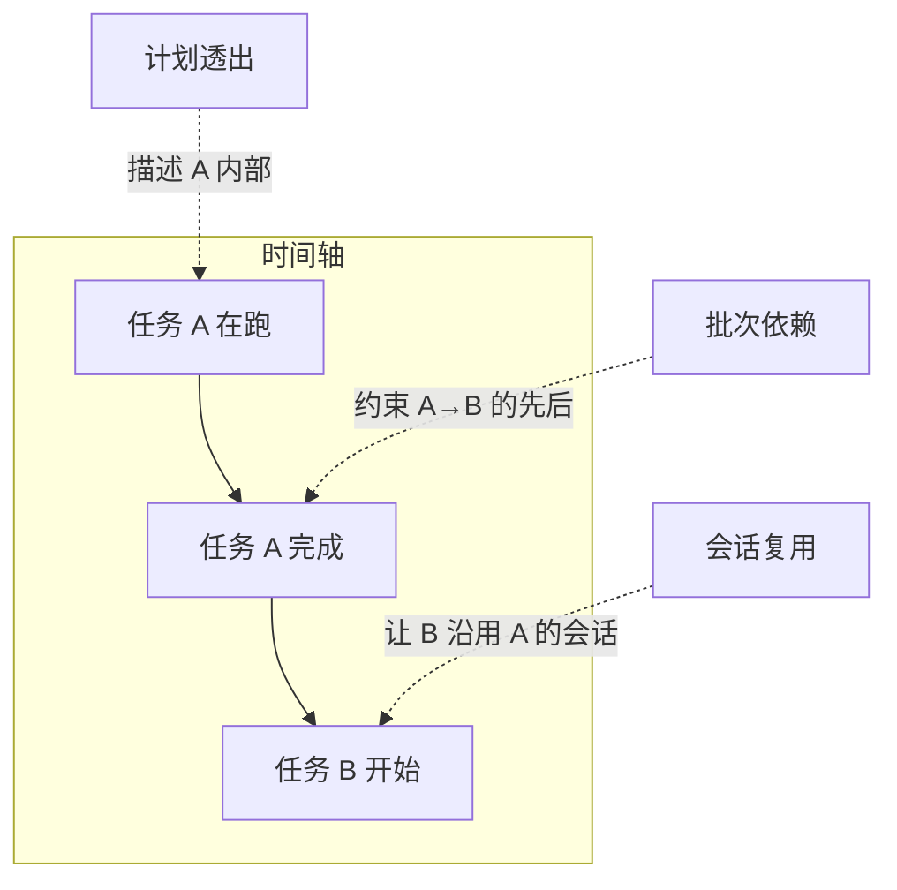
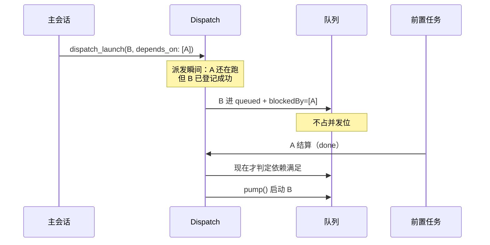
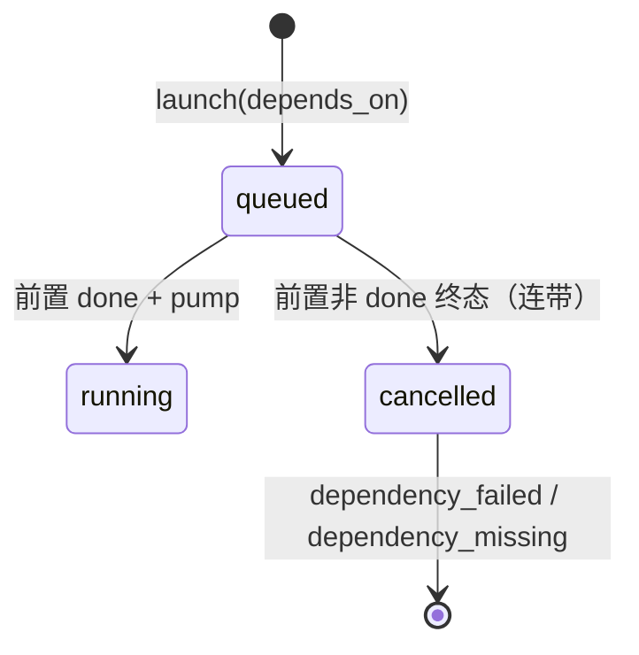
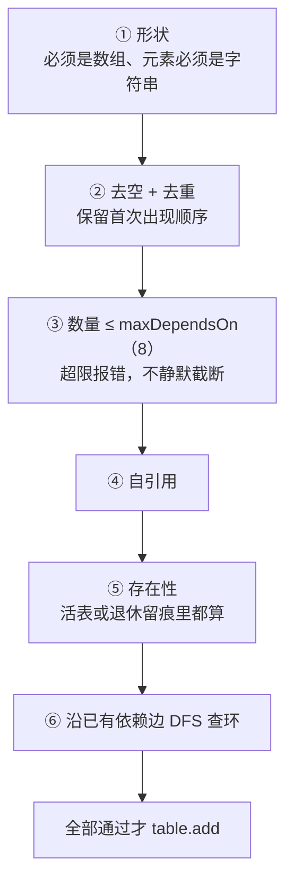
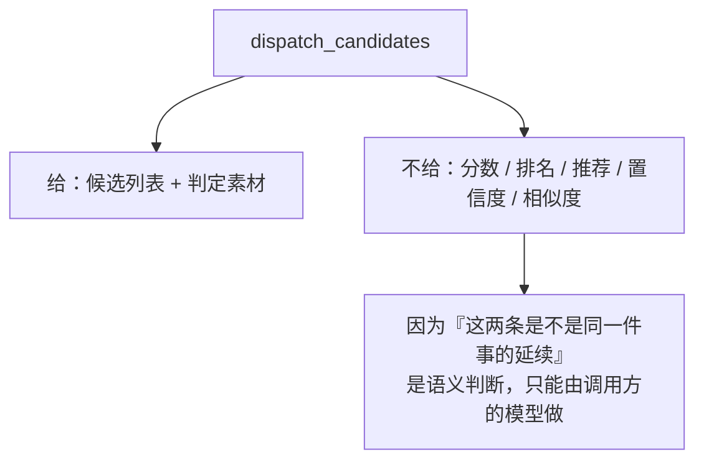
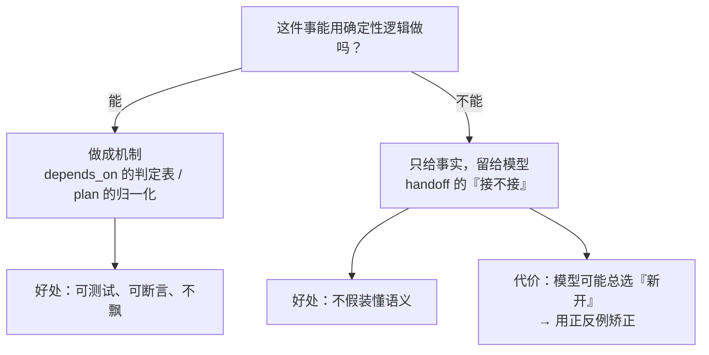
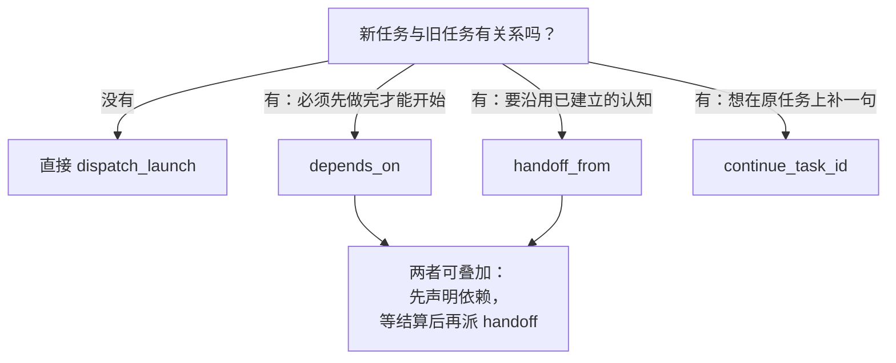

# dsh-mini-superagent 09：三种连续性——计划、依赖与会话复用（0.9.0 后期）

> **代码仓库**：[wychmod/dsh-mini-superagent](https://github.com/wychmod/dsh-mini-superagent)
> **本章目标**：把「计划透出」「批次依赖」「会话复用」三件名字相近、问题完全不同的事分清，并理解「接还是不接」这个判断为什么必须留给模型。
> **对应提交**：`d442061`（计划透出 / 批次依赖 / 会话复用 / 候选工具）→ `686736d`（看板四视图与依赖展示）→ `0114700`（接续判据改成该接/该新开正反例）→ `4f47a53`（依赖准入绕过修复）。
> **原文对照**：`docs/tools.md` 的「依赖」「续派」「dispatch_candidates」三节，`plans/15` / `plans/16` / `plans/11`。

---

## 目录

- [一、三种连续性，别混](#一、三种连续性，别混)
- [二、计划透出：worker 自己说「走到哪一步」](#二、计划透出：worker-自己说「走到哪一步」)
- [三、批次依赖：等到前置结算再开始](#三、批次依赖：等到前置结算再开始)
- [四、会话复用：接着上一段上下文再派活](#四、会话复用：接着上一段上下文再派活)
- [五、候选工具：只给素材，不给推荐](#五、候选工具：只给素材，不给推荐)
- [六、接还是不接：一份正反例](#六、接还是不接：一份正反例)
- [七、核心讲解：把「判断」留在模型，把「事实」放进工具](#七、核心讲解：把「判断」留在模型，把「事实」放进工具)
- [八、使用建议](#八、使用建议)

---

## 一、三种连续性，别混

先看这张表，它是全篇的地基：

| 能力 | 解决什么 | 入口 | 会不会新增任务 |
|---|---|---|---|
| **计划透出** | worker 自己说「这条任务分几步、走到哪一步」 | `dispatch_report` 的可选 `plan` | 不会，只改账本字段 |
| **批次依赖** | 任务之间**有先后关系**：后一步在前一步结算前一直排队 | `dispatch_launch({ depends_on })` | 会，每次都是新任务 |
| **会话复用** | 上一条已经做完，但**结论与上下文还要接着用** | `dispatch_launch({ handoff_from })` | 会，新任务沿用来源子会话 |



**最容易混的一对是「依赖」和「复用」**：

- 要表达「**等它做完再做**」→ 用 `depends_on`。
- 要在做完之后**接着同一段上下文**再派活 → 用 `handoff_from`。
- 两者可以同时用：先声明依赖，等前置结算后再派一条带 `handoff_from` 的新任务。

## 二、计划透出：worker 自己说「走到哪一步」

### 形态

`dispatch_report` 多了一个可选参数：

```text
plan: [{text, status}]
status ∈ pending | doing | done
```

规则：

| 规则 | 内容 |
|---|---|
| 整版替换 | 每次传都是**整版替换**，不做增量合并、没有 step id |
| 归一化 | 空文案丢弃；同文案最多 3 条；`text` 必填 |
| 上限 | `maxPlanSteps` 12 步 / `maxPlanStepChars` 120 字，超限**截断不报错** |
| 只写账本 | 进 `task.plan`，**不进 `recent_reports`**，不产生新会话消息 |
| 终态冻结 | `queued` 与已结算任务一律拒绝（返回 `plan_accepted: false`） |

### 为什么「截断不报错」

> 计划是汇报的附属信息，不能因为计划太长让结论回不来。

这条判断很关键：如果计划超限就报错，worker 会为了「让报告成功」而删掉结论——那是本末倒置。

### 看板怎么用它

看板只投影三个**标量**：

| 字段 | 内容 |
|---|---|
| `plan_total` | 总步数 |
| `plan_done` | 已 done 的步数 → 行上显示 `2/5` |
| `plan_current` | 当前步骤的**文案字符串**（优先 `doing`，其次第一条 `pending`；全 done 时是空串） |

**为什么不投影步骤数组**：200 条任务 × 12 步会把每次轮询的 payload 放大一个量级，而任务行只需要 `2/5`。

**`plan_current` 全 done 时给空串，不编「已完成」**——这是「不编造」原则的又一次落地。

### `plan_accepted` 的语义陷阱

文档专门标出了这个坑：

> `plan_accepted`：这一版计划有没有被写进账本。**没传 `plan` 时也是 `false`**——语义是「本条报告没有一版计划被接受」，不是「计划被拒绝」。

一个字段名叫「accepted」，值为 `false` 却可能表示「你压根没提交」——这个歧义必须在文档里写清，否则调用方会误判。

## 三、批次依赖：等到前置结算再开始

### 判定时机：任务开始前，不是派发时

这是最容易误解的一点：



**为什么不能在派发时判定**：如果派发时就拒绝，你就得「先派 A、等报告回来再派 B」手搓两轮——那正是这个参数要消除的动作。

### 判定表

| 前置状态 | 后继行为 |
|---|---|
| `done` | 满足，下一次 `pump()` 启动后继 |
| `queued` / `running` | 等待，仍是 `queued`，`blocked_reason: 'running'` |
| `failed` / `cancelled` / `interrupted` / `ended` / `blocked` | **连带取消**，`cancel_reason: 'dependency_failed'` |
| 不在活表、退休留痕 `status === 'done'` | 满足（它做完了，只是被移出计算） |
| 不在活表、退休留痕非 done 或不存在 | 连带取消，`cancel_reason: 'dependency_missing'` |



### 校验顺序：六步，全在登记之前



> **这张图按代码画，不按注释画**：`#resolveDependencies()` 的实际循环是先 `if (id === taskId)` 判自引用、再 `resolveTask(id)` 判存在性，与本图一致；但同函数的 JSDoc 把这两条列成「4. 存在性 / 5. 自引用」，顺序正好相反。这是仓库自身的一处文档漂移（第 14 篇列了同类问题），不影响行为——两条都在 `table.add` 之前抛错，任一条命中都不会留下半条任务。

**为什么要查环**：依赖边可以从「手工改过的账本」来——防的是脏数据，不是正常调用。

**为什么数量超限不静默截断**：「少一条依赖」是逻辑错误，静默截断会让任务在错误的时机启动。

### `depends_on_index`：批内下标

`dispatch_launch_many` 里可以用**批内下标**声明依赖，不必先知道 task id：

```text
tasks: [
  { title: '改接口' },
  { title: '补实现', depends_on_index: [0] },
  { title: '跑测试', depends_on_index: [1] },
]
```

一个细节：**失败项占位为 `undefined`**。所以后面的 item 用 `depends_on_index` 指向它时会解析不到 id，报 `UNKNOWN_DEPENDENCY`——而不是**错位指向别人**。

### 非目标（明确不做）

| 不做 | 原因 |
|---|---|
| DAG 可视化 | 依赖只有「先后」这一种关系，画图不增加信息 |
| 跨批次编排 | 批次是「一条汇总」的单位，不是执行图 |
| 前置失败自动重试前置 | 重试是人的决定（见 08 篇的重试语义） |
| 后继被取消后前置重跑自动复活后继 | 同上 |

> **一个容易误读的地方**：`depends_on` 是**全满足**语义——`depends_on: ['A','B']` 的意思是「A 且 B 都 `done` 才启动」，`#blockedStateOf` 会逐个检查、遇到任一未满足就继续排队。所以「A、B 都完成才做 C」**是支持的**，它本身就是一次 AND-join，不需要额外机制。真正不支持的是 **OR-join**（任一完成即可）、**条件分支**（按前置结论决定走哪条）与**运行期改图**：依赖边在 `launch()` 时校验并落账，之后没有 API 能增删改；`#annotateDependencies()` 每轮 `pump()` 重算的只是「这些固定的边此刻是否满足」，不是边本身。

## 四、会话复用：接着上一段上下文再派活

### 形态

```text
dispatch_launch({ handoff_from: 't-xxx', handoff_reason: '接着上一条的接口改动' })
```

语义：**新建一条任务，沿用来源子会话**。

与 `continue_task_id`（续派）的区别：

| | `continue_task_id`（续派） | `handoff_from`（复用） |
|---|---|---|
| 新建任务吗 | **不新建**，转发成一次 `dispatch_message` | **新建** |
| 有独立任务记录吗 | 没有 | 有 |
| 有独立报告链吗 | 没有（混在同一任务里） | 有 |
| 有独立看板行吗 | 没有 | 有 |
| 适用 | 「这条任务上补一句要求」 | 「上一条做完了，接着做下一步」 |

续派的三个代价（文档要求写清）：

1. **没有独立的任务记录**——列表与看板里仍只有原来那一条。
2. **没有独立的报告链**——这次的要求与上一轮的报告记进同一个 `task.reports`。
3. **没有独立的看板行**——事后无法分开审计。

### 四条硬约束

| 约束 | 违反时 |
|---|---|
| 沿用来源会话的**模型与 preset**（不能改） | 报错 |
| **不能跨 workspace / cwd** | 报错 |
| 来源必须已结算且未退休归档 | 报错 |
| 当前没有别的活跃任务（仅续派） | 报错 |

唯一的降级开关是部署级 `allowSessionReuse: false`，且降级时返回值里**一定带 `note`**，不静默。

### 血缘

复用会记录 `parentTaskId`，落盘与 `restore()` 都保留，看板投影 `handoff_from`。于是「这条是从哪条接过来的」是可查的。

## 五、候选工具：只给素材，不给推荐

`dispatch_candidates` 是这一批里最克制的一个设计。

### 它做什么

列出本会话派出的、已结算且仍在时间窗内的任务，并附上判断「这是不是接着上一条」所需的素材：简报、最后报告摘要、终态、线程、后继。

### 它明确不做什么



**红线**：返回里没有 `score` / `rank` / `recommend` / `confidence` / `match` / `similarity` 这类键，由 `test/handoff-candidates.test.js` 的用例把守。

### `excluded`：把「为什么没选」也返回

返回里带一个 `excluded` 对象：

```text
{ not_settled: 2, cancelled: 1, archived: 2, retired: 0, outside_window: 5, other_domain: 1 }
```

它让「**为什么没有候选**」可回答。没有这个字段，用户看到空列表只能猜。

`reuse_check` 同理：它只报告事实（`ok:false` 的唯一常见原因是 `blocked_by: ['session-busy']`），**不含偏好**——`ok:true` 不等于「建议接」。

## 六、接还是不接：一份正反例

这段提示词的迭代过程最能说明问题。

最早那版提示词写的是：

> 只有「同一份产物 / 同一条工作线」才接

字面没错，但**判据是个形容词，模型无法照做**。

实测后果（文档原文）：

> 用户连续 6 条**完全同质**的演示任务（都只是「建一个占位文件 + 读回验证」），一条都没接，每条子会话都从零重建项目认知。

根因分析得很准：

> **新开永远不会错，接错要负责**——只给方向不给样例时，风险最低的选项总是胜出。

改成两行对照的正反例：

| 该接（`handoff_from`） | 该新开 |
|---|---|
| 同一产物连续改（改完 A 再改 A 的样式） | 换文件 / 换子系统，旧结论对新任务没有增量 |
| 一批**同质**任务（N 条都只是「建占位文件并验证」） | 新任务需要**干净假设**（独立复核），旧结论会污染判断 |
| 新任务会大量引用上一条已建立的**事实**（路径、接口形状、踩过的坑） | 上一条的**结论本身是错的**——带过去只会把错误延续 |

还有一句必须留下的话：

> **复用省的是「重建认知」，不是省「思考」。**

它解释了什么时候不该接：如果新任务并不需要那份认知，复用就只是把无关上下文塞进窗口——既不省事，又污染判断。

## 七、核心讲解：把「判断」留在模型，把「事实」放进工具

这三件事看起来都在解决「连续性」，但它们的分工其实遵循同一条原则：



三件事的落点：

| 能力 | 哪些是机制 | 哪些留给模型 |
|---|---|---|
| 计划透出 | 归一化、上限、终态冻结 | 「分几步」由 worker 自己决定 |
| 批次依赖 | 前置状态判定、连带取消、查环 | 「谁等谁」由调用方声明 |
| 会话复用 | 四条硬约束、血缘记录 | 「该不该接」由模型判断 |

**第三行是重点**：它明确拒绝了一个看起来很有价值的功能——「自动判断该不该复用」。

拒绝的理由写在 `docs/tools.md` 里：

> 「这两条任务是不是同一件事的延续」是语义判断，只能由调用方（主会话的模型）做。

而代价也用正反例兜住了：既然模型总选最安全的「新开」，那就给它具体的锚点。

## 八、使用建议

### 什么时候用哪个



### 五条实操建议

1. **能并行就别用依赖。** 依赖是为「真的必须先做」准备的，不是为「我担心」准备的。
2. **计划写 3–6 步最有信息量。** 超过 12 步会被截断，1–2 步看不出进度。
3. **复用前先看候选的最后一条报告。** `dispatch_candidates` 的 `last_report.summary` 是最有用的素材。
4. **拿不准就新开。** 错接会把旧结论、旧模型、旧权限一起带进新任务，基本不可逆；漏接只是多一条会话。
5. **别指望 `depends_on` 帮你重试前置。** 它只表达先后，不做失败恢复。

### 三条已知限制

- `dispatch_message` 与续派**不能**唤醒被依赖挡住的任务（会报 `dispatch/conflict`），要放弃请用 `dispatch_cancel`。
- `continue_task_id` 不能同时传 `depends_on`（会报错，不静默忽略）。
- 计划与依赖都没有 token / 成本字段。

---

> **下一篇**：功能做完了，接下来是「把它钉住」。0.9.1 的 A 类七条不讲新功能，只把已经写进代码的事实钉进文档、工具面、存储闸门、CI 与看板——以及 npm 包边界与落地页。
