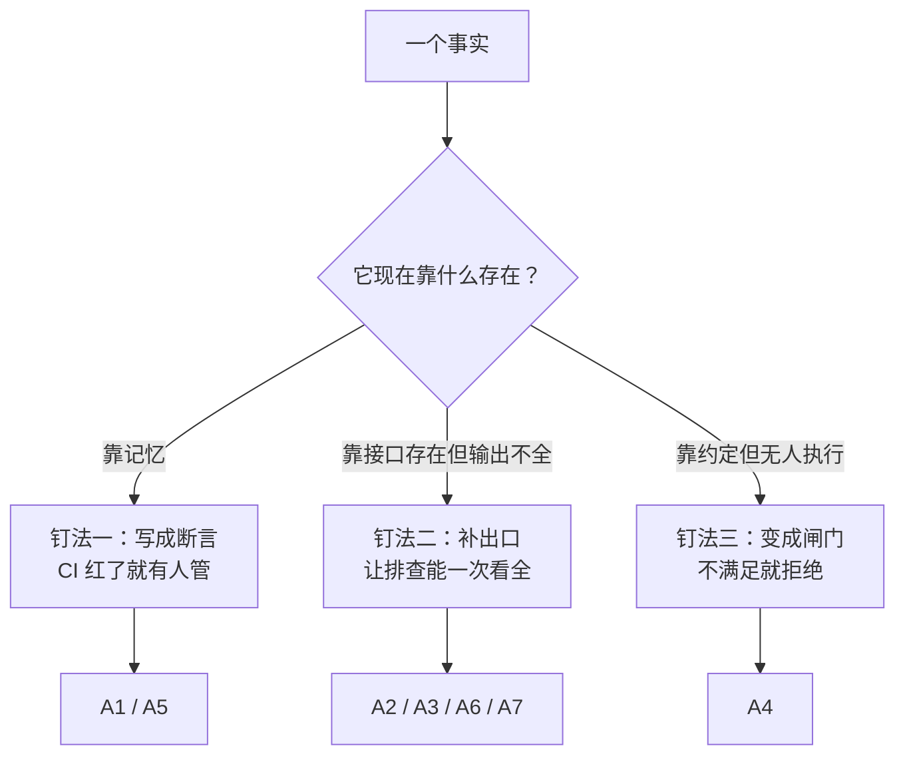
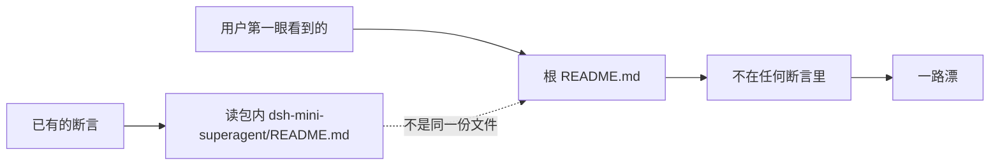
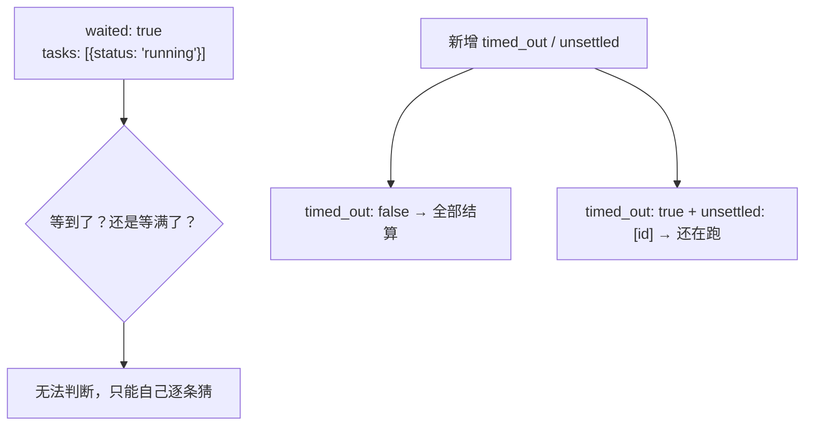
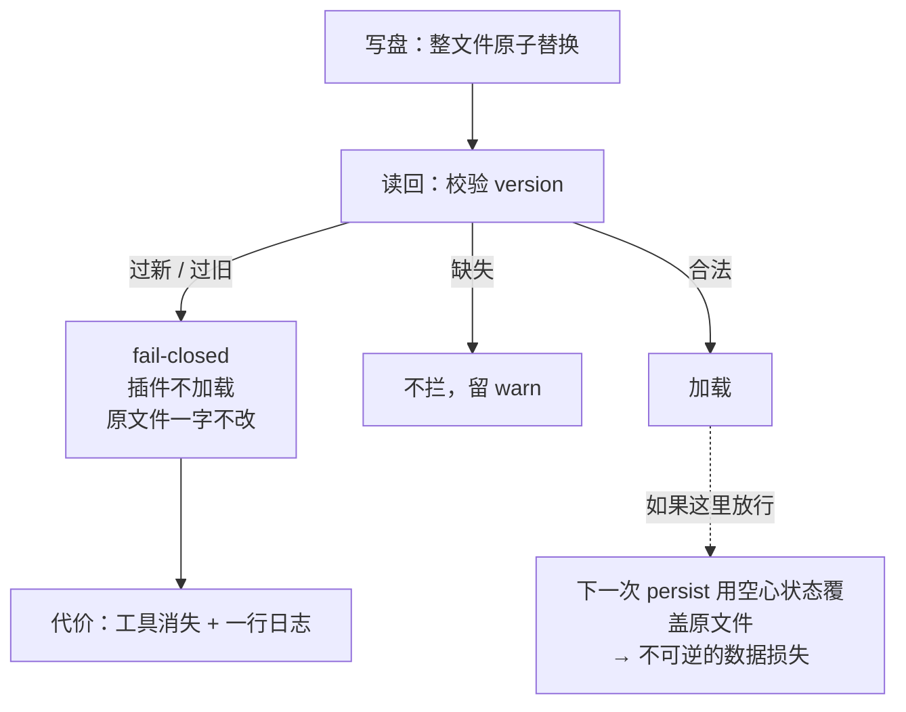
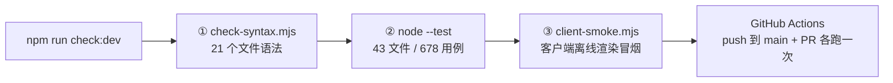
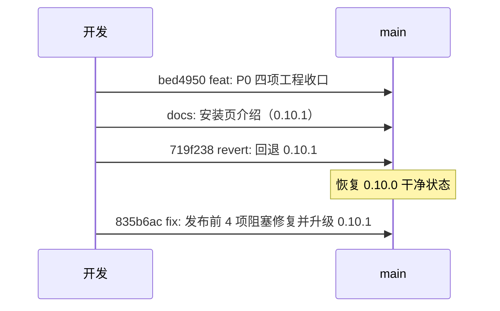
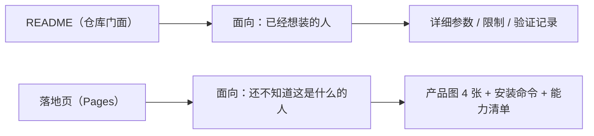
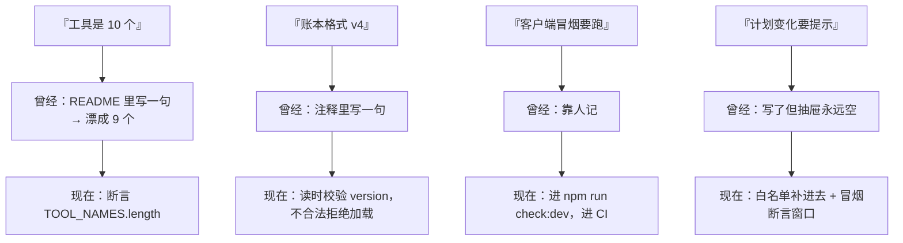

# dsh-mini-superagent 10：工程收口与对外发布（0.9.1 → 0.10.x）

> **代码仓库**：[wychmod/dsh-mini-superagent](https://github.com/wychmod/dsh-mini-superagent)
> **本章目标**：看懂「A 类七条」这轮不加功能的改动在做什么、CI 三道闸门怎么排、npm 包边界为什么必须显式白名单，以及一次「回退再重做」的取舍。
> **对应提交**：`fed9b46`（A1–A7）→ `07bcf00`（移除 docs、补 npm 元数据）→ `052a5d6`（重写 README 为开源门面）→ `bed4950` / `719f238`（P0 四项 + 回退）→ `835b6ac`（发布前四项阻塞修复）。
> **原文对照**：`CHANGELOG.md` 0.9.1 与 0.10.0 / 0.10.1 段，`plans/17-a-class-optimizations.md`。

---

## 目录

- [一、A 类七条：不加功能的一轮](#一、a-类七条：不加功能的一轮)
- [二、A1：根 README 终于进了断言](#二、a1：根-readme-终于进了断言)
- [三、A2–A3：把「一次看全」和「等到了没」补上](#三、a2a3：把「一次看全」和「等到了没」补上)
- [四、A4：账本版本闸门](#四、a4：账本版本闸门)
- [五、A5：三闸门 CI](#五、a5：三闸门-ci)
- [六、A6–A7：重试健康度与提示窗口](#六、a6a7：重试健康度与提示窗口)
- [七、对外发布：npm 包边界与一处回退](#七、对外发布：npm-包边界与一处回退)
- [八、核心讲解：什么叫「钉住」](#八、核心讲解：什么叫「钉住」)
- [九、使用建议](#九、使用建议)

---

## 一、A 类七条：不加功能的一轮

0.9.1 的定位写得很清楚：

> PRD「A 类七条」不做新功能，只把**已经实现的东西钉住**：每一处都补上「为什么这样、不这样会怎么坏」，并且把「话说过就算」的地方换成有断言或闸门兜着的。

「钉住」有三种形态：



## 二、A1：根 README 终于进了断言

### 现象

根 README 写着「9 个 `dispatch_*` 工具」，而 `TOOL_NAMES` 是 10 个；版本停在 `0.8.0`，而 `package.json` 与 `constants.VERSION` 早就是另一个数。

**没有任何测试会红。**

### 根因



### 修法

`test/contract-consistency.test.js` 新增「根 README 的工具数与版本号与代码一致」。

三个细节：

| 细节 | 内容 | 为什么 |
|---|---|---|
| 只钉两个数字 | `TOOL_NAMES.length` 与 `package.json.version` | 两份 README 允许说法不同，但数字必须与代码同源 |
| 正则只认一种写法 | 「N 个 `dispatch_*` 工具」 | 将来改成表格或英文时会**直接失败**，逼维护者连断言一起改 |
| 不用宽松匹配 | 匹配不到就红，不「放过」 | 「匹配不到就放过」等于断言会自己失效 |

第三条是核心：**一个会自己失效的断言，比没有断言更糟**——因为它会让人误以为有保护。

## 三、A2–A3：把「一次看全」和「等到了没」补上

### A2：字段的「出口」问题

依赖与计划的字段**账本里早就有**，缺的是**出口**：

| 字段 | `card()`（列表） | `detail()`（详情） |
|---|---|---|
| `depends_on` | ✅ | ✅ |
| `blocked_by` | ✅ | ✅ |
| `blocked_reason` | ❌ | ✅ |
| `cancel_reason` | ❌ | ✅ |
| `error_code` | ❌ | ✅ |
| `plan`（全量步骤） | ❌ **刻意不做** | ✅ |

**为什么 `card()` 不含 `plan`**：`card()` 同时服务 `list` 与 `inspect`，而列表是每轮都要渲染的全量。把步骤数组塞进去会让返回体膨胀数倍——列表要的是「一眼看多少条」。

**一处刻意的不一致**：`blocked_by` 在工具面是**数组**（一次看全在等谁），在看板是**标量**（2 秒轮询省体积）。两者第 0 项逐字相同。

### A3：`dispatch_wait` 能说清「等到了」还是「等满了」

旧返回体只有 `waited` 和 `tasks`。而 `status` 在两种情形下都可能是 `running`：



**这是一处破坏性变更**（文档专门加了警告块）：

> `TaskTable.waitFor()` 的返回值从「任务数组」变成 `{ timedOut, tasks }`。仓库内唯一调用方是 `dispatch_wait`（已同步）；外部若直接 `import { TaskTable }` 并调用 `waitFor()`，需要改读 `.tasks`。

**为什么工具层不算破坏性变更**：它只是**新增**字段，不影响现有调用方。

## 四、A4：账本版本闸门

[第 07 篇](/md/10-项目实战/04-DSH任务派发插件/07-记忆治理-权威源与投影.md)已经讲过这条的设计。这里补它作为「闸门」的形态：



三个配套约定（[第 07 篇](/md/10-项目实战/04-DSH任务派发插件/07-记忆治理-权威源与投影.md)讲过两个，这里是第三个）：

> 这两个错误码**不进** `ERROR_CODES` 闭集——插件此时根本没加载，`selfCheck()` 与看板都不可用，唯一出口是启动日志。

**为什么不放进错误码闭集**：塞进去会误导消费方以为「可以拿 code 去分流重试」。而此时插件**根本没加载**，没有任何东西能响应。

## 五、A5：三闸门 CI



> **脚本名的坑**：这条链在 `0.9.1`（提交 `fed9b46`）时叫 `npm run check`，到发布准备（`07bcf00`）因为 `client-smoke.mjs` 在仓库根、不在 npm 包里，改名成 **`check:dev`**——否则装到用户机器上执行必然报错。现在 `package.json` 的 `scripts` 只有 `test` 与 `check:dev` 两个键，**没有 `check`**。CI 工作流因为始终在仓库里跑，三条命令是逐条写死的，不依赖这个脚本名。

四个刻意的选择：

| 选择 | 理由 |
|---|---|
| 语法闸门放最前 | 先把「文件根本解析不了」拦掉——否则单测只会报一堆 ImportError，看不出真正原因 |
| 不执行 `npm ci` | 零运行时依赖、无 lockfile，直接调 node 更稳 |
| **不用 `continue-on-error`** | 首次接入若暴露既有失败，应该**修失败**，而不是让闸门装成绿的 |
| Node 22 对齐 `engines.node` | 与运行时一致 |

**第三条最容易做错**：CI 第一次接进来必然是红的（因为以前没人跑过客户端冒烟）。这时最容易做的事是加 `continue-on-error: true` 让它先绿——那就等于把闸门装成装饰。

## 六、A6–A7：重试健康度与提示窗口

### A6：`retry_health`

新增 `retry_health: { attempts, since?, last_at?, last_error? }`。

**它解决什么**：看板能显示「重试中」却说不清重试了几次、从什么时候开始，用户分不出「刚失败一次」和「卡在退避循环里半小时」。

**与投递重试刻意区分**：

| 字段 | 回答 |
|---|---|
| `report_delivery` | 报告有没有送到主会话 |
| `retry_health` | 模型/连接瞬时故障后这条任务续跑了几次 |

> 放在一起展示，用户会把「重试 2 次」读成「报告没送到」。

**不落盘、重启归零**：

> 账本里照抄一份快照，重启后显示「重试 2 次」而真实次数是 0，比不显示更糟。

### A7：提示窗口 2 秒 → 6 秒

「计划已更新」徽标的窗口从「一轮轮询（2 秒）」改成 `PLAN_NOTICE_MS = POLL_MS * 3`（6 秒）。

**为什么**：2 秒窗口等于「下一次轮询就把它抹掉」——在 2 秒一轮的刷新里人眼几乎看不见。

**为什么写成 `POLL_MS * 3` 而不是 `6000`**：

> 这个窗口的语义是「让用户看到 3 次轮询」：`POLL_MS` 一改窗口必须跟着变，写死魔法数字会变成「一闪而过」或「赖着不走」。

**一个真实死代码**：抽屉那段原本什么都没显示，因为 `historyRowOf` 是白名单归一，`plan_*` 没搬进去，于是抽屉里「当前步骤」永远是空的（`planTotal = 0`）。补进白名单才让「抽屉同步」真的成立。

## 七、对外发布：npm 包边界与一处回退

### npm 包的显式白名单

`package.json` 的 `files` 是一个**白名单**，npm 包里只有：

```text
src/ · client/ · cordis.patch.yml · locale/ · icon.svg
README.md · CHANGELOG.md · LICENSE · package.json
```

**`docs/` 不在里面**（0.9.1 的 `07bcf00` 提交把 docs 移出发布白名单）。

后果很具体：README 里指向 `docs/xxx.md` 的相对链接在 npmjs.com 上**全是 404**。修法是把这些链接改成 GitHub 绝对 URL：


**为什么保留 `docs/` 在仓库而不进包**：文档 4,307 行，对「装插件的人」是负担；而想看的人会去仓库。

### 一次回退：`719f238`

版本历史上有一个特殊的提交：`revert: 回退 0.10.1（P0 四项），恢复 0.10.0 干净状态`。



**回退不等于失败**：那四项改动（Config / 可选服务 / worker 边界 / 看板隔离）方向是对的，但实施时带进了阻塞问题。先把 main 恢复干净、再重做，比在坏状态上继续加补丁更安全。

这个动作的含义是：**它把「main 分支必须是可发布的」当成硬约束**。如果允许 main 短暂不可用，就会一路修一路加，最后没人说得清哪个状态是好的。

### 落地页

0.10.0 之后有 GitHub Pages 落地页（`index.html`），0.10.2 更新。它解决的是「怎么让人在 30 秒内知道这是什么」：



## 八、核心讲解：什么叫「钉住」

这一轮的七条改动，共同回答了同一个问题：**你怎么知道某件事还在？**

三种答案，可靠性依次递增：

| 层次 | 手段 | 失效方式 |
|---|---|---|
| 最弱 | 文档里写一句 | 代码改了文档不改 |
| 中 | 代码注释 | 注释离代码近，但没人读 |
| 强 | 断言 / 闸门 | 会红，会拒绝 |

A 类七条做的事，就是把尽可能多的「最弱」和「中」升级成「强」：



**还有一个反例**：`test/voice-prompt.test.js` 的长度门禁（≤8 行 / ≤500 字）——它量的是**装配后的真实提示文本**，不是源码字符数。因为源码里的常量可能被拼接、被条件分支改变，量源码等于量了个假数字。

**这就是「钉住」的判断标准：钉住的东西必须是你真正关心的那个量。**

## 九、使用建议

### 如果你在维护一个有 CI 的项目

这份清单可以直接用：

| 检查 | 问法 |
|---|---|
| 门面文件在断言里吗 | README 的数字（版本、工具数、用例数）有测试钉吗？ |
| 断言会自己失效吗 | 正则匹配不到时是红还是放过？ |
| CI 有 `continue-on-error` 吗 | 有的话，它保护的是闸门还是你的面子？ |
| 语法检查在最前面吗 | 否则单测报一堆 ImportError |
| 包边界是白名单还是黑名单 | `.npmignore` 是黑名单，新增目录会被默认打进去 |
| main 分支可发布吗 | 不可发布时是先回退还是继续打补丁？ |

### 如果你在用这个插件

1. **装 0.10.x 用 `plugin_manager` 的 `install_bundle`。** 纯 ESM，不需要构建、不需要 `npm install`。
2. **不要和旧插件 `dsh-dispatch` 同时装。** 两者共有 8 个同名工具，重复注册直接抛错。
3. **`npm` 包里没有 `docs/`。** 想看详细文档去仓库。
4. **重装/升级后刷新一次 GUI 页面。** 客户端模块在页面刷新后加载。

### 一条关于「发布」的经验

这个项目的发布准备清单很短，但每条都是被咬过的：


第 ① 条最容易漏：一个版本号要改六个地方，而且**没有任何编译器会提醒你漏了哪个**。所以它有断言。

---

> **下一篇**：0.10.0 把「派发与回流」从工具行变成了会话里的两张卡。这是纯 UI 侧的工程——但那套降级矩阵比功能本身更耐看。
>
> 继续读：[第 11 篇](/md/10-项目实战/04-DSH任务派发插件/11-会话里的卡片与分隔线.md)
