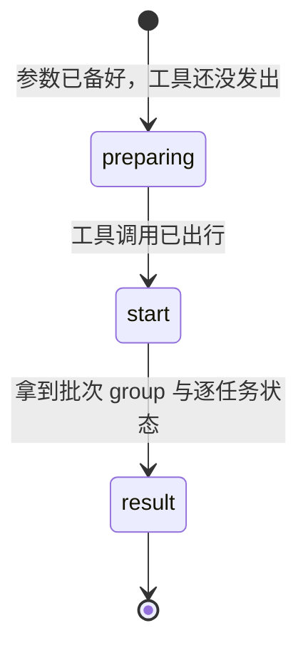
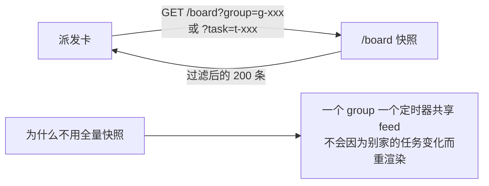
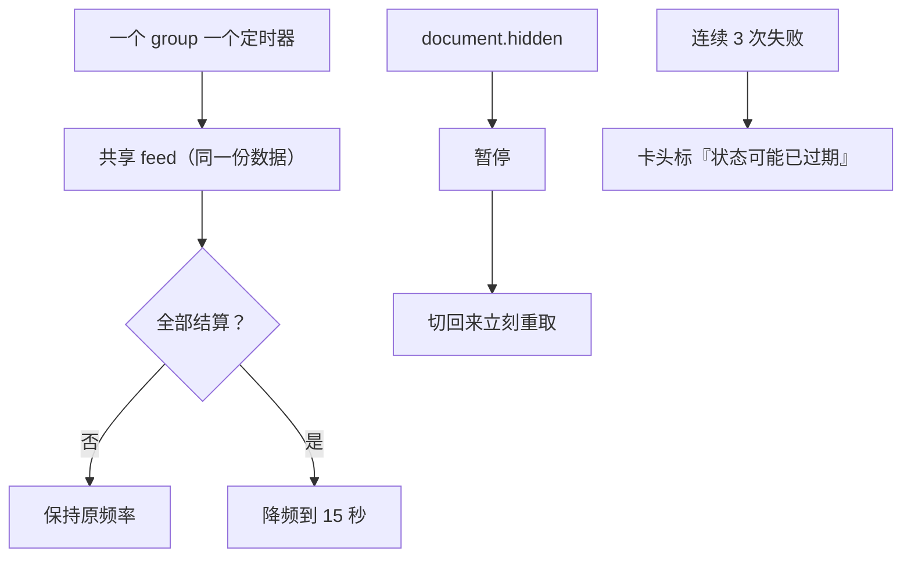
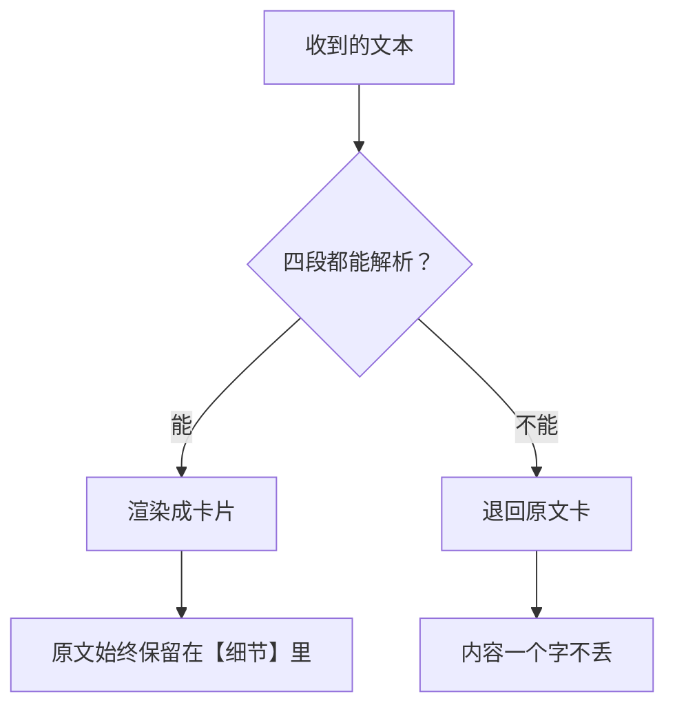
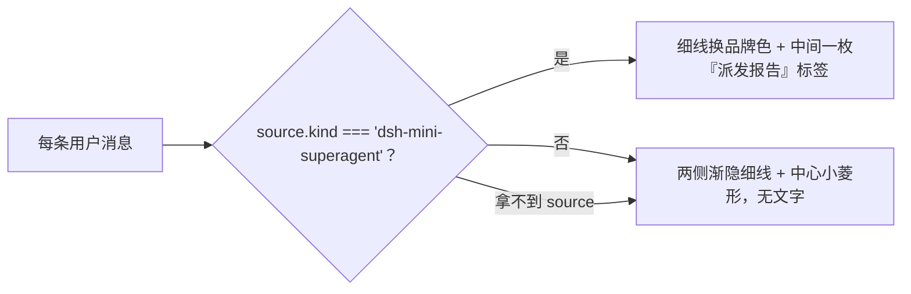
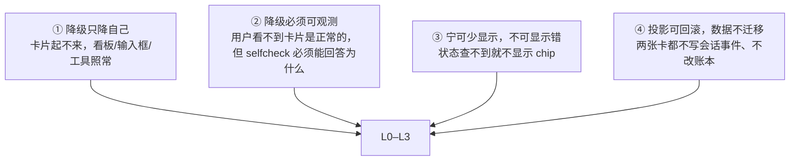
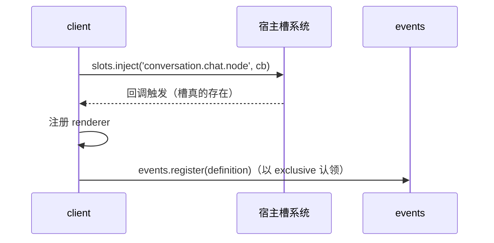
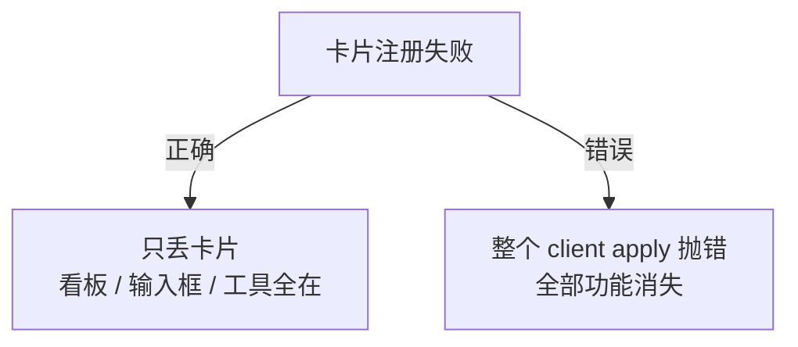

# dsh-mini-superagent 11：会话里的卡片与分隔线（0.10.0）

> **代码仓库**：[wychmod/dsh-mini-superagent](https://github.com/wychmod/dsh-mini-superagent)
> **本章目标**：看懂「派发卡」「报告卡」「轮次分隔线」三块纯 UI 增量各自挂在宿主的哪条接缝上，以及一份 L0–L3 降级矩阵怎么把「坏了怎么退」写清楚。
> **对应提交**：`834efd8`（`/board` 支持 `?group=` 与 `?task=` 只读过滤）→ `203358f`（派发卡与轮次尾部摘要）→ `f6db9c2`（报告卡正式版）→ `d52204f`（0.10.0 发布）。
> **原文对照**：`plans/12-dispatch-card.md`、`plans/13-report-card.md`、`plans/14-cards-degradation-validation.md`（这三份规划书是本项目「接缝工程」最完整的样本）。

---

## 目录

- [一、为什么还要做 UI](#一、为什么还要做-ui)
- [二、派发卡：把一次工具调用变成一批任务](#二、派发卡：把一次工具调用变成一批任务)
- [三、报告卡：四段式与「解析不出就退回原文」](#三、报告卡：四段式与「解析不出就退回原文」)
- [四、轮次分隔线：纯装饰为什么也要写一节文档](#四、轮次分隔线：纯装饰为什么也要写一节文档)
- [五、L0–L3：降级矩阵怎么用](#五、l0l3：降级矩阵怎么用)
- [六、最危险的一条：认领与渲染的顺序](#六、最危险的一条：认领与渲染的顺序)
- [七、核心讲解：插件 UI 的四条接缝纪律](#七、核心讲解：插件-ui-的四条接缝纪律)
- [八、使用建议](#八、使用建议)

---

## 一、为什么还要做 UI

到 0.9.1，信息已经全了：看板有并发、有进度、有失败原因；工具返回值里有一切。

**缺的是「会话里」的那一眼。**


同样，报告回流是一条灰色的 `context` 行，四段式文本全挤在一起。**信息在，但读不出来。**

0.10.0 的增量就是把这两处补上。它们是纯投影层：**不写会话事件、不改账本**——所以回滚只需换回旧版本，不存在数据修复。

## 二、派发卡：把一次工具调用变成一批任务

### 接缝

`tool.call.toolview` 槽。`dispatch_launch` / `dispatch_launch_many` 的通用工具行换成**批次卡**。

### 三阶段



| 阶段 | 界面 | 为什么需要这一阶段 |
|---|---|---|
| `preparing` | 显示「准备派发 N 条」 | 工具调用可能要几十毫秒才出行，空白期用户会以为没反应 |
| `start` | 行已出现，状态未知 | 给一个「已发出」的确定感 |
| `result` | 逐任务状态 | 真正的信息 |

### 实时状态：按 group / task 单点取数

这个接口设计要单独说：



`/board` 新增两个**精确匹配**的查询参数：

| 参数 | 取值 | 缺省 |
|---|---|---|
| `group` | 批次 id，精确匹配 `task.group` | 不过滤（返回全部，与旧版逐字段一致） |
| `task` | 任务 id，精确匹配 `task_id` | 不过滤 |

四个必须写清的边界：

1. **卡片专用，非通用查询接口。** 不提供排序 / 分页 / 字段选择。加参数的目的是让卡片取自己那一小片数据，而不是把 `/board` 扩张成一个查询 API。
2. **过滤在 200 条截断之前。** 否则批次成员排在第 201 名之后时，卡片会拿到空列表——任务明明还在跑。
3. **两个参数同时给取交集。** 空串 / 只有空白等价于未给，**不是**「匹配空 group」。值 `trim` 后截断到 64 字符，按精确字符串比较。
4. **未知 `group` / `task` 仍返回 200**，body 是 `{ …, tasks: [], truncated: null }`。资源存在，只是这次过滤没命中——这不是 404。

第 2 条是唯一一条「不过滤就出错」的：它是一个**顺序 bug**，不看代码根本想不到。

### 轮询纪律



**为什么「全部结算后降频」而不是停止**：任务虽然结算了，但还可能被追问（`dispatch_message` 会让它重新 `running`）。停止轮询会让卡片显示一个过时状态。

**为什么连续 3 次失败才标记**：单次失败可能是网络抖动。3 次是一个经验阈值——足够过滤抖动，又不至于让用户长时间看着假状态。

## 三、报告卡：四段式与「解析不出就退回原文」

### 接缝

`conversation.chat.node`。注册 `dispatch-report` 节点类型，以 `exclusive` **认领**插件来源的 relay `user/message`。

### 四段

```text
【任务】auth 令牌刷新
【结果】登录超时修好了，补了 3 个回归测试
【说明】替换了 refresh 调用点 6 处；新增 3 条用例；测试全绿。
【需要你】定一下：重试、换做法，还是先放着？
【细节】dispatch_inspect t-1a9f-1
```

（`【需要你】` **只在 blocked / failed / interrupted 时出现**——成功报告天天喊「需要你」会让这四个字贬值。）

### 最重要的规则：任一段解析不出，整份退回原文卡



**为什么不是「部分渲染」**：如果三段能解析、一段不能，那渲染出来的卡片会**丢掉那一段的内容**——而用户不知道丢了什么。退回原文至少保证「你看到的就是收到的」。

这条和「宁可少显示，不可显示错」是同一条原则的两种落法：

| 原则 | 落点 |
|---|---|
| 宁可少显示 | 状态查不到就不显示 chip |
| 不可显示错 | 解析不全就退回原文 |

### 一键复制原文

卡片带一个「复制原文」的按钮。它的作用不只是方便——**它是「卡片是投影」这件事的逃生口**：任何时候用户觉得卡片少了什么，都能拿到完整原文。

## 四、轮次分隔线：纯装饰为什么也要写一节文档

0.9.0 起，会话流里**每条用户消息上方**多一条分隔线。

### 为什么需要

长会话里最缺的不是状态，是**锚点**：

> assistant 的步骤、工具卡片与回流报告连成一片，滚动时找不到「这一轮是从哪句话开始的」。

### 两种外观，判据只有一条



### 四个「不」

| 不做 | 原因 |
|---|---|
| 不新增 Chat 节点类型 | `conversation.chat.node` 的 key 是宿主**闭集** |
| 不改 `conversation.chat.flow` | 同上 |
| 不动 `dsh.client` | 所以刷新页面即生效，**不需要重启宿主** |
| 不改变任何排版尺寸 | `pointer-events: none`，纯装饰 |

### 一条自我限制

> 分隔线只标示「新的一轮开始」，**不带轮次编号**——`user.before` 只给 `source` 与 `kind`，没有「这是第几轮」的权威字段，插件不自己数（虚拟化列表里计数会错）。

这条要单独说：**「能做」不等于「该做」**。在虚拟化列表里自己数轮次，滚动时会数错——而一个会数错的编号，比没有编号更糟。

## 五、L0–L3：降级矩阵怎么用

这是本项目最完整的「坏了怎么退」文档。四条原则：



### 三级阶梯

| 层级 | 触发条件 | 派发卡 | 报告卡 | 用户看到 |
|---|---|---|---|---|
| **L0 全功能** | 宿主能力齐全 | 卡片 + 实时状态 | 卡片 + 状态 chip | 设计稿的样子 |
| **L1 数据降级** | `/board` 403/404/超时/空 | 卡片保留，用派发时的初始状态，标「状态可能已过期」 | 卡片保留，不显示 chip | 卡片仍在，状态不刷新 |
| **L2 单卡拉闸** | 报告卡注册失败 / 常量关闭 | 不受影响 | 回到 `context` 行 | 报告是一条上下文行 |
| **L3 双卡拉闸** | `tool.call.toolview` 不存在 / client 脚本异常 | 宿主内置通用行 | 同 L2 | 完全是 0.9.1 的样子 |

**关键点：L2 和 L3 是两张卡各自独立的。** 报告卡失败不许把派发卡一起关掉；反之亦然。

### 逐项降级矩阵（派发卡摘录）

| 失败点 | 检测方式 | 降级动作 | 禁止 |
|---|---|---|---|
| 宿主无 `tool.call.toolview` | `slots.inject` 回调不执行 | 不注册，走内置行 | 不许轮询兜底、不许自绘 DOM |
| `result.content` 不是 JSON | `JSON.parse` 抛错 | 标题照常，状态显示「未知」 | 不许把整卡吞掉 |
| `/board` 不支持 `group`（旧宿主） | 返回全量快照 | 前端按 group 过滤；成员不全则**停止轮询并标「状态为派发时快照」** | 不许用截断后的全量快照冒充实时状态 |
| 任务已归档/退休 | board 行查不到 | 保持最后一次已知状态 | 不许删行、不许标成功 |
| 成员超过 4 条 | `view.total > CARD_VISIBLE_ROWS` | 折叠到 4 行，按钮写明「展开后共 N 条 · 还藏 M 条」 | 不许撑满屏幕 |
| 常量 `CARD_FEATURES.batch=false` | 启动时读 | 不注册 | —— |

第三行那个「禁止」是全表最重要的一条：**不许用截断后的全量快照冒充实时状态**。因为那会让用户看到一批「不存在」的任务状态——比不显示更糟。

## 六、最危险的一条：认领与渲染的顺序

报告卡的注册顺序是**固定**的：



**顺序反了会怎样**：如果先 `events.register` 认领、后等槽，中间会有一段窗口——**消息已被独占认领，但还没有渲染器**。默认 `context` 行不再渲染，卡片也没人画，**那条报告会直接消失**。

文档写得很直白：

> 反过来没有兜底可言。

这条和 0.2.0 的「先占位再返回」是同一类经验：**中间态的可见性是必须被设计的**。

## 七、核心讲解：插件 UI 的四条接缝纪律

把这三块增量抽象一下，能得到四条可以直接迁移的纪律：

### 纪律一：只降自己，不降别人



对应的代码形态是**每个注册单独 try/catch**，而不是一个大 try 包住 `apply`。注册失败只 warn 一次。

### 纪律二：注册前先确认接缝存在

`slots.inject` 的回调触发才说明槽真的存在。**不要假设宿主有这个槽**——旧宿主没有，半加载状态下也可能没有。

### 纪律三：中间态要可见

`preparing` / `start` / `result` 三阶段的存在意义就是「让用户知道工具还没出行」。没有它，几十毫秒的空白会被读成「没反应」。

### 纪律四：投影必须可退回原文

报告卡的「任一段解析不出就整份退回」+「原文始终保留在【细节】」是这个纪律的完整形态：


## 八、使用建议

### 如果你在用这个插件

1. **装完/升级必须刷新页面。** 卡片、分隔线、看板都在客户端模块里。
2. **想知道某张卡为什么没出现**：看 `GET /board/selfcheck` 的 `client.ready.cards.batch` / `.report`。三态读法见下表。
3. **关掉某张卡**：改客户端常量 `CARD_FEATURES`（改完要刷新页面）。
4. **报告变成普通上下文行了**：先看 `cards.report`——`on` 说明注册成功（问题在渲染），`error:*` 说明注册真失败，**键缺席**说明客户端没刷新或宿主版本不提供这条槽（正常降级）。

| `cards` 的值 | 含义 | 下一步 |
|---|---|---|
| `on` | 注册成功 | 卡还没画出来就去看槽与渲染 |
| `error:slot` | `inject` 抛错：宿主有 slots 但不认这条槽名 | 查宿主版本与槽名 |
| `error:register` | `slots.register` 抛错：槽在、我们动手了、宿主拒收 | 多半是 key 重复或参数形态不符 |
| `error:parse` | 解析阶段降级（报告卡专用） | 内容契约问题，不是注册问题。**注意：当前实现里客户端从不产生这个值**（见下节「三处实现与文档的偏差」） |
| **键不存在** | **宿主没提供这个能力** | 正常降级，不要当故障修 |

### 三处实现与文档的偏差（复核时发现）

写这一篇时对着代码逐条核对，发现三处「文档承诺、代码没做到」的地方。它们都不影响主功能，但**恰好说明这个项目自己反复强调的那件事有多难**——文档漂移不会报错：

| # | 偏差 | 证据 | 后果 |
|---|---|---|---|
| 1 | **`cards.tail` 的自报被宿主丢弃** | 客户端 `markCard('tail', …)` 有三处调用（`error:register` / `on` / `error:slot`），但宿主侧 `CLIENT_CARD_KEYS` 白名单只有 `batch` / `report` | `selfcheck` 里永远看不到摘要卡的结论，排障时无法回答「本轮派发摘要为什么没出现」 |
| 2 | **`error:parse` 是死值** | `client/index.js` 里 `error:parse` 出现 **0 次**；但它同时出现在宿主白名单、`docs/board.md` 与 README | 用户会去查一个永远不会出现的状态；真正的解析降级走的是「退回原文卡」，且不上报 |
| 3 | **四段名在 README / CHANGELOG 里写错** | 代码是 `【任务】【结果】【说明】【需要你】`，README 第 424 行与 CHANGELOG 0.10.0 段写的是 `【备注】【需要】` | worker 若照 README 写 `【备注】`，该段会被当成 `【说明】` 的正文——卡片少一段，**且不会有任何报错** |

第一条最反常，因为它和这个项目自己的原则正相反：**白名单过滤是对的**（防止浏览器往诊断快照里塞任意键），但白名单只列了两个键，而客户端已经在报第三个——过滤逻辑没有跟上卡片的增加。修法只需在白名单里加一个 `tail`，但**没有任何测试会因为缺它而变红**，这才是它一直没被发现的原因。

### 三件「未实测」要诚实标出

项目的 README 明确写着：

- 界面**未在真浏览器里逐屏核对**；
- 分隔线的粗细 / 间距 / 主题对比度**未截图目视**；
- `plans/14` 的 G2 五条真机标准没有逐条验收记录。

**这不是「应该藏着」的信息，而是「必须写出来」的信息。** 因为读者会拿这些能力去做判断，而「验过」与「没验过」的置信度完全不同。

### 一条给自己的建议

如果你也在给某个宿主写 UI 插件，这张降级矩阵可以直接照结构搬——**照结构，不必照内容**：

```text
每个失败点 → 怎么检测 → 降级成什么 → 明确禁止什么
```

最后一栏是大多数人会漏的。没有「禁止」那一栏，降级很容易变成「随便糊一个能看的」——而糊出来的东西往往比没有更误导。

---

> **下一篇**：0.10.2 到 0.10.4，三个补丁版本连着来，全部与「安全」有关：接上宿主闸门、修一个无损 JSON 的坑、把闸门改成 fail-closed。它们加起来只有 100 多行改动，但每一处都得单独讲。
>
> 继续读：[第 12 篇](/md/10-项目实战/04-DSH任务派发插件/12-安全纵深与最后三修.md)
