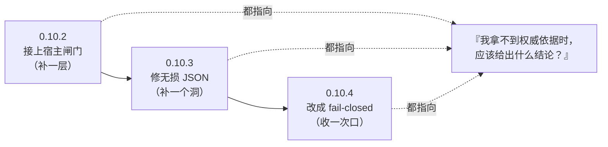
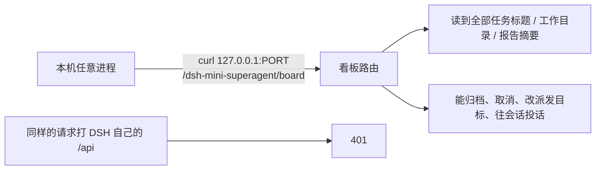
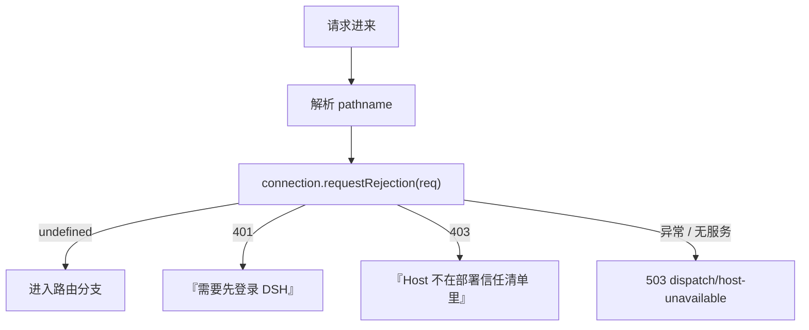
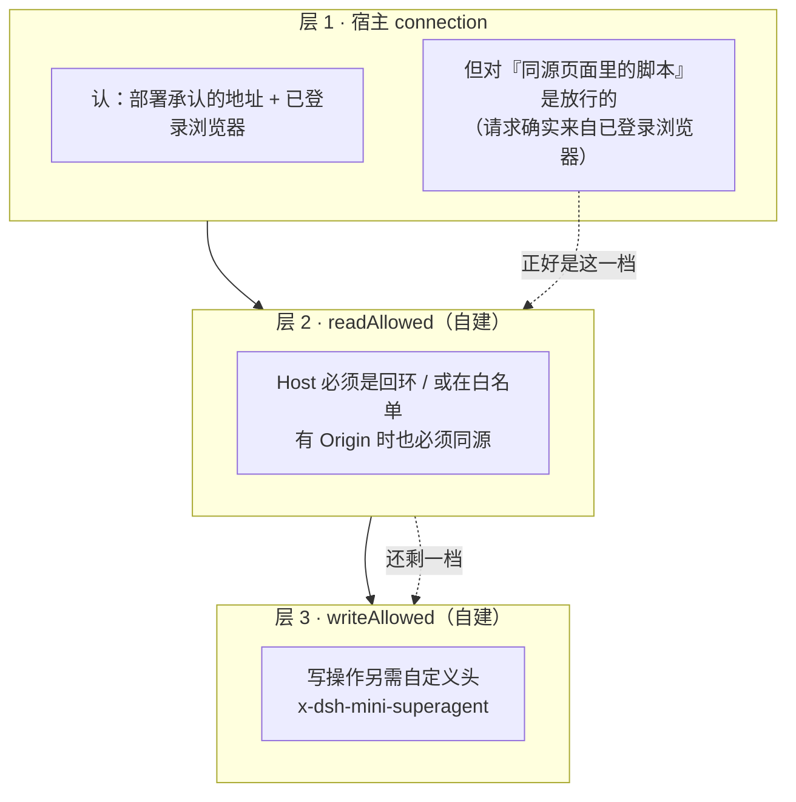
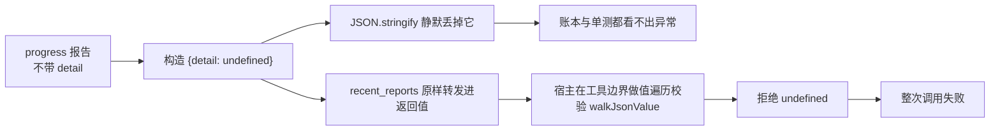
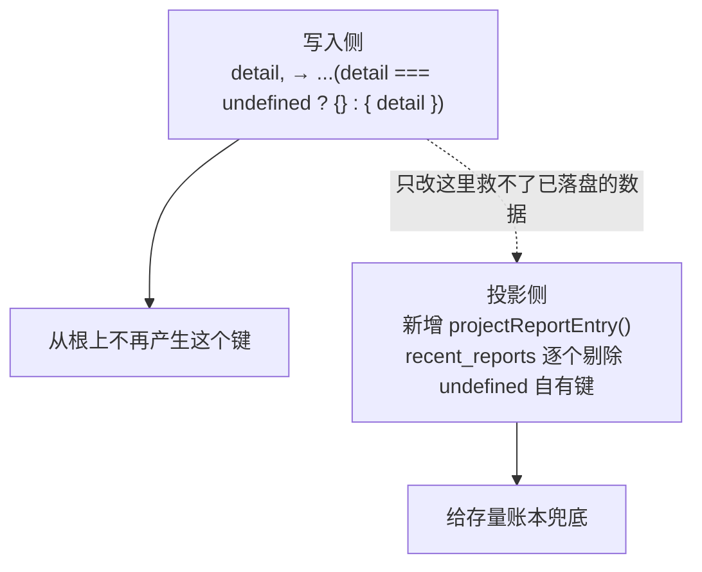
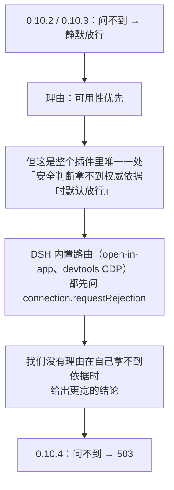
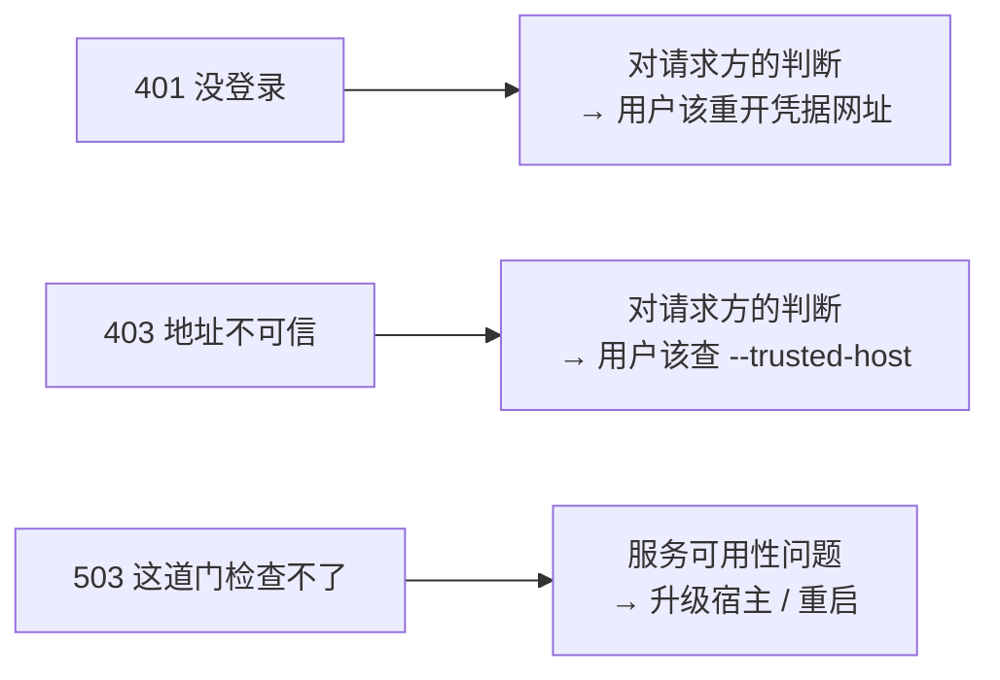
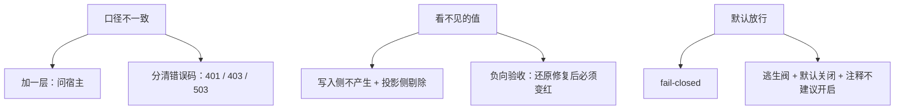

# dsh-mini-superagent 12：安全纵深与最后三修（0.10.2 → 0.10.4）

> **代码仓库**：[wychmod/dsh-mini-superagent](https://github.com/wychmod/dsh-mini-superagent)
> **本章目标**：看清三层准入为什么要并存、`undefined` 这种「看不见的值」怎么让一个工具稳定失败、以及 fail-closed 与 fail-open 的取舍为什么不能用「可用性」来论证。
> **对应提交**：`754a2a8`（接宿主 `connection.requestRejection`）→ `b8951dc`（报告条目不再带 `detail: undefined`）→ `f36088c`（准入改 fail-closed）。
> **原文对照**：`CHANGELOG.md` 的 0.10.2 / 0.10.3 / 0.10.4 三段（这三段是全项目最细的缺陷分析），`docs/board.md` 的「鉴权与暴露面」。

---

## 目录

- [一、三个补丁版本，一条主线](#一、三个补丁版本，一条主线)
- [二、0.10.2：为什么必须问宿主](#二、0102：为什么必须问宿主)
- [三、三层准入为什么不能只留一层](#三、三层准入为什么不能只留一层)
- [四、0.10.3：一个 `undefined` 如何让工具稳定失败](#四、0103：一个-undefined-如何让工具稳定失败)
- [五、0.10.4：fail-closed 的完整论证](#五、0104：fail-closed-的完整论证)
- [六、503 而不是 401/403](#六、503-而不是-401403)
- [七、核心讲解：三种「不失败但也不对」的错误](#七、核心讲解：三种「不失败但也不对」的错误)
- [八、使用建议](#八、使用建议)

---

## 一、三个补丁版本，一条主线



三个版本加起来改动不大，但每一处都是「默认值级别的判断」——`undefined` 怎么处理、问不到服务时放不放行。

## 二、0.10.2：为什么必须问宿主

### 问题

插件用 `server.register({kind:'prefix', path:'/dsh-mini-superagent/board'})` 把看板挂在宿主的**裸 `webServer`** 上。

而 `webServer` **只做路径分发、不做准入**——准入长在 `connection` 服务里（Host 信任清单 + 浏览器登录凭据）。

于是：



**同一台机器，两种口径**：宿主的 `/api` 说「要登录」，插件的看板说「不用」。这不是「不够安全」，是**口径不一致**——而口径不一致本身就是缺陷。

### 修法

闸门加在 `createBoardHandler()` 返回的 handler **最开头**（解析完 pathname 之后、进入任何路由分支之前）——一个 handler 覆盖全部端点。



**为什么闸门必须在最前面**：如果把闸门放在每个路由分支里，那么「未知路径」会先返回 404——**泄露端点表**。测试里专门有一条断言钉这个：「拒绝发生在任何路由分支之前（未知路径也先 403，而不是先 404）」。

### 错误码为什么要分开

| 码 | HTTP | 用户该做什么 |
|---|---|---|
| `dispatch/unauthenticated` | 401 | 重新打开 `dsh web` 打印的那个带凭据的网址 |
| `dispatch/forbidden` | 403 | 把域名写进 `--trusted-host` |

> 合并成一个码，排障脚本就只能去读中文措辞。

两个方向相反的处置动作，不能共用一个码。

## 三、三层准入为什么不能只留一层



文档的原话：

> **为什么三层并存而不是替换**：层 1 认的是「这台部署承认的地址 + 已登录浏览器」，但它对**同源页面里的脚本**是放行的（请求确实来自已登录浏览器）；层 2/3 挡的正是这一档。**删任何一层都会掉一档防护。**

这解释了一个常见误解：**「既然接了宿主的准入，自建的栅栏就可以删了」——错。** 两层挡的是不同东西。

### 自定义头到底挡什么

这一条必须说准，否则会给人虚假的安全感：

| 它挡得住 | 它挡不住 |
|---|---|
| 同源页面**之外**的脚本 | DNS rebinding（同源请求不触发预检） |
| 简单 CSRF | 同源页面里的 XSS（能带任何头） |

**真正的判据是 `Host`**——浏览器无法伪造它，它来自 URL。

## 四、0.10.3：一个 `undefined` 如何让工具稳定失败

这个 bug 是全项目绕得最深的一处，下面完整拆一遍。

### 现象

`dispatch_inspect` 永久报：

```text
tool "dispatch_inspect" returned invalid output: value is not lossless JSON
```

只要任务有过一条**不带 `detail`** 的报告（`progress` 最常见），此后每次 inspect 都失败，只能看 `dispatch_list` 的摘要。

### 根因：一个脏键

```js
// 旧代码（简写）
const entry = { at, status, summary, detail, truncated }
```

当 `detail` 是 `undefined` 时，这个对象有一个**值为 `undefined` 的自有键**：`detail: undefined`。



**为什么这个 bug 特别难查**：

| 层 | 表现 |
|---|---|
| 账本 | 看起来完全正常（`JSON.stringify` 丢了它） |
| 单测 | 完全正常（同样的原因） |
| 只有工具边界 | 失败 |
| 而且只在**有过 progress 之后** | 表现为「突然坏了」 |

### 修法：两处，纵深防御



**关键判断**：只改写入侧不够——用户机器上已经落盘的 `tasks.json` 里就带着脏键。

### 一个细节：只剔 `undefined`，不剔 `null`

> 两者语义不同（「没有值」vs「存在但为空」），把 `null` 一起抹掉会让 `truncated` 这类可选字段的读法失去信息。

### 验证方式：先自检宿主规则

- 新增 7 条用例，先**自检宿主规则确实拒绝 `undefined`**（如果宿主规则变了，这组用例应该先红在自检上，而不是红在结论上）；
- **负向验收**：还原两处修复后，7 条里有 5 条变红，说明用例真的钉住了这个形状，而不是恰好通过。

## 五、0.10.4：fail-closed 的完整论证

### 背景

0.10.2 留了一个回退：拿不到 `connection` 服务时**静默放行**，退回只靠自建栅栏。理由是「不因为闸门缺席就把整块看板打成 500」。

这个选择在向 [`polang233/dsh-plugin-index`](https://github.com/polang233/dsh-plugin-index) 提交收录申请时被**主动披露**（Issue #601），而该仓库的标准是「拿不到 `connection` 时应直接拒绝」——于是按 fail-closed 改。



### 实际情况要说清（不夸大）

CHANGELOG 里有一段很诚实的说明：

> `connection` 在 `src/index.js` 里已是**硬 inject 依赖**，所以「路由在、服务不在」只出现在旧宿主与半加载窗口——这次改动的真实价值是**纵深防御**与对齐收录方的明确要求，不是修一个日常可复现的洞。

**这句话的分寸拿得准**：它把一个安全检查的价值说准了，没有吹成「修复了严重漏洞」。一个被夸大的安全修复，会让读者对其它修复的可信度打折扣。

### 逃生阀

`allowBoardWithoutConnectionGate`（默认 `false`），**只影响「问不到」这一档**：

| 能翻掉 | 不能翻掉 |
|---|---|
| 服务缺失 / 没有方法 / 方法抛错 → 放行 | 401 / 403（已经拿到的权威结论） |

打开后自建 `readAllowed` / `writeAllowed` 仍然生效——退的只是一层，不是整块拆掉。

## 六、503 而不是 401/403

这是一个纯粹语义层面的选择，但很重要：



> 用 401 会误导用户去重开一条带凭据的网址，用 403 会误导用户去查 `--trusted-host`。

**这就是为什么错误码要分开**：不是洁癖，而是**每个码对应一个不同的处置动作**。合并码等于把「该做什么」这件事从机器可读变成人肉解析中文。

## 七、核心讲解：三种「不失败但也不对」的错误

这三个补丁版本处理的是同一类错误——**它们都不抛异常、不报错，但结果是错的**：

| 类型 | 例子 | 为什么危险 |
|---|---|---|
| **口径不一致** | 宿主 `/api` 要登录，插件看板不用 | 单看每一边都「正常」，只有对比才看得出 |
| **看不见的值** | `detail: undefined` | 序列化时消失，只有遍历才暴露 |
| **默认放行** | 问不到准入依据 → 放行 | 在正常环境里永远不触发 |

共同点：**它们的失败路径本身是静默的**。所以修法也必须针对「静默」这件事：



**「负向验收」这一条要单说**：

> 还原两处修复后，该文件的 7 条里有 5 条变红，说明用例真的钉住了这个形状，而不是恰好通过。

大多数测试只证明「改完之后是绿的」。负向验收证明「这个测试确实在测那件事」——两者的置信度差一个量级。

## 八、使用建议

### 如果你在用这个插件

1. **0.10.4 起，旧宿主上可能看不到看板（503）。** 工具不受影响。先重启 DSH（半加载会在重启后自愈）；确实是宿主不提供该服务，再考虑逃生阀。
2. **别开 `allowBoardWithoutConnectionGate`。** 它只在「跑在旧宿主上、又必须保留看板」时用。
3. **远程访问只能用同源页面。** 远程 `curl` 会被 403——这是有意的。
4. **升级到 0.10.4 解决 `dispatch_inspect` 报 invalid output。** 这个修复在仓库里记作 `0.10.3`，但 `0.10.3` 没有发布到 npm，装 `0.10.4` 即可（它包含该修复）。存量账本无需手工清洗。

### 如果你在写自己的服务

三条可以直接用：

| 原则 | 具体做法 |
|---|---|
| 问不到权威依据时拒绝，不猜测 | 503 + 一个能指出「这是可用性问题」的错误码 |
| 错误码对应处置动作 | 401 重新登录 / 403 改配置 / 503 升级或重启，别合并 |
| 修「静默消失」的值要给存量兜底 | 只改写入侧救不了已经落盘的数据 |

### 一条关于安全修复的表达建议

CHANGELOG 里有两句话，把这件事的边界说得很清楚：

> 这次改动的真实价值是**纵深防御**与对齐收录方的明确要求，不是修一个日常可复现的洞。

> 风险等级要说清：不是远程漏洞（攻击面是能控制 `dispatch_launch` 参数的会话），但它破坏了数据/指令边界。

**把严重性说准，比说严重更有说服力。** 一个每次都说「严重漏洞」的项目，读者会学会打折；一个能说「这个不严重、但那个很严重」的项目，读者才愿意相信它的判断。

---

> **下一篇**：最后一篇收拢全系列——十条横切亮点、可迁移的模式清单、适用场景地图，以及一份明确的「不建议用」清单。
