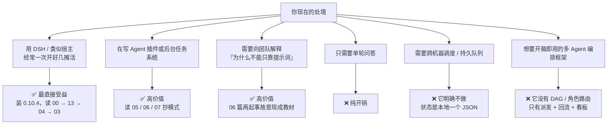
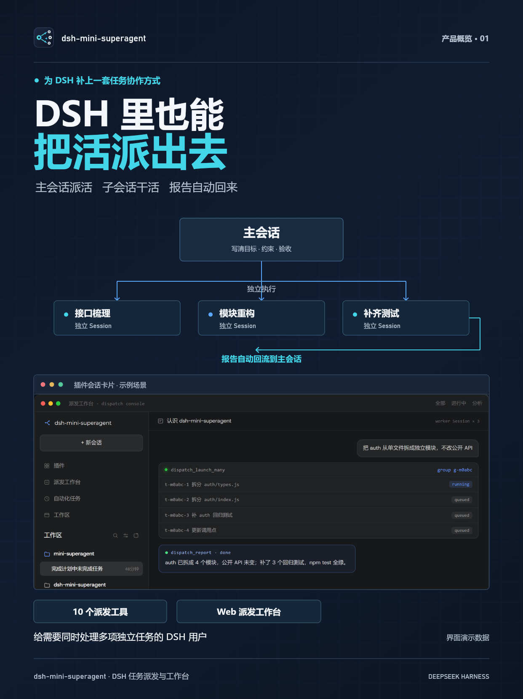
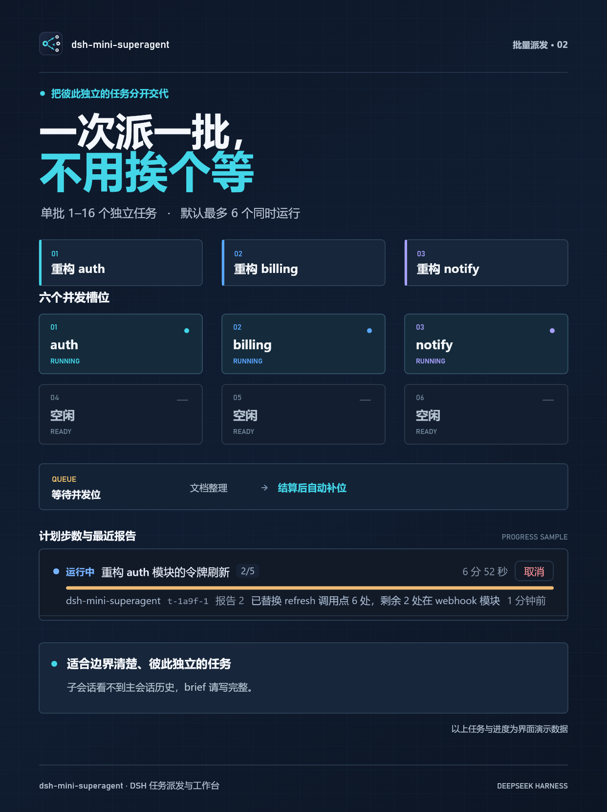
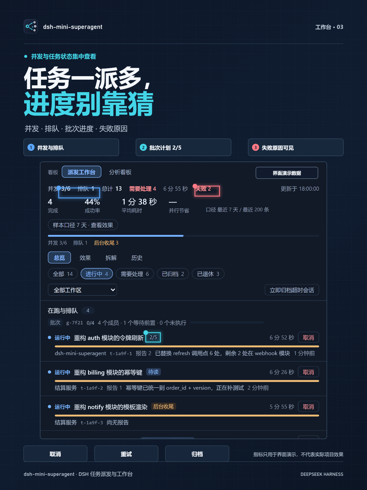
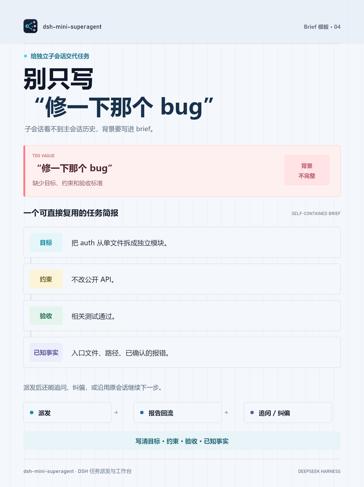
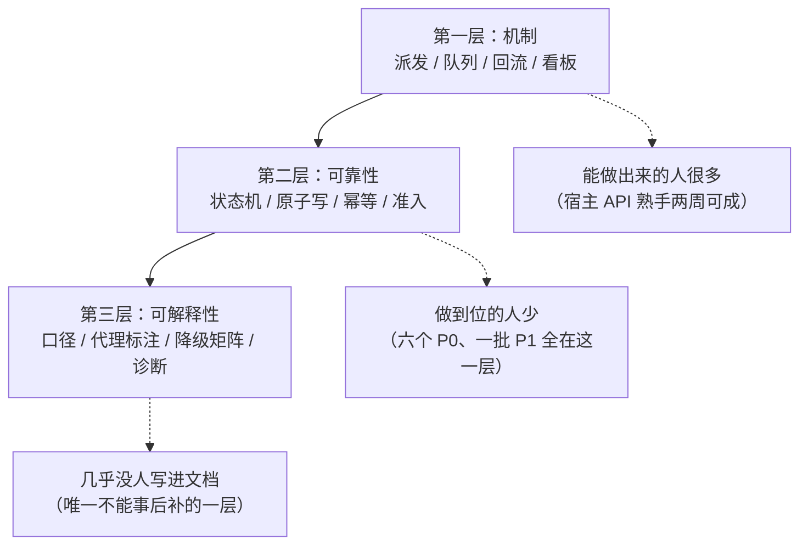

# dsh-mini-superagent 13：亮点、适用场景与推荐结论

> **代码仓库**：[wychmod/dsh-mini-superagent](https://github.com/wychmod/dsh-mini-superagent) ｜ **版本**：`0.10.4` ｜ MIT
> **本章目标**：横向收拢全系列，给出可复用的亮点清单、可迁移模式、适用人群地图与明确的「不建议用」边界——读这一篇就能判断「这个项目对我有没有用、该学哪几招」。
> **原文对照**：全系列 00–12 篇与仓库 `README.md` / `docs/architecture.md` / `CHANGELOG.md` 的综合归纳。

---

## 目录

- [一、十条横切亮点](#一、十条横切亮点)
- [二、可迁移的模式清单](#二、可迁移的模式清单)
- [三、适用场景地图](#三、适用场景地图)
- [四、明确不做什么](#四、明确不做什么)
- [五、谁该读这个系列](#五、谁该读这个系列)
- [六、产品形态：四张图看懂它长什么样](#六、产品形态：四张图看懂它长什么样)
- [七、核心讲解：这个项目真正的价值密度在哪](#七、核心讲解：这个项目真正的价值密度在哪)
- [八、总体推荐结论](#八、总体推荐结论)

---

## 一、十条横切亮点

把前十三篇压成十条：

| # | 亮点 | 一句话 | 出处 |
|---|---|---|---|
| 1 | **派发是非阻塞的，且「结束本轮」被写成合法终点** | 报告自己回来，主会话不必占着 step 等 | 01 / 06 |
| 2 | **worker 是真正的 Session，不是一次性执行器** | 所以能追问、能接手、能续跑、能归档 | 01 |
| 3 | **看板与派发同源但不同路** | 看板挂了不影响派发，派发挂了看板只是没数据 | 02 |
| 4 | **会话归属与工作目录分离** | 侧边栏干净，活干在正确目录 | 03 |
| 5 | **状态只有一个写入口 + 跃迁表** | 消灭「幽灵占用」这一类不可见故障 | 05 |
| 6 | **结构性约束用工具面，语义约束用提示词** | 一条清晰的分界线，避免两类错误 | 06 |
| 7 | **账本是权威，会话是投影** | 压的永远是投影，账本一个字不压 | 07 |
| 8 | **终态硬直通，配置只能扩展不能降级** | 保证主会话永远等得到「做完了」 | 07 |
| 9 | **n=0 时给 null 不给 0** | 「没有样本」与「0%」在界面上必须长得不一样 | 08 |
| 10 | **降级矩阵带「明确禁止」那一栏** | 没有禁止栏的降级，很容易糊出一个更误导的东西 | 11 |

每一条都在前面的专题篇里有完整展开，这里只做索引。

## 二、可迁移的模式清单

如果你要「拿来用」，下面这些可以直接迁移到别的项目：

| 模式 | 来自 | 迁移到 |
|---|---|---|
| 状态跃迁表 + 唯一写入口 | 05 | 任何有异步状态机的系统（订单、工单、部署流水线） |
| 副作用先于状态变更 | 05 | 任何「改状态 + 调外部」的组合 |
| `await` 之后检查状态 | 05 | 任何有取消能力的异步启动流程 |
| 原子写 + `.bak` 回退 + 版本闸门 | 07 | 任何单文件持久化的本地应用 |
| 权威源 / 投影分离 | 07 | 任何「有账本又有展示层」的系统 |
| 准入分级：结论恒直通 | 07 | 通知系统、告警系统、消息推送 |
| 合并窗口（只合并过程态） | 07 | 高频进度推送、日志聚合、UI 刷新节流 |
| n=0 给 null + `sampleLow` | 08 | 任何数据看板、报表、监控面板 |
| 代理指标三层标注 | 08 | 缺字段但有分析诉求的场景 |
| 同源 HTTP + 快照拍平 | 02 | 宿主插件与浏览器 UI 的分工 |
| 降级矩阵（含禁止栏） | 11 | 任何需要「坏了怎么退」的 UI 集成 |
| 负向验收（还原修复必须变红） | 12 | 任何 bug 修复的测试写法 |
| 诊断接口白名单过滤 | 02 | 任何接收客户端自报状态的后端 |

### 五条最能直接用的

**① 状态跃迁表。** 不是「校验一下 status 合不合法」，而是**把合法跃迁列出来**。前者会漏，后者不会——未知跃迁自动被拒。

**② 副作用先于状态。** 「投递成功后才置 `running`」，而不是「置 `running` 后投递」。因为本地状态可回滚，外部副作用不可。

**③ 合并窗口只合并过程态。** 结论类（done / blocked / failed / cancelled）永不参与合并，且到达时先冲刷窗口再发自己——保证「先过程、后结论」的因果顺序。

**④ n=0 给 null。** 一个 0% 和一个「—」在用户眼里是完全不同的两件事，而这个歧义必须由数据层消掉。

**⑤ 负向验收。** 修完 bug 后，把修复还原、确认测试变红，再改回来。这一步能把「测试恰好通过」和「测试真的在测那件事」分开。

## 三、适用场景地图

### 三个「最合适」的具体场景

| 场景 | 为什么合适 |
|---|---|
| **一次重构多个互不相关的模块** | 批量派发 + 并发队列 + 批次汇总，正是为这个设计的 |
| **长任务（压测、迁移、批量生成）** | 派完就结束本轮，报告回来再汇总；后台活还会继续占位直到真正收尾 |
| **需要「人随时接手」的后台任务** | 子会话就是普通 Session，侧边栏能直接打开 |

### 三个「不合适」的具体场景

| 场景 | 为什么 |
|---|---|
| 需要跨机器 / 跨实例调度 | 状态是一个本地 JSON，单写，不跨进程协调 |
| 需要「任务失败自动重试 N 次再放弃」的队列语义 | 没有持久队列、没有重试策略；重启后未结算任务标 `interrupted` 由人决定 |
| 需要严格权限隔离 | 不裁剪 worker 工具集（除非你给子会话指定收紧的 `agent_preset`） |

## 四、明确不做什么

这一栏比亮点更有价值，因为它决定了你能信任它到什么程度：

| 不做 | 原因 | 代价 |
|---|---|---|
| 多机调度 | 单文件状态，单写 | 只能单进程 |
| 持久队列 | 队列只在内存里 | 重启时排队中且没启动过的会重排，跑过的标 `interrupted` |
| 权限系统 | 不裁剪 worker 工具集 | worker 能看到全部全局工具（包括 `dispatch_launch`），靠提示词禁止 |
| 自动重试策略 | 重试是人的决定 | 看板上点，或脚本调接口 |
| DAG 编排 | 依赖只有「先后」一种关系 | 表达不了「A、B 都完成才做 C」（只能用 `depends_on` 同时声明两个） |
| 真实工时/成本核算 | 缺宿主数据源 | 并行节省是粗算，`estimated` 恒为 true |
| 真实负责人/截止时间 | 账本没有这两个字段 | 用代理指标并标「待业务确认」 |

**还有一条自我限制**：`maxWorkers` 是**软上限**。`dispatch_message` 唤醒已结算的 worker 会直接置 `running`，可能短暂超过上限——这是有意的（人的追问不该排在批量任务后面）。

## 五、谁该读这个系列

### 三类高价值读者

**① 正在被「多任务并行」折磨的 Agent 使用者。**
你不需要懂架构，只需要知道：装上之后派完就能走，报告会自己回来，卡住了在侧边栏看得见。读 00 → 04 → 03 就够用。

**② 写后台任务系统的工程师。**
这个项目最有价值的部分不是「派发」，是那套「让异步任务不丢、不重、不卡死、不静默」的工程手法。第 05 篇的十个检查问题和第 07 篇的「先定权威再定投影」是两把可以直接用的尺子。

**③ 要给团队讲「为什么提示词不够」的人。**
第 06 篇那两起事故（重复做派出去的活、连续等 33 分钟）是现成的例子——因为它们不是「模型不听话」，而是**规则写得不可操作**。作者改法也很示范：从「不要调用 write/edit」改成「这件事是不是那个任务的目标」。

### 两类可以先跳过的人

- **只做单轮问答的**：这套东西是纯开销，装它反而多十个工具要模型分辨。
- **要找「多 Agent 框架」的**：它会让你失望——没有 DAG、没有角色路由、没有消息总线。它只做「一个会话派活给另一个会话」这一件事。

## 六、产品形态：四张图看懂它长什么样

以下四张图取自项目仓库 `assets/readme/`，图中的任务、进度与指标均为演示数据，不代表实际效果。

**图 1 · 从派发到报告回流。** 主会话提交简报，多个独立 Session 执行，结果回到原会话。注意三件事同时发生：主会话没有被占住、三个子会话各在自己的目录里、报告回来时是一条带来源标识的消息而不是「用户说的」。

**图 2 · 批量派发与并发队列。** 单批 1–16 项独立任务，默认最多 6 路并行，空位出现时队列自动补位。这张图对应第 01 篇讲的 `pump()` 触发点——补位是由**结算事件**驱动的，不是靠轮询。

**图 3 · 派发工作台。** 集中查看并发、排队、批次计划和异常状态，并可取消、重试或归档。这张图对应第 08 篇的三段式布局——「需要你处理」「在跑与排队」「最近完成」三块各自回答一个问题。

**图 4 · 交给子会话的任务简报。** 写明目标、约束、验收和已知事实，让任务脱离主会话历史也能执行。这是这个项目最容易被低估的一张图——**brief 写不好，后面所有机制都在为一个含糊的任务服务**。

## 七、核心讲解：这个项目真正的价值密度在哪

如果只能记一句话，记这句：

> **它示范的不是「怎么让 AI 并行干活」，而是「怎么在 AI 不可靠的地方用工程兜住」。**

展开成三层：

> 这张图只表达**比例关系**（越往上越容易、越往下越稀缺），不标具体百分比。这类「可靠性占多少代码」的数字没有任何可复现的口径——真要去数，也只能数出「以 `if` 开头的出错分支有多少」，那和「可靠」不是一回事。全系列反复强调不编造指标，这里也就不编。

**第一层（机制）** 是最容易被看见的，也是最容易被复制的。任何一个熟悉宿主 API 的人，两周内能写出来。

**第二层（可靠性）** 是真正的分野。它不出现在功能列表里，只出现在「用久了会不会咬人」上——六个 P0、二十条 P1，全部在这一层。

**第三层（可解释性）** 是最少见的。它包含：

| 做法 | 具体表现 |
|---|---|
| 口径写清 | 每个百分比都能追到窗口、分子、分母 |
| 代理标注 | 负责人 / 逾期明确标「代理，待业务确认」 |
| 降级带禁止 | 失败点 → 检测 → 降级 → **禁止什么** |
| 未验就写未验 | README 有一整节「未实测」 |
| 价值说准 | 「这次改动的真实价值是纵深防御，不是修一个日常可复现的洞」 |

**为什么第三层最难补**：前两层可以重构，这一层不能。一份没有口径的看板，事后补上口径会发现所有历史数字都得重算。

## 八、总体推荐结论

### 推荐指数与理由

| 维度 | 评价 |
|---|---|
| **作为工具**（在 DSH 上做多任务并行） | ★★★★★ —— 它把这件事做到了「日常可用」的程度，且失败有明确出口 |
| **作为学习材料**（异步任务可靠性） | ★★★★★ —— 05 / 07 两篇的密度超过多数付费课程 |
| **作为架构范本**（Host/Client 分工、降级设计） | ★★★★☆ —— 极好，但绑定 DSH 的槽位机制，迁移时要重新映射 |
| **作为「多 Agent 编排框架」** | ★★☆☆☆ —— 它不做这件事，别按这个期待去用 |

### 三句话结论

1. **如果你在 DSH 上经常一次开好几摊活，装它。** 收益最直接：不用串行等、卡住了看得见、报告不会丢。装完记得刷新页面。
2. **如果你在写后台任务系统，读 05 和 07。** 那两篇里的十个检查问题和「先定权威、再定投影、然后给生命周期和预算」是两把能直接用的尺子。
3. **如果你想找「多 Agent 编排框架」，别用它的功能，读它的取舍。** 它明确不做 DAG、不做角色路由、不做多机——而它把「为什么不做什么」写得比「做了什么」更清楚，这本身就是最好的架构课。

### 一条使用建议，也是这个项目的态度

这个项目的 README 里有一句容易被略过的话，放在最后：

> 任务卡、批次状态和指标属于示例场景。插件提供状态追踪能力，**不承诺固定耗时、效率提升或任务成功率**。

一个工具愿意说清「我不承诺什么」，比它罗列十个卖点更容易让人放心。这也是整个系列读完最该带走的东西：

**把边界写清楚，比把能力吹满更有价值。**

---

> **全系列完。** 回到 [00 篇](/md/10-项目实战/04-DSH任务派发插件/00-项目全景与阅读地图.md) 看阅读路径，或直接去 [01 篇](/md/10-项目实战/04-DSH任务派发插件/01-从单文件到最小闭环.md) 开始。
