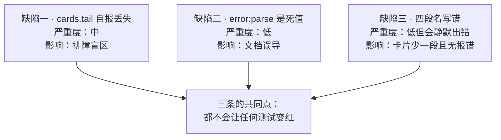
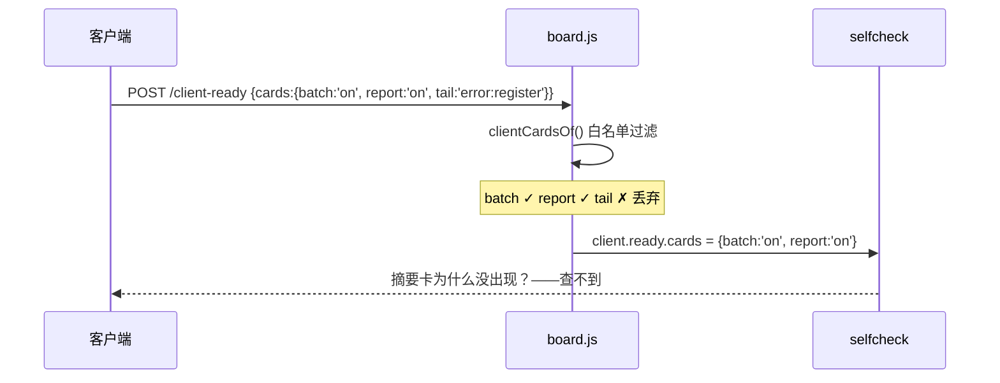
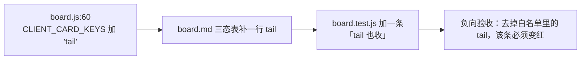
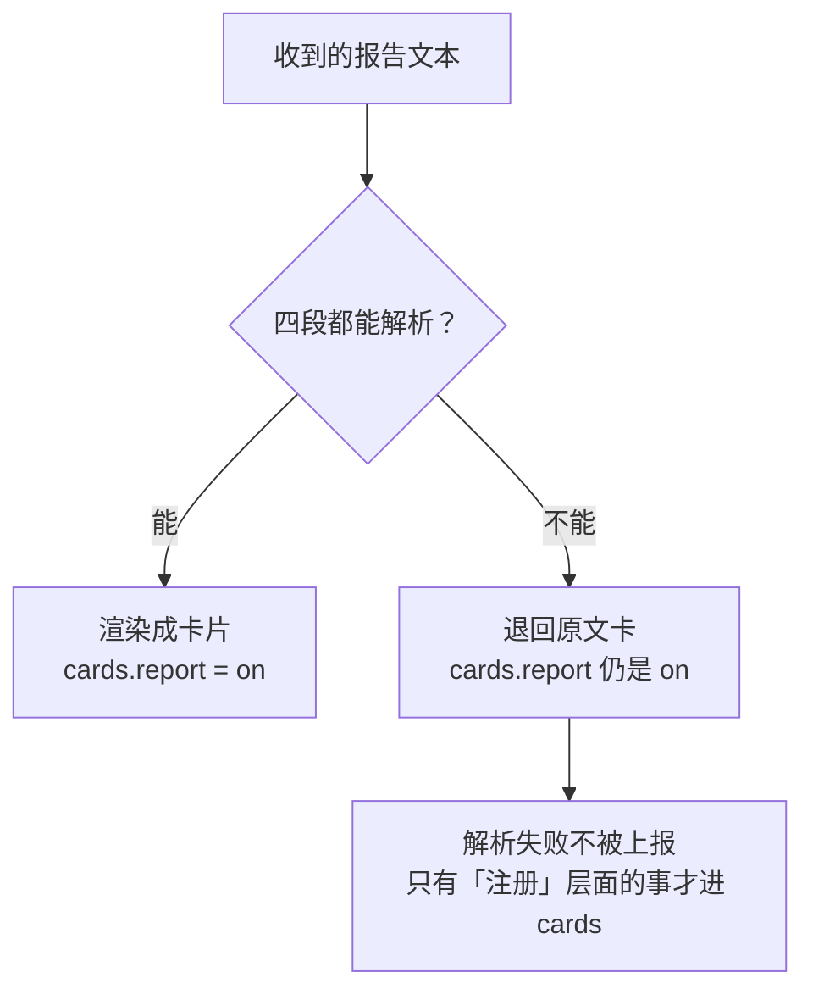
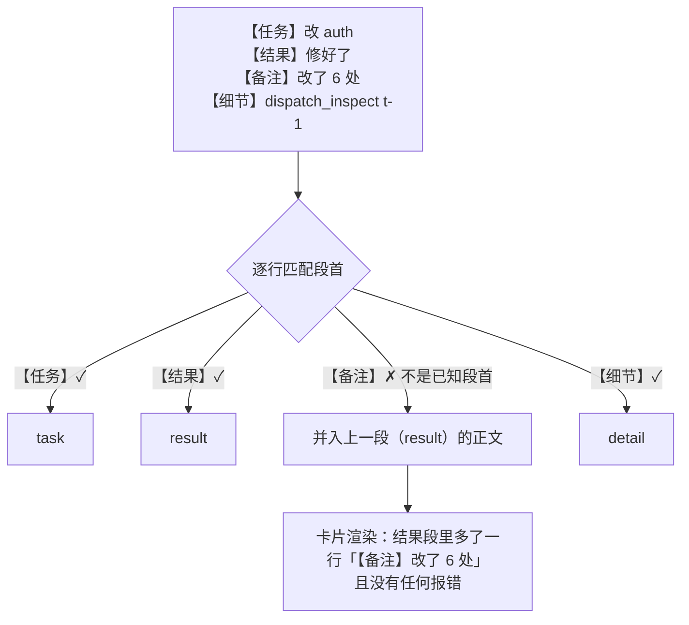
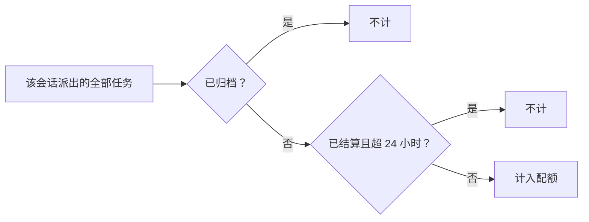
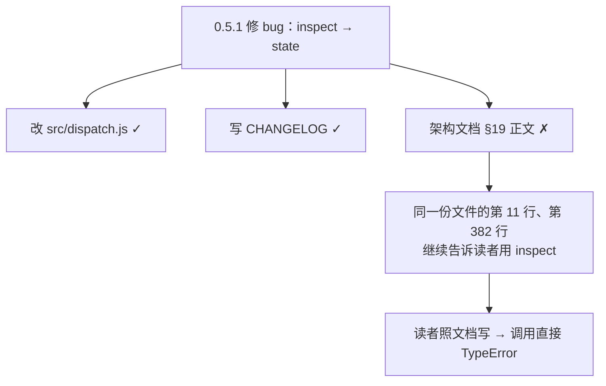
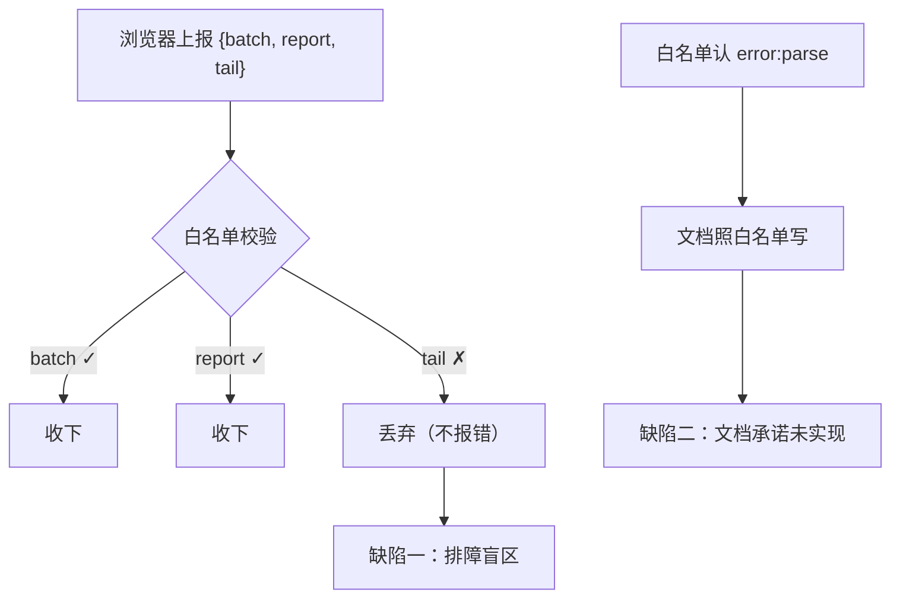
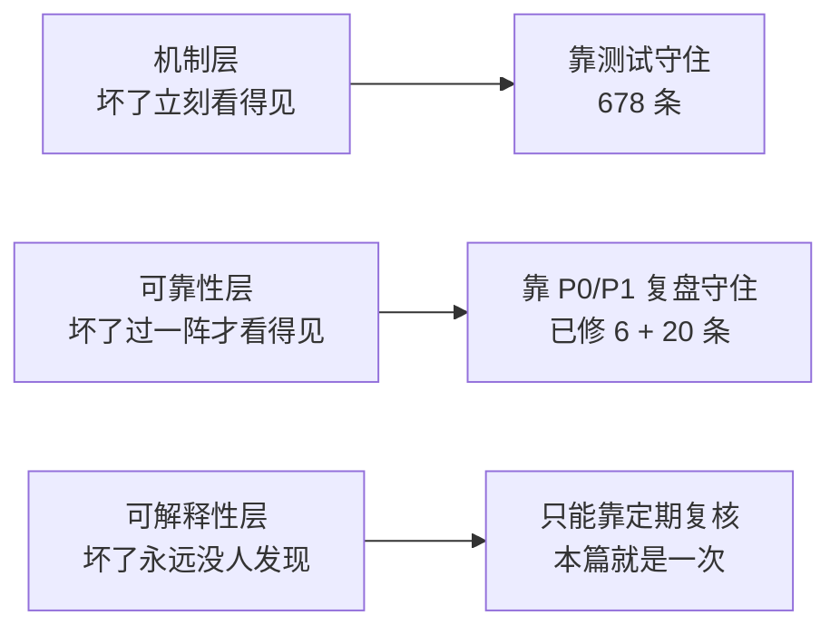

# dsh-mini-superagent 14：复核记录——三个真实缺陷与六处文档漂移

> **代码仓库**：[wychmod/dsh-mini-superagent](https://github.com/wychmod/dsh-mini-superagent) ｜ 复核版本 `0.10.4`
> **本章目标**：把「系列写完后再回头对一遍代码」这件事摊开。这是唯一一篇**不介绍能力、只报问题**的文章——它回答了前十三篇一直没回答的问题：**这些说法凭什么可信？**
> **复核方式**：逐条对照 `src/` 与 `client/` 的实现、实跑 `npm test`（678 pass）与 `client-smoke.mjs`（817 项）、用 `node -e` 复现可疑行为、用 `git show` 追每个数字的来源。

---

## 目录

- [一、为什么要有这一篇](#一、为什么要有这一篇)
- [二、复核结论速览](#二、复核结论速览)
- [三、缺陷一：`cards.tail` 的自报被宿主丢弃](#三、缺陷一：cardstail-的自报被宿主丢弃)
- [四、缺陷二：`error:parse` 是一个死值](#四、缺陷二：errorparse-是一个死值)
- [五、缺陷三：四段名在 README 里写错](#五、缺陷三：四段名在-readme-里写错)
- [六、两处「不算错但会误导」的小偏差](#六、两处「不算错但会误导」的小偏差)
- [七、六处文档漂移](#七、六处文档漂移)
- [八、复核确认无误的部分](#八、复核确认无误的部分)
- [九、核心讲解：为什么「白名单过滤」反而成了缺陷温床](#九、核心讲解：为什么「白名单过滤」反而成了缺陷温床)
- [十、使用建议与结论](#十、使用建议与结论)

---

## 一、为什么要有这一篇

前十三篇写了 100 张图、十几万字，全部基于三样东西：仓库里的文档、`CHANGELOG` 的记录、以及代码。而这三样**本身就可能互相矛盾**。

一个诚实的教程必须回答：**你怎么知道文档说的是真的？**

答案只能是——去对代码。所以这一篇做了三件事：


第 ③ 步里有一个重要区分：**文章写错了**（我改文章）与**项目真的有缺陷**（我记录，但不擅自改别人的仓库）。这两类在这一篇里分开写。

## 二、复核结论速览

| 类别 | 数量 | 处理 |
|---|---|---|
| 真实缺陷（影响功能或排障） | **3** | 记录在此，附修法建议 |
| 小偏差（不影响功能） | **2** | 记录在此 |
| 文档漂移（文档与代码不一致） | **6** | 记录在此；其中 3 处我已在系列文章里按代码口径写，另外 3 处是仓库自身的问题 |
| 我上一版文章里的错误 | **6** | **已直接改掉**（见下一篇之前的修订说明） |
| 复核确认无误的关键数字 | **20+** | 列在第八节 |

三条缺陷按严重度排：



**这三条一条都不会让 CI 变红。** 这是本篇最重要的观察——第六节会展开。

## 三、缺陷一：`cards.tail` 的自报被宿主丢弃

### 现象

`GET /board/selfcheck` 的 `client.ready.cards` 里永远只有 `batch` 与 `report` 两个键，**看不到 `tail`**。

### 证据链

客户端侧有三处上报摘要卡（`conversation.chat.turnTail`）的注册结论：

| 位置 | 调用 | 含义 |
|---|---|---|
| `client/index.js:11278` | `markCard('tail', 'error:register')` | 槽给了、注册被拒 |
| `client/index.js:11282` | `markCard('tail', 'on')` | 注册成功 |
| `client/index.js:11286` | `markCard('tail', 'error:slot')` | `inject` 自己抛了 |

宿主侧的白名单只收两个键：

```js
// src/board.js:60
const CLIENT_CARD_KEYS = new Set(['batch', 'report'])
```

于是 `clientCardsOf()` 在遍历时把 `tail` 直接 `continue` 掉：



### 实测

```text
上报 {batch:'on', report:'on', tail:'on'}  →  宿主存下 {batch:'on', report:'on'}
上报 {tail:'error:register'}              →  宿主存下 undefined
```

### 影响范围（说准，不夸大）

| 会不会受影响 | 说明 |
|---|---|
| 摘要卡本身 | **不受影响**。`registered` 数组里那条 `conversation.chat.turnTail` 读的是同步路径的 `tailReady` 变量，不走 `cards.tail` |
| 排障 | **受影响**。摘要卡注册失败时，`selfcheck` 里查不到任何痕迹，只能去翻日志里的 warn |

也就是说：**功能是好的，可观测性是缺的。** 而本项目自己的原则恰好是「降级必须可观测」（第 11 篇引过那四条）。这条缺陷是这个原则在自己身上失效的一个样本。

### 修法建议



第四条是关键。这个缺陷能活下来，正是因为**没有任何测试覆盖「客户端报的键，宿主是否都收下了」**——只有测「宿主的白名单挡住了非法键」，没测「白名单漏了合法键」。

## 四、缺陷二：`error:parse` 是一个死值

### 现象

`error:parse` 出现在**三处文档与一处白名单**里，但在客户端源码里出现 **0 次**：

| 位置 | 出现 |
|---|---|
| `client/index.js` | **0 次**（客户端从不产生这个值） |
| `src/board.js:70` 的 `CLIENT_CARD_STAGES` | 认这个值 |
| `docs/board.md` 的三态表 | 写了，还配了「内容契约问题」的解释 |
| `README.md` | 写在「查它为什么没出现」那一行 |

### 那真实的解析降级是什么

报告卡的解析失败**不走 `markCard`**，它走的是「退回原文卡」——内容一字不丢，只是外观朴素（第 11 篇第三节讲过）。



所以 `error:parse` 描述的是一个**设计上存在、实现上未接**的状态。文档把一个「预留值」写成了「可观测状态」。

### 影响

用户看到报告变成朴素样式，会去 `selfcheck` 查 `cards.report`——看到 `on`，然后困惑：注册是成功的，为什么长得不一样？

### 修法建议

两条路，二选一：

| 方案 | 做法 | 代价 |
|---|---|---|
| **补实现** | 退回原文卡时 `markCard('report', 'error:parse')` | 会让「解析失败」和「注册成功」互斥，语义需要重新定义 |
| **删死值** | 从三处文档与 `CLIENT_CARD_STAGES` 里删掉 `parse` | 少一个可诊断维度，但消除了误导 |

本项目一贯的取向（「不假装」）更接近第二条：宁可少一个状态，也不要一个永远不出现的状态。

## 五、缺陷三：四段名在 README 里写错

### 现象

代码里的段名（`src/constants.js` 的 `REPORT_SECTIONS`、`client/index.js` 的 `REPORT_TEXT_SECTIONS`，两处逐字相同且有测试钉住）：

```text
【任务】 【结果】 【说明】 【需要你】 【细节】 【批次】
```

而 README 与 CHANGELOG 写的是：

```text
【任务】 【结果】 【备注】 【需要】     ← 错了两处
```

| 位置 | 原文 |
|---|---|
| `README.md:424` | 「分成【任务】【结果】【备注】【需要】四段渲染」 |
| `CHANGELOG.md:178`（0.10.0 段） | 「按【任务】【结果】【备注】【需要】四段解析」 |

### 后果：静默、且不可见

报告卡的解析是**按行首精确匹配**的。worker 如果照 README 写 `【备注】…`，那一行不匹配任何段首，会被当成上一条已知段的正文：



**这是三条缺陷里最危险的一条**：它不会失败，只会让信息错位。用户看到的结果段里混着一句「【备注】…」，会以为是 worker 自己写得不规范。

### 为什么测试没拦住

`test/voice-contract.test.js` 有一条断言专门钉「客户端也存了这六个段名」——但那比对的是 `src/constants.js` 与 `client/index.js`，**README 不在断言范围内**。这和 0.9.1 的 A1 修过的问题（根 README 的工具数没人钉）是同一类：门面文件永远在断言之外。

## 六、两处「不算错但会误导」的小偏差

### 6.1 `clip()` 的截断计数少报 40

`src/tasks.js` 的 `clip()`：

```js
const note = tail => `\n…（已截断 ${value.length - cap} 字符）…\n${tail}`
const bodyBudget = Math.max(0, cap - 40)
```

提示语里的「已截断 X 字符」用的是 `value.length - cap`，但真实丢弃是 `value.length - bodyBudget`（少了 40 字的提示语预算）。实测：

| `limit` | 文案声称丢弃 | 实际丢弃 | 偏差 |
|---|---|---|---|
| 200 | 4800 | 4840 | +40 |
| 500 | 4500 | 4540 | +40 |
| 1000 | 4000 | 4040 | +40 |

**恒定偏 40，方向和长度无关。** 长度上限本身是对的（输出 176 ≤ 200），错的只是这句给人看的数字。

之所以单列，是它恰好撞上本项目的一条自我要求：「给人看的数字必须可复核」。一句「少报 40」的提示，本质上和看板上的假百分比是同一类问题，只是小得多。

### 6.2 `maxTasksPerSession` 的注释口径已过期

```js
// src/constants.js:261
/** 每个主会话最多累计派发多少个任务。 */
maxTasksPerSession: 64,
```

而实现（`src/dispatch.js:642` 的 `quotaUsed()`）数的是**仍在册**的任务：



注释说「累计」，实现是「当前占用」。读注释的人会以为「派满 64 个就永久封死」——那恰好是 0.8.0 修掉的 bug 的形态，注释却还留着旧口径。

## 七、六处文档漂移

这一节的六条都在**仓库自己的文档**里（不是我的文章）。列出来是因为它们直接解释了「为什么不能只信文档」：

| # | 位置 | 文档说 | 代码是 |
|---|---|---|---|
| 1 | `docs/architecture.md:11` | 「硬依赖 DSH 的**三个**服务：`tools`、`agents`、`sessionController`」 | `inject` 有**四个**：多了 `connection`（0.10.2 加的） |
| 2 | 同上一行 | 「可选依赖**四个**」 | 实际有 **9 个**：`webServer` / `workspaceRegistry` / `workingDirectory` / `permissionPresets` / `llm` / `subagents` / `jobs` / `sessionPersistence` / `clientModules` |
| 3 | `docs/architecture.md:11` 与 `:382` | 「`sessionController.inspect` 判断默认主会话存在性」 | 0.5.1 起改用 `state({sessionId})`，`list()` 兜底；**`inspect` 这个方法根本不存在** |
| 4 | `README.md:424`、`CHANGELOG.md:178` | 【备注】【需要】 | 【说明】【需要你】 |
| 5 | `README.md` 与 `docs/board.md` | `error:parse` 可观测 | 客户端从不产生 |
| 6 | `src/constants.js:261` | 「累计派发多少个任务」 | 只数仍在册的 |

其中**第 3 条最讽刺**：`docs/architecture.md` 自己有一段专门记「0.5.1 修了 `inspect` 不存在这个 bug」，而同一份文件的第 11 行和第 382 行还在写 `inspect`。修 bug 时改了代码、写了 CHANGELOG，但没回头改架构文档的正文。



这是「文档漂移」最标准的形态：**不是写错了，而是改了一半。**

## 八、复核确认无误的部分

复核不只是找错。下面这些数字与行为都逐条验过，**全部成立**：

| 项 | 声明值 | 复核结果 |
|---|---|---|
| 版本号 | `0.10.4` | `package.json` / `constants.VERSION` / 两份 README / `docs` 示例 / 落地页 / 冒烟 fixture **八处同源** |
| 测试 | 678 pass | `npm test` 实跑 678 pass / 0 fail |
| 语法 | 21 个文件 | `node scripts/check-syntax.mjs` 通过 |
| 客户端冒烟 | 817 项 | `client-smoke.mjs` 实跑 817 项全过 |
| 工具数 | 10 个 | `TOOL_NAMES` 目录导出确认 |
| 配置项 | 47 个默认值 | `Object.keys(DEFAULTS).length === 47` |
| 错误码 | 12 个 | `ERROR_CODES` 12 项，闭集 |
| HTTP 路由 | 11 条 | 5 个 GET + 6 个 POST，逐条点出 |
| 任务状态 | 8 个 | `STATUS_ORDER` 8 项；`SETTLED` 6 项；`COMPLETION_BASE` 5 项（去掉 cancelled） |
| Host 源码 | 12,093 行 / 14 文件 | `cat src/*.js \| wc -l` |
| `dispatch.js` | 4,999 行 | 实测一致 |
| 客户端 | 12,586 行 | 实测一致 |
| 包内文档 | 4,307 行 / 8 篇 | `cat docs/*.md \| wc -l` |
| `plans/` | 18 份规划书 | 19 个文件，减去 `README.md` |
| CHANGELOG | 18 个版本段 | `grep "^## 0\."` 去重后 18 |
| 0.1.0 单文件 | 853 行 | `git show ac045ac` 的 `plugins/dsh-dispatch/index.js` |
| 0.2.0 模块数 | 8 个 | `git ls-tree a6bb907` 的 `src/` 正好 8 个 |
| 工具数演进 | 8 → 9 → 10 | 分别对应 `7b54bd8` / `de3b126` / `d442061` |
| `clip` 上限 | 输出 ≤ limit | 实测 200/100/1000 三档全部成立 |
| `transition` 幂等 | 已结算不再被覆盖 | 实测 `settle(blocked)` 后再 `settle(done)` 返回 false |
| 状态机 | blocked 可被 `message` 重开 | `message()` 用 `transition(force)`，成立 |
| 报告段名 | 六个值两端一致 | 且有 `voice-contract.test.js` 钉住 |

> 一个额外发现：`0.8.1` / `0.8.2` **确实从未出现在 `package.json` 里**（第 00 篇专门标注过这个坑）。那批改动合在 `0.8.0 → 0.9.0` 发布，首次 npm 发布是 `0.9.1`。这条已在前文写明，复核再次确认。

## 九、核心讲解：为什么「白名单过滤」反而成了缺陷温床

缺陷一和缺陷二有同一个形状：**白名单是对的，但它只覆盖了一部分现实。**



三条经验：

**① 白名单防「伪造」，不防「遗漏」。** 它的设计目标是挡住浏览器往诊断快照里塞任意键（这确实拦住了）。但它天然有一个盲区：**开发者新增一张卡时，白名单不会提醒你**。这个方向上的保护只能靠「两侧键集合必须相等」这类断言。

**② 「不报错地丢弃」在安全边界上是对的，在可观测性上是错的。** 同一个行为，在「接收客户端数据」这一侧必须静默（否则异常客户端能把自报变成 500）；在「开发者排查自己为什么没数据」这一侧必须是可见的。这两件事需要两套机制，不能靠同一个 `continue` 兼顾。

**③ 死代码比错误代码更贵。** 一个抛错的实现会立刻暴露；一个永远不出现的状态会安静地留在文档里，让每个读它的人都浪费一次排查。

## 十、使用建议与结论

### 如果你在用这个插件

1. **`selfcheck` 的 `cards` 只有 `batch` / `report` 是权威的。** 摘要卡（`turnTail`）的结论查不到，出问题去看日志里搜 `dsh-mini-superagent:`。
2. **写报告用 `【说明】` 与 `【需要你】`，不要照 README 写 `【备注】`/`【需要】`。** 后者不会报错，只会让那行混进上一段。
3. **`cards.report = on` 只代表注册成功，不代表内容解析成功。** 报告变朴素样式时，注册是好的——问题在段名或格式。
4. **`maxTasksPerSession` 不是「终身额度」。** 归档的、结算超 24 小时的都不占配额。

### 如果你在维护自己的项目

这一篇的四条可直接抄：

| 做法 | 为什么 |
|---|---|
| 给「客户端上报的键」和「宿主接受的键」加相等断言 | 单向白名单必然漏掉新增项，只有集合相等能拦住 |
| 门面文件（README）也必须进断言 | 它永远在测试视野之外，而它最先被读 |
| 文档里写的每个数字，都要能被一行命令复算 | 否则它会在某次重构后变成谣言 |
| 修 bug 时同步搜一遍文档里的旧 API 名 | 「改了一半」比「完全没改」更难发现 |

### 结论

**这三条缺陷没有一条动摇这个项目的可用性。** 派发、回流、看板、依赖、复用全部照常工作，678 条测试全绿也不是刷出来的。

但它们确实说明了一件事——**这个项目最引以为傲的「可解释性」，恰恰是最难维持的一层**：



一个愿意把自己这三条缺陷写出来的项目，比一个声称零缺陷的项目更可信。这也是我在第十三篇把「把边界写清楚，比把能力吹满更有价值」当作结论的原因——现在这句话有了具体的注脚：**连写这句话的人自己也会漏三处。**

---

> **本篇与其它篇的关系**：00–13 讲「它做了什么、为什么这样做」，本篇讲「它哪里没做到」。两者合起来才是完整的项目画像。
> **复核可复现**：所有结论都附了文件与行号，或用一行 `node -e` / `grep` 可复算。凡本篇说「代码是 X」的地方，都当场跑过。
