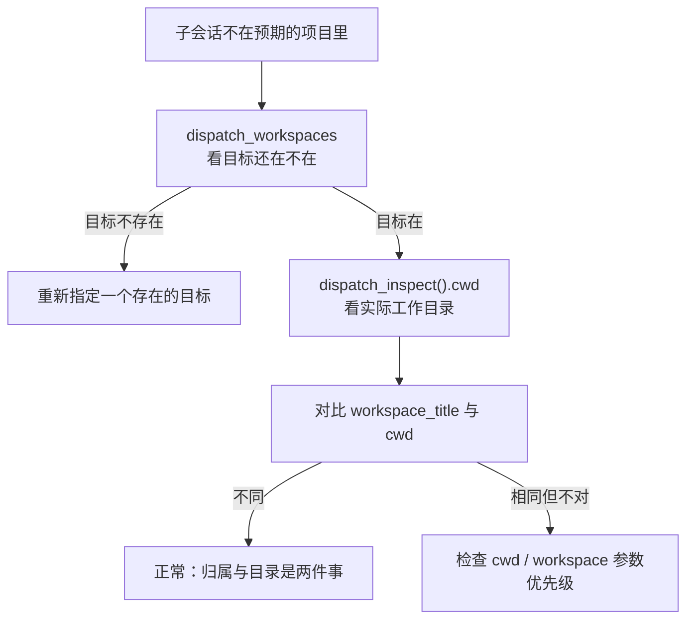

# dsh-mini-superagent 15：常见故障排查

> **代码仓库**：[wychmod/dsh-mini-superagent](https://github.com/wychmod/dsh-mini-superagent) ｜ **版本**：`0.10.4`
> **本篇目标**：把「出了问题怎么办」从 13 篇的「使用建议」里抽出来集中写。每个症状给三样东西——**现象 / 先查什么 / 怎么处置**，不给「可能是什么」这种多余的话。
> **原文对照**：包内 `docs/troubleshooting.md`（116 行，本项目自己的排障手册，本系列此前从未引用）。

---

## 目录

- [一、排障的三个入口](#一、排障的三个入口)
- [二、装完没反应](#二、装完没反应)
- [三、看板打不开](#三、看板打不开)
- [四、任务状态不对](#四、任务状态不对)
- [五、报告与卡片异常](#五、报告与卡片异常)
- [六、工作区与目录不对](#六、工作区与目录不对)
- [七、依赖与复用报错](#七、依赖与复用报错)
- [八、账本与版本](#八、账本与版本)
- [九、错误码速查（12 个）](#九、错误码速查（12-个）)
- [十、报障该带什么](#十、报障该带什么)

---

## 一、排障的三个入口

绝大多数问题在这三处就能定位，**不用翻日志**：

| 入口 | 回答什么 | 怎么调 |
|---|---|---|
| `dispatch_list()` | 我派了什么、卡在哪、`version` 对不对、并发位占了几格 | 工具调用 |
| `dispatch_inspect(task_id)` | 这一条为什么停住：`error` / `cwd` / `recent_reports` / `last_worker_text` | 工具调用 |
| `GET /board/selfcheck` | 浏览器半边到底有没有跑起来 | 同源地址，浏览器打开 |

日志排第四——它主要用来区分「投递失败」和「对端不在」。**所有本插件日志都带前缀 `dsh-mini-superagent:`**，grep 这个前缀就行。

> **一条排序纪律**：先看 `dispatch_list` 的 `version`。装错版本会同时制造好几个假症状（工具数不对、配置不生效、某个按钮没有），而它们全都是同一个根因。

## 二、装完没反应

### 症状 2.1 · 模型看不到 `dispatch_*` 工具

**先查**：`plugin_manager(action="list_plugins")` 里 `dsh-mini-superagent` 是否 `fiberPhase: active`。

**处置**：

| 查到什么 | 怎么做 |
|---|---|
| 不在列表里 | 插件没装上，重装 |
| 在列表里但不是 `active` | 依赖服务缺失（见下条），或插件加载时抛错了——翻启动日志找 `dsh-mini-superagent:` |
| 同时装着 `dsh-dispatch` | **必须先卸载旧的**。两者共有 8 个同名工具，同一全局层重复注册会直接抛错，整个插件起不来 |

### 症状 2.2 · 报「该工具只能在某个会话（Agent）中调用」

**原因**：`dispatch_*` 需要 Agent 作为调用者（要判「你是主会话还是 worker」）。脚本、工具测试环境里没有 Agent。

**处置**：从正常会话里调。这不是 bug。

### 症状 2.3 · 工具能调，但侧边栏没有「派发工作台」

**先查** `GET /board/selfcheck` 的三个字段：

| 字段 | 值 | 含义 | 处置 |
|---|---|---|---|
| `client.inGraph` | `false` | 客户端模块没进启动图 | **重启宿主进程**（不是刷新页面） |
| `client.ready` | 缺失 | 进了图但页面里没跑起来 | **刷新 GUI 页面** |
| `client.probes` | 全部为空 | 探测方法本身不可靠（多半是宿主 API 变了） | 不是本插件的问题，看宿主版本 |

**`inGraph` 与 `ready` 是两件事**：前者「模块被列进启动图」，后者「它在页面里执行完了」。两个都过还是没有面板，才轮到槽注册与渲染（见 [11 篇](/md/10-项目实战/04-DSH任务派发插件/11-会话里的卡片与分隔线.md) 第八节的三态表）。

**最高频的假故障**：装完没刷新页面。这一条在 README 里出现了三次——它看起来像「插件坏了」，实际只是浏览器半边没加载。

## 三、看板打不开

### 症状 3.1 · `403`

两种完全不同的原因，看响应里的错误码区分：

| 错误码 | HTTP | 含义 | 处置 |
|---|---|---|---|
| `dispatch/unauthenticated` | 401 | 没登录 | 重新打开 `dsh web` 打印的那个**带凭据的网址** |
| `dispatch/forbidden` | 403 | 地址不在部署信任清单里 | 把域名写进 `--trusted-host` |

**合并这两个码是错的**：它们的处置动作方向相反——一个去重新登录，一个去改启动参数。合并了排障脚本就只能读中文措辞。

**远程访问的取舍**：看板默认只允许回环 Host。想让局域网直连，把地址写进 `BOARD_ALLOWED_HOSTS`（默认空数组）。代价是远程 `curl` 读不到看板——这是有意的，不是漏了校验。

### 症状 3.2 · `503`（0.10.4 起可能出现）

**含义**：这道门**检查不了**——拿不到 `connection.requestRejection`，或方法不存在、或方法抛错。

**为什么是 503 而不是 403**：503 说的是「服务不可用」，处置是「升级宿主 / 重启」；403 说的是「你的地址不可信」，处置是「改配置」。用错了会把人引到错的方向。

**处置顺序**：

1. **先重启 DSH**——半加载窗口会在重启后自愈，这是最常见的情形
2. 重启后仍 503，说明宿主确实不提供该服务（旧宿主），这时才考虑逃生阀
3. 逃生阀 `allowBoardWithoutConnectionGate: true`，**默认关闭，不建议开**——它只放开「问不到」这一档，401 / 403 仍会被拒

**说准严重性**：`connection` 在 `src/index.js` 里已是**硬 inject 依赖**，所以「路由在、服务不在」只出现在旧宿主与半加载窗口。这次改动的真实价值是纵深防御与对齐收录方要求，**不是修一个日常可复现的洞**。

### 症状 3.3 · `dispatch_inspect` 永久报 `invalid output`

```text
tool "dispatch_inspect" returned invalid output: value is not lossless JSON
```

**原因**：任务只要有过一条**不带 `detail`** 的报告（`progress` 最常见），账本里就留下一个值为 `undefined` 的自有键。`JSON.stringify` 会静默丢掉它，所以账本和单测都看不出异常；但 `recent_reports` 原样转发进返回值时，宿主在工具边界做值遍历校验会拒绝 `undefined`，整次调用失败。

**处置**：**升级到 `0.10.4`**（这个修复在仓库里记作 `0.10.3`，但 `0.10.3` 没有发布到 npm）。存量账本无需手工清洗——投影侧的 `projectReportEntry()` 就是给已落盘数据兜底的。

## 四、任务状态不对

| 现象 | 先查 | 处置 |
|---|---|---|
| 一直 `queued` | `dispatch_list().running` 是否已等于 `max_workers` | 相等＝正常排队，不是失败。`running < max` 却仍排队 → 看是不是有任务卡在 `running` 占位 |
| 一直 `running` | 打开子会话 `dispatch-<task_id>` 看卡在哪；`inspect` 的 `last_worker_text` | 等它跑完 / `dispatch_message` 追问 / `dispatch_cancel` |
| `failed` | `inspect().error` | 常见是建会话失败：工作区不存在、`cwd` 与 `workspace` 冲突、`agent_preset` 名字写错 |
| `blocked` 停着 | `recent_reports` 里 worker 要什么 | 它在等人。用 `dispatch_message` 回答或补凭据 |
| `done` 但主会话没收到消息 | 日志里搜「主会话 … 已不在运行」或「报告投递失败」 | 报告只在任务表里，用 `dispatch_inspect` 取回 |
| `interrupted` | 插件是否重启过；子会话是否被手动关闭 | 新进程里没有活 worker，不假装还在跑。需要就重新派 |
| 收到「一轮执行结束（worker 未显式报告）」但没有 `done` | `reportOnTurnEnd` 是否为 `false`；worker 是否只报了 `progress` | 这是正常兜底。看 `last_worker_text` 判断结果 |

### 一条最容易误读的

**`queued` 不是「没派成」。** 它代表「已派出去、在等空位」。并发位满时这是**正确状态**，不是故障。本插件最常见的误判就是从这条来的。

### 一条关于「额度」的

`dispatch_launch` 报「达到上限 64」时：

```text
dispatch_list().total
```

如果 `total` 远小于 64 却报超限，说明 `quotaUsed()` 数的是**仍在册**的任务（已归档的不计、已结算超 24 小时的不计）——这时应该看**未归档且 24 小时内结算**的那部分有多少。`maxTasksPerSession` **不是终身额度**。这个语义在 `src/constants.js:261` 的注释里写的还是旧口径「累计」，以代码为准。

## 五、报告与卡片异常

### 症状 5.1 · 报告变成一条灰色 context 行

**先查** `selfcheck` 的 `client.ready.cards.report`：

| 值 | 含义 | 下一步 |
|---|---|---|
| `on` | 注册成功 | 卡还没画出来 → 看槽与渲染 |
| `error:slot` | `inject` 抛错：宿主有 slots 但不认这条槽名 | 查宿主版本与槽名拼写 |
| `error:register` | `slots.register` 抛错：槽在、我们动手了、宿主拒收 | 多半是 key 重复或参数形态不符 |
| **键不存在** | 宿主没提供这个能力 | **正常降级，不要当故障修** |

**坑**：`error:parse` 这个值在客户端源码里出现 **0 次**——它是一个设计上存在、实现上未接的死值。README 与 `docs/board.md` 都写着它可观测，**别去查它，查不到**。真实解析失败走的是「退回原文卡」，且不上报（见 [14 篇](/md/10-项目实战/04-DSH任务派发插件/14-复核记录.md) 第四节）。

### 症状 5.2 · 报告卡片少了一段

**先查报告正文的段名。** 代码认可的六个段名是：

```text
【任务】 【结果】 【说明】 【需要你】 【细节】 【批次】
```

而 `README.md:424` 与 `CHANGELOG.md:178` 写的是 `【备注】【需要】`——**这是仓库自己的文档错误**。worker 若照 README 写 `【备注】`，那一行不匹配任何段首，会被当成上一段的正文并入，**且不会有任何报错**。

**处置**：按代码的六个段名写。这条已经在 [14 篇](/md/10-项目实战/04-DSH任务派发插件/14-复核记录.md) 第五节拆过。

### 症状 5.3 · 摘要卡（轮次尾部那条）为什么没出现查不到

**这是已知缺陷**：客户端会对 `tail` 上报注册结论，但宿主侧白名单 `CLIENT_CARD_KEYS` 只收 `batch` / `report`，于是 `tail` 被静默丢弃。`selfcheck` 里永远看不到它。

**处置**：功能不受影响（摘要卡本身读的是同步的 `tailReady`），只有排障可见性缺失。改去翻日志里的 warn。

### 症状 5.4 · 选了「不派发」，它还是派发

**原因**：0.6.0 的实现以为「提示文本是函数，下一轮换文案」就够了。实际宿主对**变化的提示是追加不是替换**——旧的强制段仍留在会话面上，仍随 `deriveMessages()` 进请求，模型同时读到两套语义。

**处置**：升级到 `0.10.4`。插件在装配文本相对上一步真的变了时，通过 `agent/pre-step` 返回 `startsRequestSeries: true`，把收敛交回宿主机制。

## 六、工作区与目录不对

| 现象 | 先查 | 处置 |
|---|---|---|
| 子会话不在预期的项目里 | `dispatch_workspaces` 看目标还在不在 | 目标不存在就重新指定；目标在则看下一条 |
| 同上，目标在 | `dispatch_inspect().cwd` 与 `session.workspace_title` 是否不同 | **不同是正常的**——会话归属与工作目录是两件事 |
| 同上，都不对 | `cwd` / `workspace` 参数的优先级 | `workspace` 决定会话归属，`cwd` 决定干活目录；显式 `cwd` 不做日期兜底 |
| 工作目录不对 | `inheritWorkingDirectory`、主会话的 working directory 服务 | 或显式传 `cwd` |
| 侧边栏太乱 | `archiveAfterHours`（默认 168 小时＝7 天） | 调小（比如 24），**别关归档** |
| 一天一个日期工作区 | `workerWorkspace`（默认 `day`） | 改成 `cwd` 可完全不建日期工作区 |

**一条排障顺序**（按这个查，不要乱试）：



## 七、依赖与复用报错

| 报错 | 含义 | 处置 |
|---|---|---|
| `dispatch/unknown-dependency` | 前置 id 在活表与退休留痕里都找不到 | 先用 `dispatch_list` 查现有任务；本批内的前后关系用 `depends_on_index` |
| `dispatch/dependency-cycle` | 沿现有依赖边 DFS 查到了环 | 只可能来自被手工改过的账本——正常调用构造不出环 |
| `dispatch/conflict` | `dispatch_message` 或续派打到了一个被依赖挡住的 `queued` 任务 | 等前置结算（它会自动开始），或先 `dispatch_cancel` |
| `UNKNOWN_DEPENDENCY`（批内下标） | `depends_on_index` 指向的那一项派发失败了，占位是 `undefined` | 不是「错位指向别人」，是「那一项没成」——重派那一项 |
| `dispatch_message` 报 `session/not-found` | 子会话被删了 | 会话没了就恢复不了，重新派发该任务 |
| `dispatch_message` 报 `session/writer-held` / `agent-busy` | 多开 Harness 实例，或子会话被 subagent 路由占用 | 关掉其它实例 |

**一条限制**：`continue_task_id` **不能同时传** `depends_on`——会报错，不静默忽略。这是有意的：两者的语义会打架。

## 八、账本与版本

### 症状 8.1 · 启动后历史任务全空

**先查**日志里的这一行：

```text
dsh-mini-superagent: 读回 N 个历史任务（<path>）
```

`N=0` 但你确实派过任务，说明 `stateDir` / `DSH_HOME` 指到了别处。多实例共用同一个 `DSH_HOME` 时会互相覆盖——给每个实例配不同的 `stateDir`。

### 症状 8.2 · 插件突然不加载，日志里有个 `LEDGER_TOO_NEW`

**含义**：账本 `version` 比当前插件认识的更新——你降级过版本。

**为什么不放行**：写盘是**整文件原子替换**，没有「只改我认识的字段」这种写法。读回未来版本的账本后照常启动，下一次 `persist` 就会用空心状态覆盖原文件。用户为了用新插件装的版本、降级回来一看账本没了——**不可逆**。

**处置**：升级回新版本。**不要手改 `tasks.json` 的 `version`**——它不校验字段形状，改了会读到一堆空值。

### 症状 8.3 · `tasks.json` 损坏

**先看**同目录有没有 `tasks.json.bak`。主文件坏时 `readState()` 会自动回退（日志写「已从备份 … 恢复」）。

两者都坏才需要：停插件 → 备份并删除 `tasks.json` → 重载。删掉后**历史任务、报告与派发目标全部清空**，但子会话内容不受影响。

> **它是派发事实的权威源，不是可随手丢的展示缓存。** 这句话在整个系列里反复出现，因为它是所有治理机制的地基（见 [07 篇](/md/10-项目实战/04-DSH任务派发插件/07-记忆治理-权威源与投影.md)）。

### 症状 8.4 · 版本号对不上

本系列会出现三层版本口径，对不上是常态：

| 层 | 与实际发布的关系 |
|---|---|
| `CHANGELOG.md` 的段 | 最宽，含 `0.5.3` / `0.7.0` 这类从未成为包版本的号 |
| `package.json` 的历史值 | 16 个，含 `0.9.0` / `0.10.3` |
| **npm 实际发布** | **只有 6 个**：`0.0.0-stage` / `0.9.1` / `0.10.0` / `0.10.1` / `0.10.2` / `0.10.4` |

**装的时候只认 `0.10.4`。** 完整对照见 [00 篇](/md/10-项目实战/04-DSH任务派发插件/00-项目全景与阅读地图.md) 第四节。

## 九、错误码速查（12 个）

`ERROR_CODES` 是一个闭集，12 项：

| 码 | 什么时候出现 |
|---|---|
| `dispatch/bad-args` | 参数形状不对（`depends_on` 不是数组、元素不是字符串、超 `maxDependsOn`、含自己） |
| `dispatch/not-found` | 任务 id 查不到 |
| `dispatch/unauthenticated` | 看板 401 |
| `dispatch/forbidden` | 看板 403，或 Host 不在信任清单 |
| `dispatch/conflict` | 状态冲突（如给被依赖挡住的排队任务投消息） |
| `dispatch/host-unavailable` | 看板 503——闸门检查不了 |
| `dispatch/bad-state` | 状态跃迁不合法 |
| `dispatch/internal` | 内部错误 |
| `dispatch/unknown-dependency` | 前置 id 不存在 |
| `dispatch/dependency-cycle` | 依赖成环 |
| `dispatch/dependency-failed` | 前置非 done 终态，后继连带取消 |
| `dispatch/dependency-missing` | 前置不在活表且无 done 留痕，后继连带取消 |

> **两个例外**：`LEDGER_TOO_NEW` / `LEDGER_TOO_OLD` **不进**这个闭集——插件此时根本没加载，`selfCheck()` 与看板都不可用，唯一出口是启动日志。塞进去会误导消费方以为「可以拿 code 去分流重试」，而那时没有任何东西能响应。

## 十、报障该带什么

按这个清单贴，比描述「它不工作了」有效十倍：

1. `dispatch_list()` 的 `version`、`running`、`max_workers`、`total`
2. 出问题的 `task_id` 与 `dispatch_inspect` 的**完整返回**（含 `error`、`cwd`、`recent_reports`）
3. 相关日志行（grep `dsh-mini-superagent:`），尤其是「启动失败」「报告投递失败」「主会话 … 已不在运行」
4. `GET /board/selfcheck` 的 `client` 段
5. DSH 版本、Node 版本、是否多开实例、是否刚从旧包迁移

### 四件不要做

| 不要 | 为什么 |
|---|---|
| 不要手改 `tasks.json` 当数据库 | 它是权威源，结构由 `writeState()` 统一写、`normalize()` 读回，手改坏了两边都读不回来 |
| 不要同时装 `dsh-dispatch` 和本插件 | 8 个同名工具，重复注册直接抛错 |
| 不要把 `dispatch_wait` 当 sleep | 它占着当前 step，期间什么也做不了。超时回来任务可能仍在跑 |
| 不要删完子会话还指望任务继续 | `agent/disposed` 会把任务标 `interrupted`，恢复不了只能重派 |

---

> **下一篇**：故障排查完了，但「每个工具到底收什么参数、返回什么形状」还散在各篇里。下一章把 10 个工具与 47 个配置项一次列全。
>
> 继续读：[第 16 篇](/md/10-项目实战/04-DSH任务派发插件/16-十工具速查与配置项.md)
