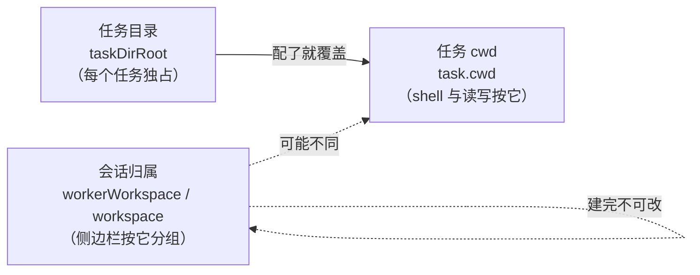
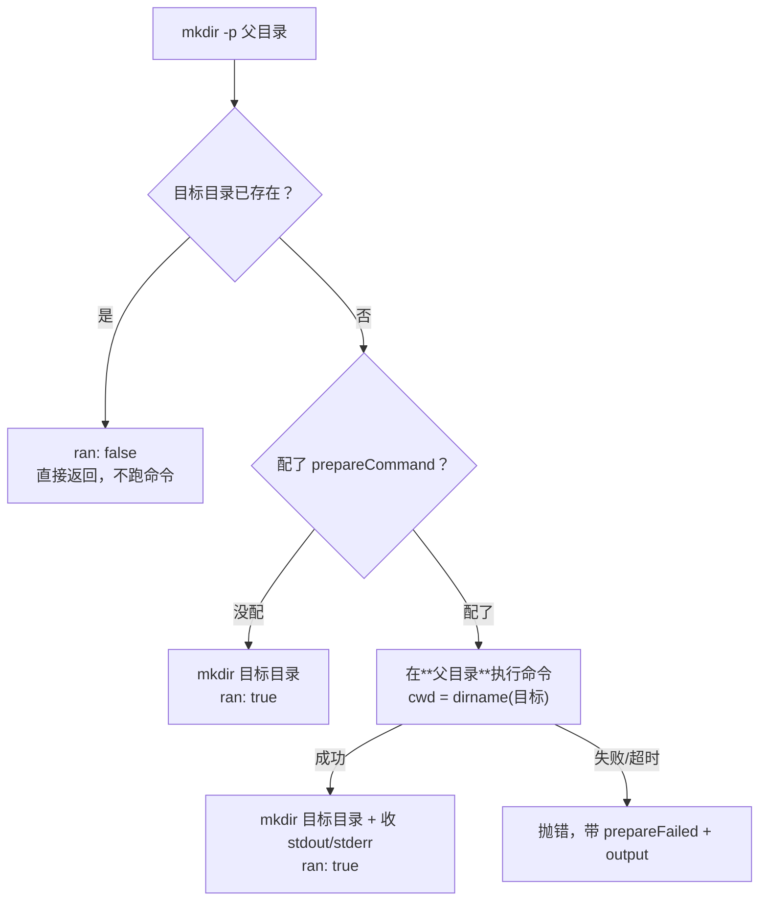
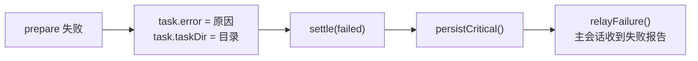
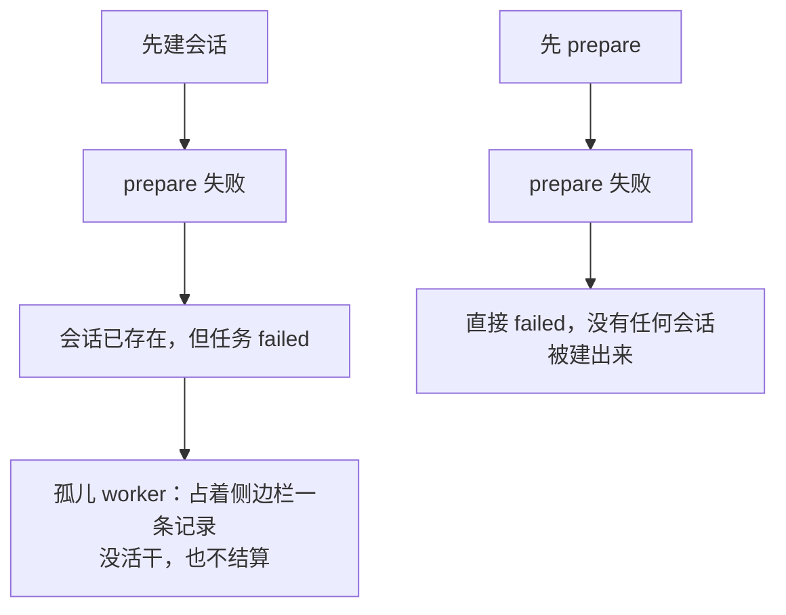

# dsh-mini-superagent 17：每任务目录与 prepare 命令（0.8.x）

> **代码仓库**：[wychmod/dsh-mini-superagent](https://github.com/wychmod/dsh-mini-superagent) ｜ **版本**：`0.10.4`（MIT）
> **本章目标**：讲清「一个任务一个目录」这条能力的完整链路——它解决什么、目录名怎么拼、prepare 命令在哪个目录跑、失败为什么**不重试**，以及 `dispatch_workspaces` 这个此前没专节讲过的工具。
> **原文对照**：`src/prepare.js`（97 行）、`docs/architecture.md` §24 之③、`test/prepare.test.js`（9 条用例）。
> **前置**：[03 篇](/md/10-项目实战/04-DSH任务派发插件/03-工作区模型.md) 讲清了「会话归属」与「工作目录」是两件事。本篇讲第三件：**同一个任务的工作目录，还可以再细分一格**。

---

## 目录

- [一、三个「在哪里」，别混](#一、三个「在哪里」，别混)
- [二、目录名是怎么拼出来的](#二、目录名是怎么拼出来的)
- [三、prepare 命令：在父目录跑，用环境变量拿目标](#三、prepare-命令：在父目录跑，用环境变量拿目标)
- [四、四道判据，每道都有代价](#四、四道判据，每道都有代价)
- [五、为什么必须在建会话之前](#五、为什么必须在建会话之前)
- [六、`dispatch_workspaces`：那个一直没专节讲的工具](#六、dispatch_workspaces：那个一直没专节讲的工具)
- [七、核心讲解：隔离的代价是「谁清理」](#七、核心讲解：隔离的代价是「谁清理」)
- [八、使用建议](#八、使用建议)

---

## 一、三个「在哪里」，别混

到 0.4.0 为止，这个项目有两个「在哪里」（[03 篇](/md/10-项目实战/04-DSH任务派发插件/03-工作区模型.md) 第二节）：

| 概念 | 谁决定 | 能不能改 |
|---|---|---|
| **会话归属** | 建会话时定死 | 不能（DSH 里会话的工作区建完不可迁移） |
| **任务的工作目录**（`task.cwd`） | `dispatch_launch` 的 `workspace` / `cwd` / 会话记住的派发目标 | 能，每个任务都可以不同 |

0.8.x 加了第三个：

| 概念 | 谁决定 | 典型值 |
|---|---|---|
| **任务目录**（`task.taskDir`） | 配置项 `taskDirRoot` + 任务标题 + 任务 id | `D:\wt\重构 auth 模块-c123-1` |

**它不是「又一个 cwd」，而是「cwd 的上游」**：配了 `taskDirRoot` 之后，插件先建出任务目录，再把 `task.cwd` 指向它。所以三者的关系是：



**为什么要第三层**：派发目标通常是「团队共享的仓库」，所有 worker 都往同一个 checkout 里写——两个任务同时改同一个文件，冲突无法避免。任务目录给每个任务一份独立的工作区，典型实现就是 `git worktree add`。

一句话：**会话归属决定「它在侧边栏住哪」，cwd 决定「它在哪干活」，任务目录决定「它有没有自己的地」。**

## 二、目录名是怎么拼出来的

`taskDirectory()` 只有六行：

```js
export function taskDirectory(root, title, taskId) {
  const base = String(root ?? '').trim()
  if (!base) return undefined
  const suffix = String(taskId ?? '').replace(/^t-/, '').slice(-6) || 'task'
  return join(base, `${safeDirName(title)}-${suffix}`)
}
```

三个细节：

**① 空根 = 不启用。** `taskDirRoot` 默认是空串，直接返回 `undefined`，后面的整条链路都不触发。这条让「加了个能力」对老用户零影响。

**② 后缀取任务 id 的**后 6 位**（去掉 `t-` 前缀）。** 实测：

```text
taskDirectory('D:/wt', '重构 auth 模块', 't-m0abc123-1')
→ D:\wt\重构 auth 模块-c123-1
```

注意 `m0abc123-1` 的**后 6 位是 `c123-1`**——它带着一个连字符。这不是 bug，是 `slice(-6)` 的必然结果。看板上看到目录名尾部有个 `-1` 别以为是序号，那是 id 片段。

**③ 标题走 `safeDirName()`**，和 [03 篇](/md/10-项目实战/04-DSH任务派发插件/03-工作区模型.md) 第六节是同一个函数——Windows 保留名（`CON` / `PRN` / `NUL`…）、非法字符、尾部点号全在这一层处理掉。

**为什么要带 id 后缀**：同一个标题完全可能被派两次（「再跑一遍压测」）。只按标题命名，第二次会撞进第一次的目录，`git worktree add` 直接失败——而失败信息是「目录已存在」，看起来像环境问题。

## 三、prepare 命令：在父目录跑，用环境变量拿目标

`runPrepare()` 的执行顺序（`src/prepare.js:71-97`）：



**最关键的一条：命令的 `cwd` 是父目录，不是目标目录。**

因为目标目录此刻**还不存在**——`git worktree add <dir>` 要求 `<dir>` 不存在。如果命令在目标目录里跑，它连 `cwd` 都进不去。所以设计成：你在父目录里跑，目标路径通过环境变量递给你。

五个环境变量（`prepareEnv()`）：

| 变量 | 值 |
|---|---|
| `DSH_DISPATCH_DIR` | 目标目录绝对路径 |
| `DSH_DISPATCH_TASK` | 任务 id |
| `DSH_DISPATCH_TITLE` | 任务标题（原文，不是安全名） |
| `DSH_DISPATCH_WORKSPACE` | 派发目标工作区标题 |
| `DSH_DISPATCH_CWD` | 原始 `task.cwd`（任务目录生效前它是什么） |

于是最典型的写法成立：

```text
prepareCommand: git worktree add "$DSH_DISPATCH_DIR"
```

**其余三个可配置的数量级**：

| 项 | 默认 | 依据 |
|---|---|---|
| `prepareTimeoutMs` | `600000`（10 分钟） | 与上游一致；挂在凭据提示上的命令会一直占着并发位 |
| 实际超时下限 | `max(1000, 配的值)` | 防止配成 0 或负数变成「立刻超时」 |
| `maxBuffer` | `1024 × 1024`（1 MB） | 超出会杀掉子进程——`git worktree` 正常输出远小于此 |
| 输出记录 | `clip(output, 2000)` | 写进 `task.prepareOutput`，看板抽屉和 `dispatch_inspect` 都能看到 |

## 四、四道判据，每道都有代价

这四条不是「最佳实践」，每一条都对应一个具体的失败模式：

### 4.1 目录已存在 → **跳过命令**

```text
第二次派发 → 目录已存在 → 直接复用
```

不跳过会怎样：`git worktree add` 在一个已存在的 checkout 上再执行一次，**必然失败**。而失败原因（「already exists」）看起来像环境脏，实际是重入了。

代价：**同一任务重试会复用同一个目录**。目录里可能躺着上一次跑了一半的产物。想要每次干净环境，得让 `prepareCommand` 自己处理（比如先 `rm -rf`，或改用带时间戳的路径）。

### 4.2 失败 → **不自动重试**

```text
命令失败 → 任务 failed → 结束，不重跑
```

不重试的理由与 4.1 是同一条硬币的另一面：**目录可能已经被写了一半**。此时重跑，`runPrepare()` 的第一道判据（目录是否存在）会把它当成「已准备好」，直接跳过——等于把一次失败伪装成成功。

这个取舍与上游 `PrepareFailed` 一致：**宁可让任务失败、让人看一眼，也不要让它带着半成品跑起来。**

### 4.3 失败即 `failed`，且**不建子会话**

`prepareTaskDir()` 的失败分支做了三件事：



**不建子会话**是重点：一个没有工作目录的 worker 会退回到默认目录里干活，产出落在一个你完全没想到的地方——比直接失败难查十倍。

### 4.4 复用会话的任务 → **整条链路跳过**

```js
if (task.parentTaskId) return this.#startReused(task)
```

`handoff_from` 复用来源子会话时，**不建任务目录**。原因写在代码注释里：

> `taskDirRoot` 会给出一个新目录，来源会话的 cwd 已经定死，切过去就跨目录了。

复用会话的整个承诺是「上下文接着走」，而上下文里包含「我在哪个目录」。给它换一个目录，等于把 `git status` 的输出全变成删除+新增。

## 五、为什么必须在建会话之前

`start()` 里的顺序是：

```text
prepare 任务目录 → 解析工作区 placement → 建会话 createWorker
→ 切工作目录 enterDirectory → 投递简报 deliver
```

把 prepare 放在**建会话之前**，是为了避免一种孤儿：



**顺序本身就是一种错误处理**。这条与 [05 篇](/md/10-项目实战/04-DSH任务派发插件/05-正确性攻坚.md) 的 P0-4（`cancel()` 与 `start()` 竞态留下僵尸 worker）是同一类经验：能被「顺序」解决的问题，不要用「补偿」解决。

建完会话之后才切目录：

```js
if (task.cwd && task.cwd !== placement.path) await this.sessions.enterDirectory(agent, task.cwd)
```

**为什么不直接把任务目录当 `placement.path`**：`placement` 决定的是**会话归属**（侧边栏分组），任务目录是**干活的地方**。两者混同，侧边栏就会长出几十个按任务名命名的条目——那正是 0.4.0 引入工作区要解决的问题（[03 篇](/md/10-项目实战/04-DSH任务派发插件/03-工作区模型.md) 第一节）。

## 六、`dispatch_workspaces`：那个一直没专节讲的工具

这个工具从 0.4.0 就存在，是本系列此前唯一没有专节的工具。它没有参数，作用很单一：**回答「我现在能派到哪些工作区」**。

```json
{
  "root": "C:\\Users\\<user>\\Documents\\mini-superagent",
  "worker_workspace": "day",
  "archive_after_hours": 168,
  "count": 3,
  "workspaces": [
    {"workspace_id": "ws-2", "title": "sableos", "path": "D:\\idea\\sableos", "sessions": 4}
  ]
}
```

四个顶层字段都不是装饰：

| 字段 | 为什么要在同一个返回里 |
|---|---|
| `root` | 知道「新建工作区会落在哪」。空配置时它是 `<用户文档>/mini-superagent` |
| `worker_workspace` | 当前的无目标兜底策略（`day` / `cwd`）。**排查「为什么子会话进了【派发】」的第一步** |
| `archive_after_hours` | 默认 7 天。侧边栏太乱时先看这个数再决定调不调 |
| `count` + `workspaces[]` | 列表本身。`sessions` 是该工作区当前的会话数 |

**三个典型用法**：

| 场景 | 怎么用 |
|---|---|
| 派发前确认目标名 | 用 `workspace_id`（最稳）而不是标题——标题可能撞名 |
| 排查「子会话不在预期项目里」 | 先看 `workspaces[]` 里那个目标还在不在；不在就重新指定 |
| 确认工作区根在哪 | 看 `root`。它在 Windows 上是 `Documents\mini-superagent`，不是当前目录 |

**它不做什么**（这是刻意的）：不创建、不删除、不重命名工作区，也不返回每个工作区的统计。它只读。

## 七、核心讲解：隔离的代价是「谁清理」

每任务目录解决的是**并发写冲突**，但它引入了一个更难的问题：**这些目录谁删？**

项目的答案是不删——和归档一样，只收起不删除：

| 已做的事 | 没做的事 |
|---|---|
| 任务结算后目录仍在 | 不清理任务目录 |
| 归档只收起会话，不删目录 | 不清理 `<workspaceRoot>/派发/<日期>` |
| 退休只移出账本，不删 worker 会话 | 不清理 `taskDirRoot` 下的任何东西 |

**为什么不敢自动删**：任务目录里是 worker 的全部产出，而「任务失败」不等于「产出没价值」——恰恰相反，排查失败时最需要那堆半成品。自动清理会把唯一的现场抹掉。

**代价必须摆在台面上**：

- `git worktree` 会往仓库的 `.git/worktrees/` 里登记条目。目录不删，登记也不撤，`git worktree list` 会越列越长。
- 磁盘占用按「任务数 × 仓库大小」增长。20 个任务 × 500 MB = 10 GB，很容易忽视。

**所以这条能力的正确用法是「按需开启」**，而不是配了就一直开着：

| 你的情形 | 建议 |
|---|---|
| 一次派 5–10 个任务并行改同一个仓库 | 开 `taskDirRoot` + `prepareCommand: git worktree add "$DSH_DISPATCH_DIR"` |
| 偶尔派一两个任务，串行执行 | **别开**。共享目录 + 串行足够，省掉清理负担 |
| 需要每次干净环境 | 开了之后让命令自己处理（`rm -rf` 或时间戳路径），插件不会替你做 |
| 只关心 cwd 不同、不需要隔离 | 直接传 `cwd`（[03 篇](/md/10-项目实战/04-DSH任务派发插件/03-工作区模型.md) 第九节） |

## 八、使用建议

### 一个能用的最小配置

```yaml
config:
  taskDirRoot: 'D:\wt'
  prepareCommand: 'git worktree add "$DSH_DISPATCH_DIR"'
  prepareTimeoutMs: 600000
```

配完派一个任务，然后按顺序验三件事：

```text
1. dispatch_list()          → 任务进入 running/queued（不是 failed）
2. dispatch_inspect(task_id) → task_dir 有值，prepare_at 有值
3. 看板抽屉 → 「任务目录」显示 D:\wt\<标题>-<id尾6位>
                     「prepare 结果」显示 git 的输出
```

三条都对，说明整条链路通了。

### 五条容易踩的坑

1. **`prepareCommand` 里必须用 `$DSH_DISPATCH_DIR`，不能自己拼路径。** 目录名里的安全名转换（保留名、非法字符、截断到 60 字）只有 `safeDirName()` 知道，你自己拼的路径和插件算出来的**不是同一个**。
2. **命令在父目录跑。** 写 `cd "$DSH_DISPATCH_DIR" && ...` 会失败——那个目录此刻还不存在。
3. **失败不会重试。** 修好原因后要**重新派发**，不要指望同一条任务自己好。而重派会复用同名目录（见 4.1），必要时先手工删掉。
4. **复用会话（`handoff_from`）不受 `taskDirRoot` 影响。** 它沿用来源会话的 cwd，别再期待新目录。
5. **`taskDirRoot` 不会被自动创建之外的任何事清理。** 定期自己看一眼磁盘，或给 prepare 命令加清理逻辑。

---

> **相关篇目**：[03 篇](/md/10-项目实战/04-DSH任务派发插件/03-工作区模型.md)（会话归属 vs 工作目录）｜[05 篇](/md/10-项目实战/04-DSH任务派发插件/05-正确性攻坚.md)（顺序即错误处理）｜[16 篇](/md/10-项目实战/04-DSH任务派发插件/16-十工具速查与配置项.md)（三个相关配置项）
>
> **下一篇**：目录和隔离讲完了，但报告回到主会话时长什么样、为什么长那样，还没讲。18 篇讲文案层——505 行纯函数，只做一件事：把机器写的事实变成人读的一句话。
>
> 继续读：[第 18 篇](/md/10-项目实战/04-DSH任务派发插件/18-文案层-把事实变成人话.md)
