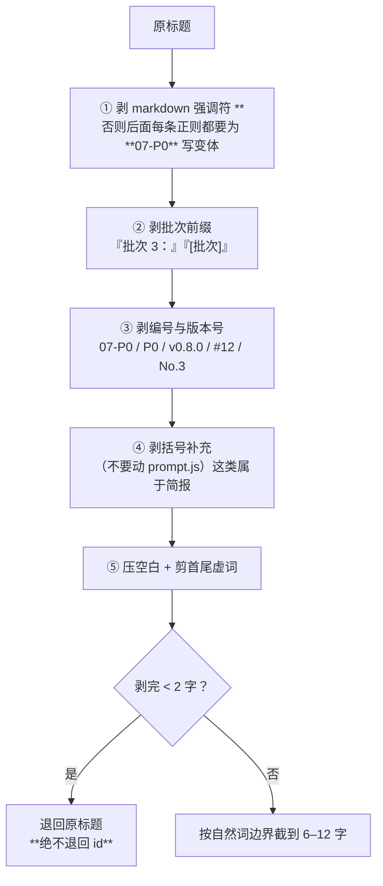
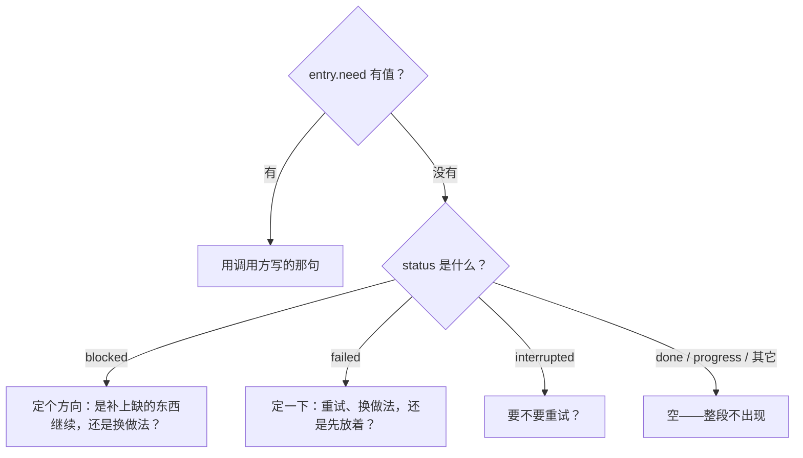

# dsh-mini-superagent 18：文案层——把事实变成人话（`src/voice.js`）

> **代码仓库**：[wychmod/dsh-mini-superagent](https://github.com/wychmod/dsh-mini-superagent) ｜ **版本**：`0.10.4`（MIT）
> **本章目标**：拆开这 505 行纯函数——报告文本为什么长成四段式、短标签怎么剥噪声、`【需要你】` 什么时候出现、以及那套「文案契约」怎么被 32 条测试钉住。
> **原文对照**：`src/voice.js`（505 行，14 个导出）、`test/voice-contract.test.js`（32 条）、`test/voice-prompt.test.js`（15 条）、`plans/10-voice-style.md`。
> **为什么单开一篇**：报告文本是**主会话唯一的输入**。前 17 篇讲的所有机制——状态机、准入分级、合并窗口——最终都收敛成这一串字符。它写得好不好，决定前面所有工程能不能被读懂。

---

## 目录

- [一、这一层为什么必须独立成文件](#一、这一层为什么必须独立成文件)
- [二、四段式：每一段只回答一个问题](#二、四段式：每一段只回答一个问题)
- [三、短标签：从标题里剥出「人能认的那几个字」](#三、短标签：从标题里剥出「人能认的那几个字」)
- [四、`【需要你】` 什么时候出现](#四、【需要你】-什么时候出现)
- [五、四种兜底文案的形状](#五、四种兜底文案的形状)
- [六、批次汇总：多数派前缀而不是全体公共前缀](#六、批次汇总：多数派前缀而不是全体公共前缀)
- [七、文案契约：32 条断言钉住了什么](#七、文案契约：32-条断言钉住了什么)
- [八、核心讲解：为什么文案要当接口来测](#八、核心讲解：为什么文案要当接口来测)
- [九、使用建议](#九、使用建议)

---

## 一、这一层为什么必须独立成文件

文件头的注释把理由写得比任何解释都清楚：

> 为什么要有这个文件，而不是继续在 `dispatch.js` 里拼字符串：报告文本是**主会话唯一的输入**，主会话很难把一段机器日志转述得自然。所以报告本身得先可读。这些是纯函数——输入是任务与报告条目，输出是字符串，不碰 ctx、不碰定时器、不写盘。放在独立文件里的直接收益是**可以单测**。

拆开看，成立的条件有三个：

| 条件 | 具体表现 |
|---|---|
| **无副作用** | 14 个导出全是纯函数。同样的任务和报告条目，任何时候算出来都一样 |
| **不依赖宿主** | 只 import `constants.js` 和 `tasks.js`，不碰 `ctx`、不碰 `agent` |
| **可断言** | 因为纯，才能写「这段文本必须不含任务 id」这种断言 |

第三条是关键。如果文案混在 `dispatch.js` 里，「一条报告不能出现英文状态词」这种规则**无法自动验证**——你得把整条派发链路跑起来才能拿到文本。抽成纯函数之后，`voiceContracts` 可以在毫秒内检查几百种组合。

## 二、四段式：每一段只回答一个问题

`reportText()` 的输出（实跑，未改一字）：

```text
【任务】重构 auth
【结果】登录超时修好了，补了 3 个回归测试
【说明】替换了 refresh 调用点 6 处；新增 3 条用例；测试全绿。
【细节】dispatch_inspect t-m0abc-1
```

四段的职责边界是硬的：

| 段 | 只回答 | 不允许出现 |
|---|---|---|
| `【任务】` | 这是哪一条 | 任务 id、英文状态词、超过 40 字 |
| `【结果】` | 成没成 / 一句话结论 | 复述摘要 |
| `【说明】` | 具体做了什么 | 换行（会撑破「一段一行」） |
| `【需要你】` | 我该做什么（**只在没成或要决策时出现**） | 重复原因 |
| `【细节】` | 去哪查全文 | 除 `dispatch_inspect` 之外的东西 |

### 2.1 为什么 `【结果】` 不许复述摘要

摘要是技术细节，结论是给人看的一句话。如果 `【结果】` 用了摘要首句，两段会变成：

```text
【结果】压测跑完了，P99 从 480ms 降到 210ms
【说明】压测跑完了，P99 从 480ms 降到 210ms
```

**重复一行不会让人更清楚，只会让人开始跳读。** 所以缺 `headline` 时的兜底句是「短标签 + 状态」，实跑：

```text
fallbackHeadline({title:'重构 auth'}, {status:'done'})
→ 重构 auth做完了
```

注意这里**故意带了任务名**——因为兜底句没有别的信息来源，标题是它唯一能说清的「这是哪条 + 成没成」。而 worker **自己写**的 `headline` 里就不许重复任务名（外层 `【任务】` 行已经说了），这条约束只针对前者。

### 2.2 为什么摘要里的换行必须压掉

```js
lines.push(`${REPORT_SECTIONS.NOTE}${summary.replace(/\s*\n+\s*/g, ' ')}`)
```

四段式的整个设计前提是「一段一行」。一条多行摘要会把四段撑成十几段，之后**按行首匹配的客户端解析器**就会把它当成一堆未知段——而 [11 篇](/md/10-项目实战/04-DSH任务派发插件/11-会话里的卡片与分隔线.md) 讲过：任一段解析不出，整份退回原文卡。一段多余换行能让整张卡片消失。

## 三、短标签：从标题里剥出「人能认的那几个字」

`shortLabel()` 做四件事，顺序有意义：



实测三个输入：

| 输入 | 输出 | 说明 |
|---|---|---|
| `07-P0 修复**登录**超时（不要动 prompt.js）` | `修复 登录 超时` | 编号、加粗符、括号补充全剥掉 |
| `07-P0` | `07-P0` | 剥完不足 2 字，退回原标题 |
| `把 src/auth.js 拆成三个独立模块并保持公开 API 不变` | `把 src/auth.js 拆成三个独立模块` | 截到 12 字，落在词边界 |

### 3.1 `labelLength` 不是 `String.length`

```js
labelLength('webhook')        // 1
labelLength('重构auth模块')    // 5
```

**西文词按「一个词一个字」计数**，中文按码点计数。理由很直接：人会读「webhook」为一个词，不会读成 7 个字母。这套计数决定了：

- `LABEL.MAX = 12` 是「12 个读起来像字的东西」，不是 12 个码点；
- `LABEL.LINE_MAX = 40` 是首行上限，`voiceViolations()` 用它判违规；
- `sliceLabel()` 截断时**不切碎西文词**——因为 `webh` 比截短更难认。

### 3.2 撞名才补后缀

```js
taskLabel({id:'t-abc123-1', title:'重构 auth'}, [])
→ 重构 auth

taskLabel({id:'t-abc123-1', title:'重构 auth'}, [{id:'t-def456-1', title:'重构 auth', workspaceTitle:'sableos'}])
→ 重构 auth·abc123-1
```

**只在真的撞名时才补**。所有标签都加后缀，等于把区分成本摊给所有任务——而绝大多数任务名是不会撞的。

后缀的优先级：**工作区标题**（用户认得目录名）→ 无工作区时退到 **id 尾段**。如果后缀本身也撞（同一工作区里的同名任务），再退到 id 后 6 位。

> 一个小坑：`slice(-6)` 会把 id 尾部的连字符带进来。实测 `t-m0abc123-1` → 后缀 `c123-1`。看到后缀里有个 `-1` 别以为是序号。

## 四、`【需要你】` 什么时候出现

`needText()` 的判据只有两条，**不看摘要里有没有出现「需要」两个字**：



**为什么不用关键词启发式**：如果按「摘要里有没有『需要』」判断，一句「不需要额外配置」会让成功报告喊出「需要你」。**猜错一次，这四个字就贬值一次**，之后真需要人时反而被略过。

所以判据是结构化的：状态 + 显式字段。三句兜底文案**刻意不复述原因**——原因已经在 `【说明】` 里，重复一遍只会稀释「要你做什么」。

实测三种状态：

```text
blocked  → 【需要你】定个方向：是补上缺的东西继续，还是换做法？
failed   → 【需要你】定一下：重试、换做法，还是先放着？
interrupted → 【需要你】要不要重试？
done     → （无此行）
```

## 五、四种兜底文案的形状

除了正常报告，还有四种「非正常收尾」，每种一句话，形状是刻意定的：

| 函数 | 触发 | 输出（实跑） |
|---|---|---|
| `failureText` | 启动失败 / 续跑失败 | `重构 auth：没能开始——原因不明。要我重试吗？` |
| `idleText` | 回合结束但没给终态报告 | `重构 auth：它跑完了，但没给结论——要我追问一句吗？` |
| `fallbackHeadline` | 报告缺 `headline` | `重构 auth做完了` |
| `batchText` | 批次全部结算 | 见下一节 |

**四条共同的形状**：`<任务短标签>：<人话状态>——<下一步动作？>`

为什么是这个形状而不是 `[dispatch] 任务 t-xxx · 标题 启动失败：error`？旧文案三样东西都在，但用户要先跳过 id、再把「启动失败」翻译成「它没开始」。**翻译成本必须由生成方承担，不能转给读的人。**

`failureText` 里的「原因不明」也是刻意的——`task.error` 为空时不能留空，也不能去掉那句话，否则形状就断了。

## 六、批次汇总：多数派前缀而不是全体公共前缀

```text
batchLabel(['重构 auth','重构 billing','重构 notify','补集成测试'])
→ 重构这批 4 条
```

**注意第四条是「补集成测试」——全体最长公共前缀是空串。** 如果按「全体公共前缀」实现，这批会退化成「这批 4 条」，把唯一有用的信息（它们是同一批重构）丢掉。

所以实现是**多数派**：先按前两个字分组，取最大的那组，再算组内最长公共前缀。

单条时：

```text
batchLabel(['重构 auth'])
→ 重构 auth（单条）
```

补「（单条）」是因为「这批 1 条」这种说法很别扭。

### 6.1 汇总正文的三种「没成」必须分开

`batchText()` 把非 done 的成员切成三类：

| 分类 | 判据 | 文案 |
|---|---|---|
| **未执行** | `cancelled` 且 `cancelReason` 是 `dependency_failed` / `dependency_missing` | `· 未执行：X（前置没成）` |
| **已取消** | `cancelled` 且不是依赖连带 | `· 已取消：Y` |
| **没成** | 其余非 done | `· 没成：Z（原因）` |

**为什么必须分**：「未执行」是前置的错，它自己的活根本没开始；「已取消」是用户自己收回。混成一个「已取消」，用户就少一次「B 为什么没跑」的解释。

实跑一个混合批次：

```text
【批次】重构这批 2 条
2 条成了 1 条，1 条没成。
· 成了：重构 auth
· 没成：重构 billing（gateway/bad-request）
【需要你】1 条没成，看看要重试、换做法，还是先放着？
【细节】dispatch_inspect 按任务查（批次 g-1）
```

注意最后一行——**批次汇总里不列任务 id**，只给 group。因为一批可能有 16 条，列 16 个 id 没人看。

## 七、文案契约：32 条断言钉住了什么

`test/voice-contract.test.js` 的 32 条分三层：

| 层 | 数量 | 钉什么 |
|---|---|---|
| **语法契约** | 9 条 | `shortLabel` 的剥离规则、`taskLabel` 的撞名后缀、`headline` 兜底形状 |
| **文案契约** | 23 条 | `reportText` 四段式、`needText` 判据、`batchText` 分类、以及**真实 `report()` 链路的输出** |
| **自检** | 2 条 | `voiceViolations` 能抓到反例（防判据退化成恒真）+ 客户端段名与 Host 端一致 |

### 7.1 `voiceViolations` 是给两边共用的

```js
voiceViolations('【任务】x\n【结果】done')
→ []
```

**这个返回值容易误读：`【结果】done` 里明明有英文状态词，为什么没被抓到？** 因为它只检查**首行**。四条判据是：

| 判据 | 检查范围 |
|---|---|
| 首行必须是 `【任务】` 或 `【批次】` 开头 | 首行 |
| 首行不能出现任务 id | 首行 |
| 首行不能出现英文状态词 | 首行 |
| 首行 ≤ 40 字 | 首行 |
| `【需要你】` 行必须带行动指向 | 该行 |

**它的定位不是「全文校验器」，而是「首行契约检查器」**。因为首行是用户在会话列表和通知里唯一能看见的那一行——它必须自足。

这个函数被两处复用：测试，和 `selfCheck()`。**两处各写一份判据，就会出现「自检说没问题、测试说有问题」的分裂。**

## 八、核心讲解：为什么文案要当接口来测

这一层最反直觉的地方是：**它测的是「文本里有没有某些字符」，而不是「行为对不对」。**

```text
✗ 行为测试：派发一个任务，看报告有没有回来
✓ 文案测试：reportText() 的输出，首行不含 t-xxx，不含 done
```

前者证明链路通，后者证明**链路通的时候说出的话是人话**。两者都需要，但只有后者能自动跑。

### 8.1 32 条断言里最值的几条

| 断言 | 挡住的退化 |
|---|---|
| `任务 id 只出现在末尾「细节」行` | 有人图省事把 id 加进首行 |
| `成功报告不出现「需要你」段` | 有人把 `needText` 改成「总是返回一句话」 |
| `批次里没成的任务必须点名` | 有人把「1 条失败」当汇总 |
| `兜底句不复述摘要` | 有人让 `【结果】` 和 `【说明】` 变成同一句 |
| `voiceViolations 能抓到反例` | 判据被改宽到恒返回 `[]` |

最后一条是**元断言**——它测的不是文案，是「测文案的东西还灵不灵」。这类断言很少见，但一旦缺了，前面 31 条可能在某次重构后全部静默失效。

### 8.2 这套做法的两个前提

不是所有文案都能这么测：

| 前提 | 本项目是否成立 |
|---|---|
| 文案生成必须是**纯函数** | 成立（`voice.js` 不碰 ctx） |
| 必须有**可机械判定的规则** | 成立（不含 id、不超过 40 字、段名固定） |

如果文案需要「读起来自然」这种主观判断，这套方法就不适用——那时只能靠人读。项目的做法是把主观部分压到最小：**结构可测（段名、长度、必含字段），措辞靠人（`headline` 由 worker 写）**。

## 九、使用建议

### 如果你在写自己的 Agent 报告格式

这份设计里有四条可以直接搬：

| 做法 | 为什么 |
|---|---|
| **首行自足** | 用户在通知/列表里只看得到第一行，它必须说清「哪条 + 成没成」 |
| **状态词用中文说法** | `done` / `failed` 是给程序的，`做完了` / `没做成` 是给人的 |
| **「需要你」不当口头禅** | 成功的任务天天喊「需要你」，真需要人时就被略过 |
| **兜底句不能空着，也不能复述** | 空着等于没报告；复述等于浪费一段 |

### 四条容易踩的坑

1. **改 `REPORT_SECTIONS` 要两端一起改。** Host 侧 `src/constants.js` 与 Client 侧 `client/index.js` 各存一份。最后一条测试读客户端源码、断言 Host 的**每个段名值**都出现在里面——所以「只改一端」一定会红。但**改错字**（两边都改了、改成的两个值不同）它抓不到，只会在运行时静默降级成原文卡（[14 篇](/md/10-项目实战/04-DSH任务派发插件/14-复核记录.md) 缺陷三就是这个形态）。
2. **别在 `shortLabel` 里加「智能摘要」。** 它的职责是**剥**，不是**懂**。任何语义判断都会引入不确定性，而这段代码的价值恰恰是确定性。
3. **`labelLength` 与 `String.length` 不能混用。** 混了就会出现「标签明明很短却报超过 40 字」——因为一个 `webhook` 在 `labelLength` 里是 1，在 `String.length` 里是 7。
4. **`batchLabel` 的多数派分组是按前两个字切的。** 中文标题的语义重心通常在前两字，但英文标题（`refactor auth` / `refactor billing`）会按 `re` 分组——这个启发式对英文不理想，是已知的粗糙处。

---

> **相关篇目**：[11 篇](/md/10-项目实战/04-DSH任务派发插件/11-会话里的卡片与分隔线.md)（四段式怎么被客户端解析）｜[07 篇](/md/10-项目实战/04-DSH任务派发插件/07-记忆治理-权威源与投影.md)（账本全文 vs 投影压缩）｜[16 篇](/md/10-项目实战/04-DSH任务派发插件/16-十工具速查与配置项.md)（`dispatch_report` 的参数与 `headline` 约束）
>
> **全系列完。** 回到 [00 篇](/md/10-项目实战/04-DSH任务派发插件/00-项目全景与阅读地图.md) 看阅读路径，或去 [15 篇](/md/10-项目实战/04-DSH任务派发插件/15-常见故障排查.md) 处理具体问题。
